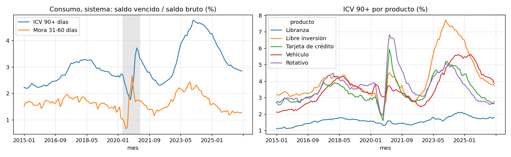
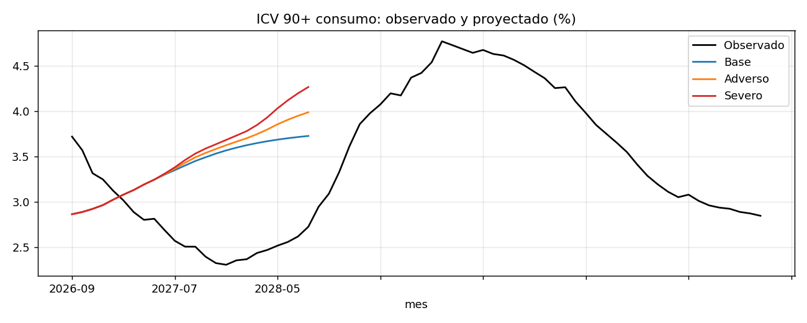

# Estrés macro y apetito de riesgo en la cartera de consumo colombiana

**Para quién.** Un comité de riesgo de un banco, una compañía de financiamiento o una fintech de consumo.

**Preguntas.** Qué explicó el deterioro de 2023–2024, qué señal lo habría anticipado, cuánto costaría un nuevo ciclo adverso
y qué límites de apetito deberían regir hoy por producto.

**Datos.** Cartera de consumo de la SFC por entidad y producto, mensual de 2015 a agosto de 2026; tasa de política de
BanRep; inflación y desempleo del DANE ([capa de datos](../datos)).

## Resultados

1. **El deterioro fue de originación, no de mezcla.** Entre el valle de abril de 2022 (2,30%) y el pico de enero de 2024
   (4,77%), el ICV 90+ subió 247 pb; 252 pb son efecto tasa dentro de cada producto y solo 2 pb efecto mezcla. Libre
   inversión aporta el 61% del cambio con el 35% del saldo; con tarjeta, el 81%.
2. **El desempleo no anticipa la mora en esta muestra.** Los alivios de 2020 rompieron la relación en el mayor choque de
   empleo. Anticipan la inflación (rezago de 12 a 18 meses), la tasa de política (9 meses) y el crecimiento pasado del
   crédito, que contemporáneamente diluye la mora y 18 meses después la sube: el mecanismo de cosecha.
3. **Alerta temprana.** Un aumento de 10 pb en la mora de 31–60 días de una entidad anticipa 3,4 pb más de mora 90+ en el
   trimestre siguiente, descontado el ciclo común (panel de 42 entidades con efectos fijos de mes, t = 6,9).
4. **Escenarios.** Aun en el base el ICV 90+ sube de 2,84% a 3,73%, porque el crédito de consumo crece al 10,6% anual y esas
   cosechas maduran. El severo llega a 4,27% y suma una pérdida incremental aproximada de 1,87 billones de pesos, el 60% en
   libre inversión.
5. **Apetito.** Umbrales por producto en los percentiles 75 y 90 de la historia y capacidad en el pico severo; libranza está
   hoy en ámbar. El semáforo de entidades combina el nivel frente al sistema y la tendencia de la mora temprana, con
   códigos anónimos.

## Iteraciones que quedaron en el notebook

- La selección de rezagos por AIC sin restricciones daba un coeficiente **negativo** para la tasa de política (subir tasas
  reduciría la mora), por la colinealidad con la inflación. Se restringe a especificaciones con los signos económicos
  esperados, y todas las comparaciones de AIC usan la misma muestra.
- El periodo de alivios (abril de 2020 a marzo de 2021) entra como variable indicadora.

## Límites

Datos agregados, no créditos; el ICV no es una PD y se mueve con castigos; LGD supuestas; canal de tasa débilmente
identificado. Este modelo se somete a [validación independiente](../02-validacion-modelo-satelite), que lo encuentra no apto
para fijar límites y propone un reemplazo.

## Archivos

`estres.py` (funciones), `construir_notebook.py` (genera y ejecuta `notebook.ipynb`), `resultados/` (resumen, proyecciones,
semáforo anónimo), `figuras/`.
