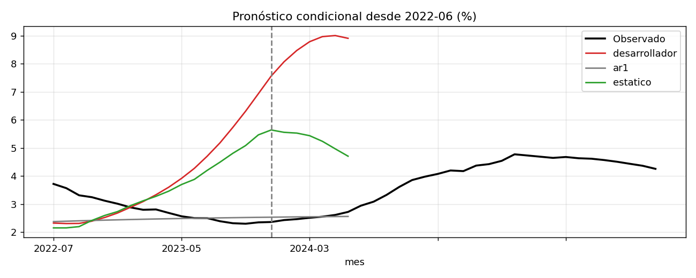

# Validación independiente del modelo satélite de mora de consumo

**Para quién.** Una función de validación o de riesgo de modelo, una auditoría o un supervisor.

**Objeto.** El [modelo satélite del proyecto 01](../01-riesgo-estres-consumo), que proyecta el ICV 90+ de consumo bajo
escenarios macro y alimenta la pérdida incremental y los límites de apetito.

**Marco.** Los ejes de una validación de riesgo de modelo (SR 11-7; en Colombia, el SIAR de la SFC): integridad de datos,
solidez conceptual, desempeño fuera de muestra frente a retadores, estabilidad, diagnóstico estadístico y razonabilidad de
escenarios y supuestos. El validador recalcula los datos sin el código del desarrollador y reestima en cada corte, incluida
la selección de rezagos.

## Dictamen

**No aprobado para estrés de capital ni para fijar límites; aprobado con restricciones para monitoreo descriptivo.**
Ocho hallazgos, cuatro de severidad alta:

| Id | Área | Severidad | Evidencia |
|---|---|---|---|
| H1 | Desempeño | Alta | Estimado hasta junio de 2022, proyecta un pico de 9,0% frente a 4,8% observado; error de 224 pb frente a 163 pb del paseo aleatorio. |
| H2 | Desempeño | Alta | En el backtest de origen rodante a 12 meses, 135 pb de error frente a 103 pb del paseo aleatorio. |
| H3 | Estabilidad | Alta | El coeficiente de la tasa de política es negativo en cuatro de cinco cortes; la especificación elegida cambia en cada corte. |
| H6 | Escenarios | Alta | El severo (4,27%) es menos duro que el máximo observado en 2024 (4,77%). |
| H4 | Solidez conceptual | Media | Colinealidad tasa-inflación (VIF 9,8 y 12,1); sin la tasa el AIC mejora. |
| H5 | Diagnóstico | Media | Residuos autocorrelacionados, no normales y con heterocedasticidad condicional. |
| H7 | Supuestos | Media | La pérdida severa va de 1,40 a 2,33 billones con LGD ±15 pp. |
| H8 | Supuestos | Baja | Mapeo sistema-producto débil en rotativo (R² 0,43). |

## Remediación propuesta

Un retador más simple, la relación de niveles con errores AR(1) estimada por GLS iterado: la persistencia queda en el error
y el pronóstico converge a la relación macro, sin acumular la mora sobre sí misma.

| Prueba | Desarrollador | Paseo aleatorio | Remediado |
|---|---|---|---|
| Error fuera de tiempo desde 2022-06, 24 meses (pb) | 224 | 163 | 60 |
| Error rodante a 12 meses (pb) | 135 | 103 | 71 |

El remediado supera al paseo aleatorio a 12 meses (Diebold-Mariano −3,15, p = 0,002; con 21 orígenes solapados la potencia
es limitada) y deja la tasa de política con signo positivo. No resuelve la colinealidad (H4) ni la calibración del severo
(H6). Condición de reapertura: adoptar el remediado, recalibrar el severo y repetir el backtest.

## Archivos

`validacion.py` (pruebas y retadores), `construir_notebook.py`, `resultados/hallazgos.csv`, `resultados/backtest_rmse_pb.csv`.
