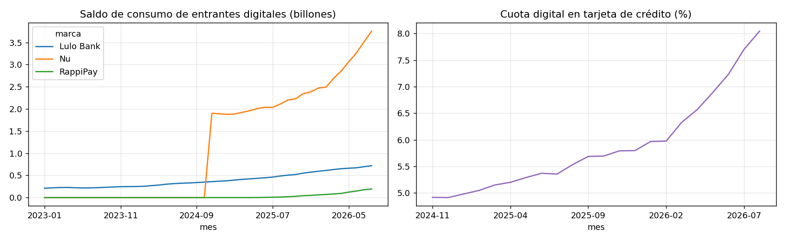
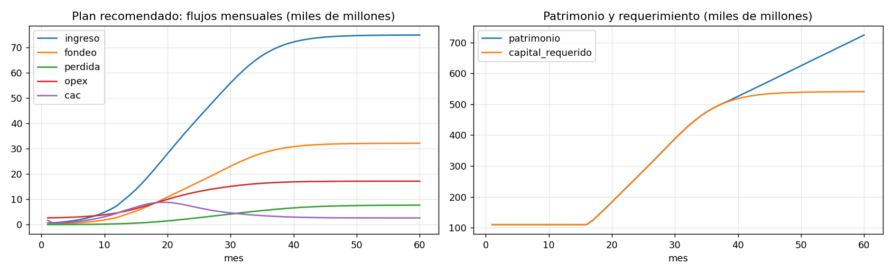

# Caso de inversión: crédito digital de consumo en Colombia

**Para quién.** Una junta directiva, un comité de inversión o un fundador que decide si lanzar una plataforma de crédito.

**Decisión.** Si conviene entrar al crédito de consumo y, si conviene, con qué producto, qué fondeo, a qué escala y con
cuánto capital.

**Método.** Hechos observados primero: tamaño del mercado y entrantes digitales (SFC), precios frente al techo de usura
(tasas semanales de la SFC), mora por producto (proyecto 01). Después la economía unitaria, un plan mensual a cinco años y
la incertidumbre. Los supuestos de negocio (CAC, costo por cliente, LGD, fondeo, capital mínimo) están declarados en
`caso.Supuestos` y se someten a tornado y a Monte Carlo.

## Resultados

- **Mercado.** 228,8 billones de pesos en consumo, 93% en bancos. Nu, Lulo Bank y RappiPay pasaron de 4,9% a 8,0% del saldo
  de tarjeta entre noviembre de 2024 y agosto de 2026: la tarjeta es la cuña de entrada probada.
- **Precio.** En tarjeta, el 46% del monto se desembolsa a menos de 2 pp del techo: el precio no es palanca. En libranza el
  techo no muerde (15 pp de margen); se compite por convenios, no por tasa.
- **Fondeo.** Con la TPM en 12,25% y el techo en 28,3%, el fondeo mayorista de una compañía de financiamiento deja un ROE
  máximo de 1%. Con depósitos y sin descuento de precio, la tarjeta llega a 18,5% en estado estable y a 9,1% con la pérdida
  del pico observado.
- **Escala y producto.** La tarjeta sola no paga el costo de capital a escalas razonables. Adquirir con tarjeta y cruzar
  libre inversión a clientes con un año de historial lleva la TIR a 23,7% con 800.000 clientes de tarjeta y un capital de
  unos 500.000 millones en cinco años; equilibrio mensual en el mes 24.
- **Qué decide el caso.** El costo operativo por cliente pesa más que cualquier mejora de originación (tornado). En Monte
  Carlo, la tarjeta supera el costo de capital en el 45% de los escenarios.
- **Ciclo de tasas.** Como el techo se ajusta con rezago y el fondeo se reprecia rápido, cada recorte de la TPM abre margen:
  conviene escalonar la adquisición al ciclo de recortes.

## Iteraciones que quedaron en el notebook

1. El primer caso, con fondeo mayorista y descuento de precio, no era rentable con ningún producto.
2. Sin descuento y con depósitos, la tarjeta es rentable por peso de saldo, pero no a la escala de un entrante.
3. La estrategia de adquisición con cruce resuelve la escala sin tomar el riesgo de libre inversión como producto de entrada.

## Límites

Los precios usan el margen frente al techo observado en 2021–2022 (las tasas semanales publicadas terminan en junio de 2022);
la pérdida anual se aproxima con el ICV 90+ promedio; costos, CAC, LGD, capital mínimo y la salida a 1,5 veces patrimonio son
supuestos de trabajo que deben reemplazarse por cotizaciones y datos propios antes de comprometer capital.

## Archivos

`caso.py` (mercado, precios, economía unitaria, plan, Monte Carlo), `construir_notebook.py`, `resultados/`, `figuras/`.
