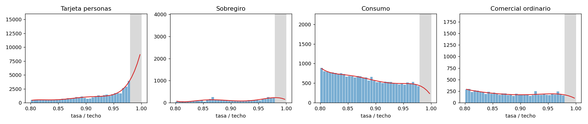
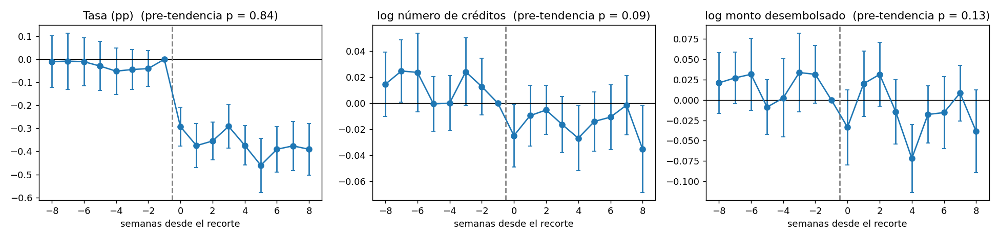

# ¿Raciona crédito el techo de usura? Evidencia semanal de Colombia, 2007–2022

**Para quién.** Programas de maestría y de investigación en economía, inferencia causal y finanzas; equipos de estudios
económicos de reguladores y gremios.

**Pregunta.** En Colombia la tasa de un crédito de consumo u ordinario no puede superar 1,5 veces el interés bancario
corriente certificado por la SFC. Si el techo solo transfiere renta del prestamista al deudor, la cantidad de crédito no
cambia cuando baja; si raciona, los prestamistas dejan de atender a los deudores marginales.

**Datos.** Tasas y montos desembolsados semanales de la SFC por entidad, modalidad y plazo, 2007–2022, e interés bancario
corriente certificado ([capa de datos](../datos)).

## Diseño

1. **Amontonamiento** de la razón tasa/techo justo debajo de 1,0, contra un contrafactual polinómico (Chetty, Friedman, Olsen y
   Pistaferri, 2011), con intervalos bootstrap que remuestrean semanas completas.
2. **Estudio de eventos apilado** alrededor de cada recorte del techo de al menos 25 pb (Cengiz, Dube, Lindner y Zipperer,
   2019). Una celda entidad-producto-plazo está tratada si en las semanas −12 a −9, separadas de la ventana de estimación,
   operó en promedio al 99% del techo o más. Efectos fijos de celda × evento y de producto × evento × semana; errores agrupados
   por evento y, como robustez, por entidad.
3. **Falsación** con celdas cercanas al techo pero sin tocarlo; robustez al umbral; heterogeneidad por producto; alzas del techo.

## Resultados

- **El techo muerde.** La masa en 0,98–1,00 del techo es entre 1,5 veces (tarjeta de personas) y 7,3 veces (sobregiro) la
  contrafactual, con intervalos lejos de 1.
- **Racionamiento.** Ante un recorte, las celdas pegadas al techo bajan su tasa 0,34 pp más que el control (t = −7,1, sin
  movimiento previo) y otorgan 2,8% menos créditos (t = −3,0 por evento; −2,2 por entidad). El ticket no cambia: el ajuste es
  en el margen extensivo. La semi-elasticidad es de 8,3% menos créditos por punto de recorte forzado y es estable al umbral.
- **Falsación.** En celdas cercanas pero no pegadas al techo la cantidad no cae.
- **Asimetría a investigar.** Con alzas del techo, la tasa sube pero la cantidad no se expande; ese diseño no pasa la prueba de
  tendencias previas y no se usa como evidencia causal.

## La iteración que se descartó

La primera definición de tratamiento ("la tasa de las cuatro semanas previas supera el techo nuevo") seleccionaba celdas
con un alza transitoria de tasa: las tendencias previas eran fuertes (p ≈ 10⁻¹⁵), y lo que seguía mezclaba el efecto del techo
con la reversión a la media. Se conserva en el notebook como ejemplo del sesgo.

## Límites y siguiente paso

Celdas, no créditos individuales; 31 recortes como grupos de inferencia (el siguiente paso es un bootstrap salvaje por
evento); en tarjeta el conteo es de utilizaciones; datos hasta junio de 2022. Para una tesis: cruzar con datos de buró o del
formato de originación de la SFC para observar rechazos, y usar el cambio de 2023 en las modalidades de crédito popular y
productivo como segundo experimento.

**Referencias.** Benmelech, E. y Moskowitz, T. (2010), *Journal of Finance*; Cengiz, D., Dube, A., Lindner, A. y Zipperer, B.
(2019), *Quarterly Journal of Economics*; Chetty, R., Friedman, J., Olsen, T. y Pistaferri, L. (2011), *Quarterly Journal of
Economics*; Rigbi, O. (2013), *Review of Economics and Statistics*.

## Archivos

`usura_efectos.py` (panel, amontonamiento, apilado, estimadores), `construir_notebook.py`, `resultados/`, `figuras/`.
