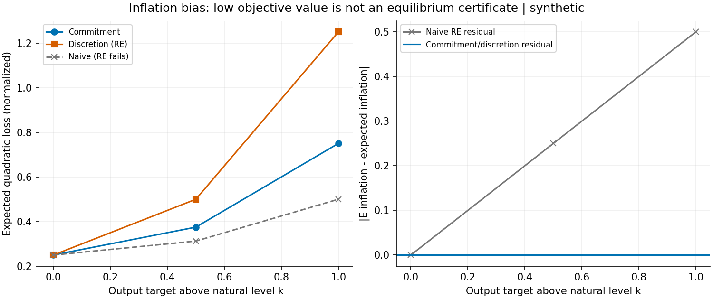

# Sesgo inflacionario y consistencia de expectativas

Nuevo componente pequeño del programa de transmisión monetaria: contrasta compromiso contingente al shock, discreción con expectativas racionales y una alternativa ingenua que congela expectativas. Se exige consistencia antes de ordenar pérdidas.

**S2 local**, no del programa completo. Modelo lineal-cuadrático clásico, parámetros supuestos y sin evidencia macro real. Compromiso supone capacidad creíble y sin coste de fijar una regla antes de expectativas; no se implementa la institución que lo garantiza.

## Reproducir

Desde esta carpeta, Python 3.11+, venv y PyPI:

```bash
bash run.sh
```

Ejecuta tests/cobertura, ruff/mypy, 54 casos con dos estados exactos y notebook en IPython limpio en proceso, sin kernel/socket. No simulación larga ni incertidumbre Monte Carlo inventada.

## Resultado sintético

Ancla α=λ=k=σ=1:

| Régimen | Pérdida esperada | Residuo RE |
|---|---:|---:|
| Compromiso contingente |0,75|0|
| Discreción consistente |1,25|0|
| Naive: expectativas congeladas |0,50|0,50|

La pérdida ingenua menor **no es una mejora de equilibrio**: genera inflación media 0,5 mientras supone expectativa cero. En los dos regímenes consistentes, producto medio cero; diferencia de pérdida exacta 0,5(λαk)². Cuando k=0, desaparece la diferencia. No se compara compromiso flexible con una regla rígida de inflación cero.



Se guardan casos y estados crudos, oráculo de mejor respuesta, hashes/versiones, figura, notebook ejecutado, cinco referencias reales e informe de 14 puntos con tres ideas comparadas. No reputación repetida, delegación, tipos de interés, agentes heterogéneos, calibración o recomendación para bancos centrales reales.
