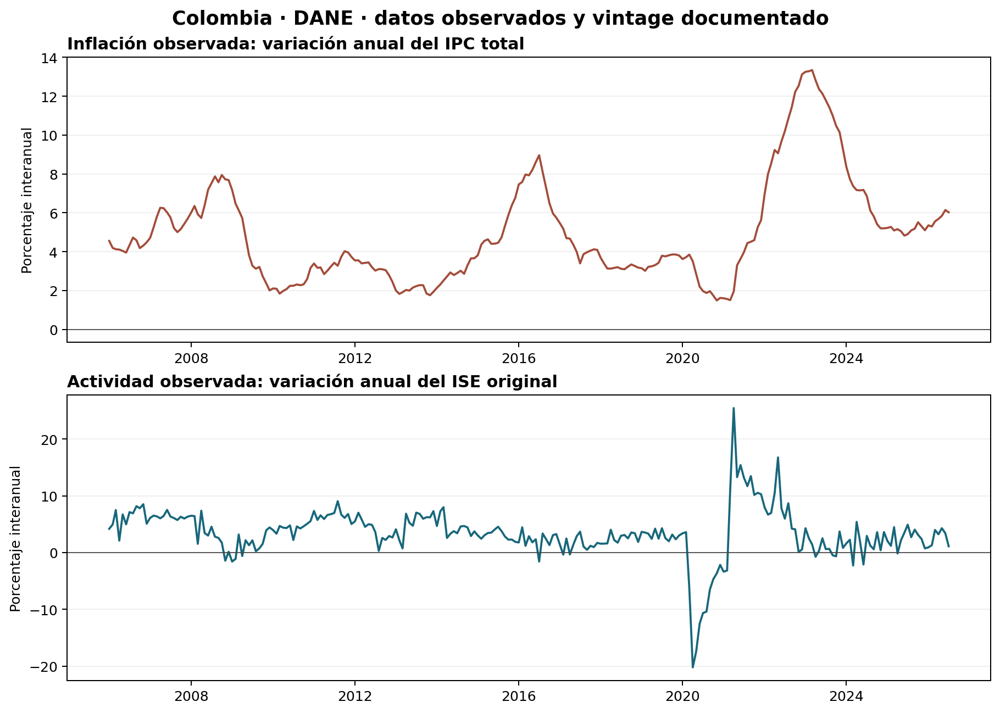
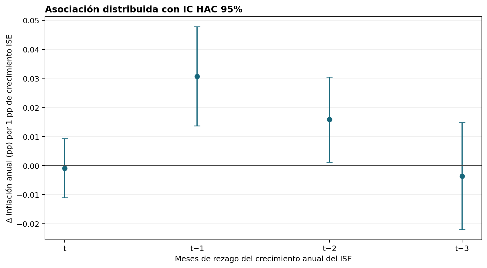

# Aplicación observada: inflación realizada y actividad (proxy)

## Resultado

En 247 meses emparejados entre 2006-01 y 2026-07, la asociación contemporánea entre crecimiento anual del ISE y el cambio mensual en inflación interanual es `r = 0.357`. La regresión usa 244 observaciones tras formar tres rezagos. Con efectos de mes, tendencia lineal y errores HAC(6), la suma de los cuatro coeficientes distribuidos es 0.0421 pp de cambio de inflación anual por cada 1 pp del crecimiento anual del ISE (IC 95% [0.0205, 0.0637]); no es una respuesta impulso estructural. Al retirar la tendencia, la suma es 0.0401 (IC 95% [0.0188, 0.0613]); al excluir outcomes de 2020–2021 (n=220) es 0.0852 (IC 95% [0.0602, 0.1102]). En esta sensibilidad se conservan las observaciones de actividad rezagadas, pero se excluyen los meses 2020–2021 como outcomes.

La última observación emparejada es 2026-07: inflación anual 6.02% e ISE anual 1.11%. El dato de actividad es preliminar.





## Variables y método

La inflación se calcula como `100 × (IPC_t / IPC_(t−12) − 1)` con el índice total empalmado de DANE; la variable dependiente es su cambio en puntos porcentuales frente al mes previo. La actividad es la variación anual del ISE original publicada por DANE. Se estiman cuatro rezagos mensuales en una regresión lineal con efectos fijos de mes, tendencia lineal y covarianza HAC con seis rezagos. Los intervalos no se interpretan como identificación causal.

La especificación es un diagnóstico de comovimiento de inflación realizada y actividad mensual. No es la ecuación de Phillips estructural: no observa expectativas de inflación ni una brecha del producto; el crecimiento del ISE es un proxy de actividad, no el output gap. Los rezagos contemporáneos son endógenos a choques de oferta, demanda y política monetaria.

## Fuentes, vintage y reproducción

- IPC: [DANE, histórico del IPC](https://www.dane.gov.co/index.php/estadisticas-por-tema/precios-y-costos/indice-de-precios-al-consumidor-ipc/ipc-historico); serie empalmada nacional, índice base diciembre de 2018=100, archivo actualizado 9-nov-2026, hash `4e8366bf2d03d4bdc15d14b1b21b12a6eec6c3695926abd503a430858ef74e2e`.
- Actividad: [DANE, ISE](https://www.dane.gov.co/index.php/estadisticas-por-tema/cuentas-nacionales/indicador-de-seguimiento-a-la-economia-ise); serie original, Cuadro 1, enero de 2006–julio de 2026; el Atlas registra el archivo en su manifiesto 2026-10-08; hash `4e333c97b6558eb7e1b82d17fb8a0aa966f9113c87f099fa000f2390a3d7a199`.

Los dos XLSX fuente se reciben por ruta, se verifican por tamaño y SHA-256 y no se copian a este producto. El IPC se toma del snapshot DANE local ya disponible en el companion de pass-through; el ISE se toma del archivo DANE en `Master_DATOS/.../01_RAW`. Desde la raíz del portafolio:

```bash
python3 -m pip install openpyxl numpy pandas statsmodels matplotlib
python3 01-macroeconomics/03-inflation-expectations-phillips/observed_application.py \
  --ipc-source 01-macroeconomics/05-exchange-rate-pass-through/data/raw/dane-ipc-empalme-2003-oct2026.xlsx \
  --ise-source "/ruta/a/Master_DATOS/ATLAS_ECONOMICO_COLOMBIA/01_RAW/dane_ise_jul2026.xlsx"
```

Salidas derivadas: `reports/paired_monthly_series.csv`, `reports/distributed_lag_coefficients.csv`, `reports/figures/` y `data/manifest.json`. El manifiesto registra hashes, rutas de fuente sin ruta local, muestra, fórmula, modelo y límites.

## Uso y límites

El resultado puede orientar si merece la pena obtener expectativas, brecha de producto y una identificación de choques antes de estimar una Phillips estructural. No debe usarse para fijar precios, pronosticar inflación ni evaluar la regla monetaria. Las revisiones de ISE, la serie empalmada del IPC, la dependencia serial y la omisión de expectativas/costos sectoriales limitan cualquier lectura estructural.

El notebook sintético se mantiene intacto: sirve para analizar el sesgo de estimadores en procesos controlados. La edición observada solo describe una relación de datos y no valida el mecanismo.
