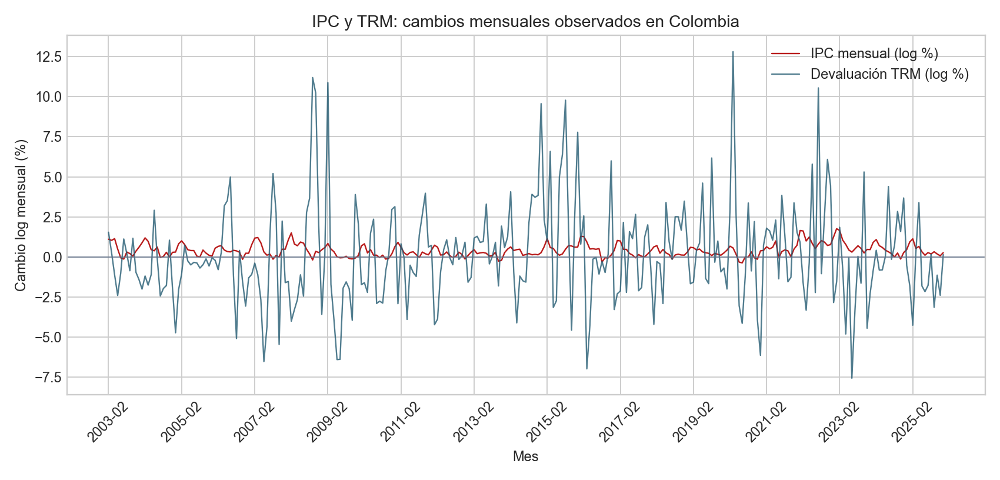
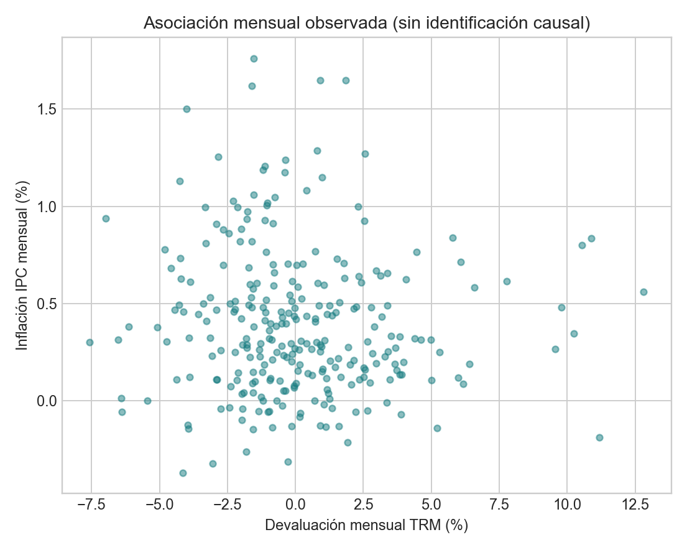

# Devaluación e inflación: aplicación mensual para Colombia

## Decisión que informa

Una empresa importadora puede usar la asociación observada para dimensionar si vale la pena estudiar precios con mayor detalle, pero no para traducir mecánicamente una variación de la TRM en una decisión de precio. Esta reproducción evalúa si el flujo de una regresión distribuida es aplicable a series oficiales observadas y qué patrón aparece en el IPC agregado.

## Datos y transformaciones

El IPC es el índice nacional total empalmado de DANE, base diciembre de 2018 = 100, enero de 2003 a octubre de 2026. La TRM diaria de BanRep en el snapshot SDMX va del 1 de enero de 2003 al 31 de diciembre de 2025. Se promedian observaciones TRM dentro de cada mes y se calcula `100 × ln(x_t/x_(t−1))` para IPC y TRM. El rezago 3 acorta la muestra de estimación a 272 meses, mayo de 2003–diciembre de 2025. Los archivos, fechas, hashes y controles de calidad están en [la tarjeta de datos](../data/README.md).

## Estimación descriptiva

OLS incluye la variación cambiaria contemporánea y tres rezagos, efectos fijos de mes y tendencia lineal temporal; la matriz de covarianza usa HAC de Newey–West con seis rezagos. La suma de los cuatro coeficientes se reporta solo como resumen lineal de esta especificación.

| Término | Estimación | Error HAC | IC 95% |
|---|---:|---:|---:|
| Devaluación contemporánea | 0,0002 | 0,0048 | [-0,0093; 0,0096] |
| Rezago 1 | 0,0087 | 0,0046 | [-0,0003; 0,0177] |
| Rezago 2 | 0,0049 | 0,0062 | [-0,0073; 0,0171] |
| Rezago 3 | 0,0023 | 0,0065 | [-0,0103; 0,0150] |
| Suma contemporánea y rezagos | 0,0161 | 0,0160 | [-0,0152; 0,0475] |

El R² es 0,495. En sensibilidad sin tendencia, la suma es 0,0200 (IC 95% [-0,0153; 0,0553]). En ambas especificaciones el intervalo de la suma incluye cero. El resultado no demuestra ausencia de pass-through; el efecto puede variar por rubro, régimen, horizonte o medida de precios.

## Lectura y registro de decisiones

| Decisión | Alternativa | Razón y coste |
|---|---|---|
| Usar IPC empalmado mensual DANE y TRM diaria BanRep | WDI anual con fuentes armonizadas | Permite estudiar una dinámica mensual colombiana y atribuir cada fuente primaria; el empalme conserva cambios metodológicos publicados. |
| Promediar TRM diaria por mes | Usar cotización de cierre | Resume el valor de referencia del periodo; oculta shocks y secuencia intramensual. |
| Usar cuatro meses de devaluación, efectos mensuales y tendencia | Estimación solo contemporánea o sin calendario | Captura una respuesta breve y controla estacionalidad/tendencia; no modela un pass-through largo ni quiebres estructurales. |
| Interpretar como asociación condicional | Llamar a la suma “elasticidad de pass-through” | No se identifica un shock cambiario exógeno y los efectos sobre precios al consumidor agregado no son equivalentes a costos importados. |

## Límites de aplicación

- La TRM es una tasa de referencia oficial, no el precio de transacción ni el costo de cobertura de cada importador.
- El IPC total no separa bienes importados, transables, servicios ni precios regulados. El empalme de DANE es una serie histórica publicada que atraviesa cambios de canasta y metodología; no representa una canasta constante durante todo el periodo.
- Se excluyen costos internacionales, demanda, brecha de producto, expectativas, política monetaria y respuestas fiscales. Los errores HAC ajustan incertidumbre ante cierta dependencia serial, pero no corrigen endogeneidad, omisiones ni quiebres.
- El archivo BanRep guardado llega a diciembre de 2025; no se imputa TRM para 2026 aunque DANE publique IPC hasta octubre de ese año.
- No se conserva una secuencia point-in-time de vintages, por lo que el ejercicio no reconstruye qué información estaba disponible en cada fecha.

Para una estimación de pass-through útil a decisiones hacen falta microdatos o subíndices transables, precios importados y costos logísticos, expectativas, vintages de publicación y una estrategia para aislar shocks cambiarios. La [figura de series](figures/dane-banrep-monthly-series.png) y la [dispersión](figures/dane-banrep-monthly-scatter.png) son descriptivas.

