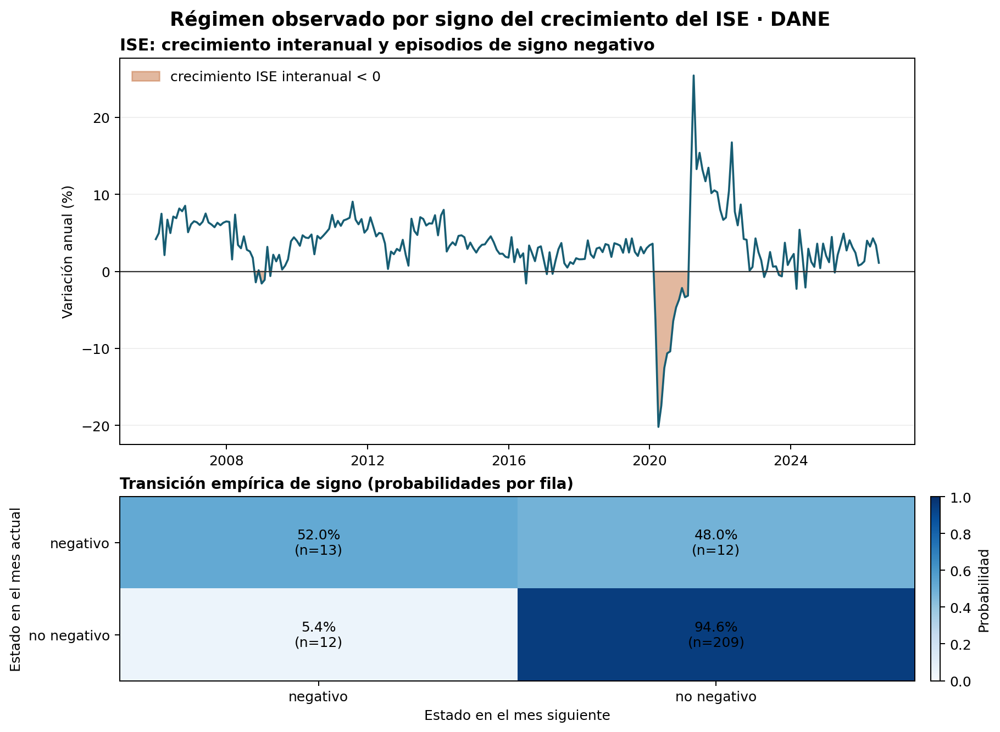

# Aplicación observada: regímenes de signo del ISE

## Resultado

En la muestra 2006-01–2026-07 hay 247 observaciones mensuales. La tasa anual del ISE fue negativa en 25 meses (10.1%). Bajo la regla binaria de este companion, la probabilidad empírica de permanecer en crecimiento negativo al mes siguiente es 52.0% (n=13 transiciones); la de permanecer en crecimiento no negativo es 94.6% (n=209). El último dato es 1.11% en 2026-07 y corresponde a período preliminar.

El estado negativo aparece en 12 episodios, todos completados dentro de la muestra, de duración media 2.08 meses y máximo de 12 meses. El spell final de crecimiento no negativo está censurado a la derecha en julio de 2026; no se usa como duración completa.



## Definición y método

Se toma directamente la fila de crecimiento anual del total ISE en la serie original del Cuadro 1 DANE. El estado es “crecimiento negativo” si la variación interanual reportada es menor que cero y “crecimiento no negativo” en caso contrario. Se cuentan transiciones mensuales consecutivas y se normalizan por el estado de origen. La clasificación es transparente y no ajusta un modelo oculto de Markov.

Este proxy mide el signo del crecimiento anual de un indicador sintético de actividad mensual. No equivale a una fecha oficial de recesión, a una brecha del producto ni al crecimiento mensual del PIB. El ISE resume cambios de corto plazo y puede ser revisado; los meses 2024p–2026pr se conservan con su estado preliminar/provisional en el CSV.

## Fuente, vintage y reproducción

Fuente primaria: [DANE, Indicador de Seguimiento a la Economía](https://www.dane.gov.co/index.php/estadisticas-por-tema/cuentas-nacionales/indicador-de-seguimiento-a-la-economia-ise); anexo “dane_ise_jul2026.xlsx”, actualizado por DANE el 18-sep-2026. El Atlas registra el crudo en su manifiesto de integridad con vintage 2026-10-08. El SHA-256 esperado es `4e333c97b6558eb7e1b82d17fb8a0aa966f9113c87f099fa000f2390a3d7a199` (487882 bytes). El archivo canónico no se duplica en este producto: el runner recibe su ruta de entrada y no persiste la ruta local.

```bash
python3 -m pip install openpyxl numpy matplotlib
python3 observed_application.py --ise-source "/ruta/a/Master_DATOS/ATLAS_ECONOMICO_COLOMBIA/01_RAW/dane_ise_jul2026.xlsx"
```

El runner verifica nombre de hoja/fila, fecha inicial/final, completitud, tamaño y hash antes de escribir. Salidas: `reports/ise_sign_regimes_monthly.csv`, `reports/figures/ise_sign_regimes.png` y `data/manifest.json`.

## Interpretación y alcance

La fuerte persistencia del signo no negativo describe el saldo de los regímenes observados y ayuda a localizar episodios para un análisis posterior. No identifica el origen de las transiciones ni una respuesta causal a la tasa de política. El resultado depende del umbral cero, de la agregación anual-interanual y de la composición del ISE; una especificación Markov-switching requeriría estimar estados latentes, comparar distribuciones condicionales, contrastar cantidad de estados y tratar revisiones/vintages.

El laboratorio sintético permanece intacto y sigue sirviendo para probar estimadores de cambio de régimen con DGP controlado. Esta aplicación observada evalúa el comportamiento del proxy en datos DANE; no demuestra la validez de un modelo oculto de Markov ni su desempeño de pronóstico.
