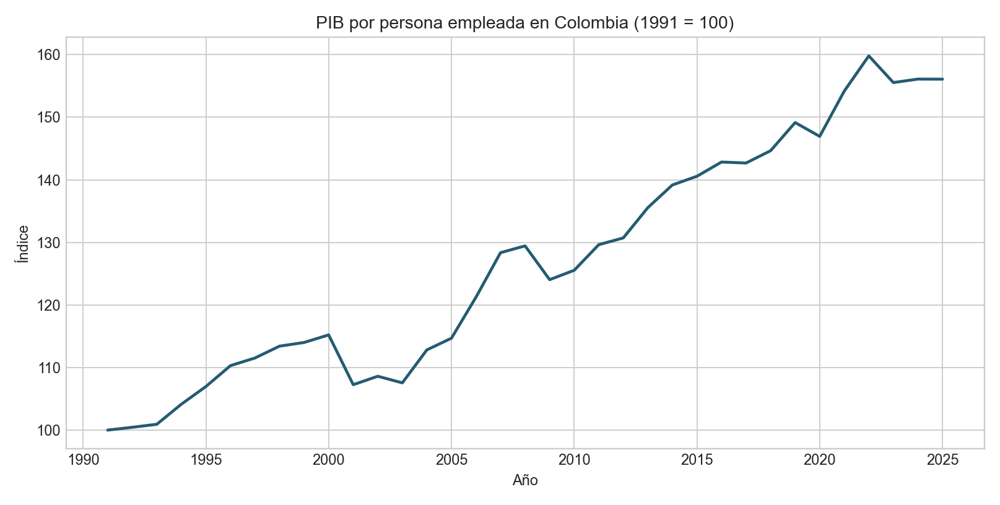
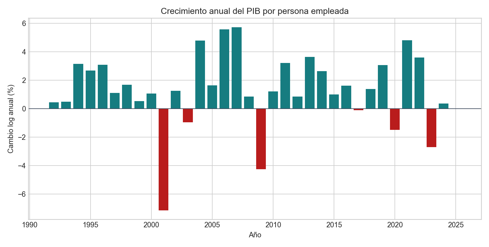

# Productividad laboral: evidencia observada para Colombia

## Decisión que informa

La serie permite poner en contexto una conversación ejecutiva sobre productividad, pero no puede atribuir cambios a automatización, IA ni a un programa específico. Para estimar esos efectos hacen falta datos de empresas, horas trabajadas, capital y adopción tecnológica con un diseño de comparación defendible.

## Dato y método

Se usa el indicador WDI `SL.GDP.PCAP.EM.KD`: PIB por persona empleada en dólares internacionales constantes de 2021. WDI lo define como PIB dividido por empleo total y convertido mediante paridad de poder adquisitivo. El registro contiene 35 observaciones anuales continuas de 1991 a 2025. La transformación de crecimiento es `100 × ln(y_t/y_(t−1))`; las tasas de período se resumen mediante CAGR del nivel inicial y final. Los JSON congelados, sus hashes y controles están en [la tarjeta de datos](../data/README.md).

## Resultado observado

| Período | CAGR del PIB por persona empleada |
|---|---:|
| 1991–2025 | 1,32% anual |
| 2010–2019 | 1,93% anual |
| 2020–2025 | 1,21% anual |

El nivel aumentó 56,1% entre 1991 y 2025. La diferencia entre períodos es descriptiva; no es una prueba de cambio estadístico ni identifica el origen de la variación.

## Decisiones de medición

| Decisión | Alternativa | Motivo y coste |
|---|---|---|
| Usar PIB por persona empleada | Llamarlo productividad total de factores | Es una medida más directa de producción relativa al empleo; también refleja capital, horas, composición sectorial y utilización. |
| Reportar crecimiento logarítmico y CAGR | Comparar niveles nominales | Los dólares PPP constantes permiten comparar el cambio del indicador sin inflación corriente; dependen de estimaciones y revisiones de PPP. |
| Presentar cortes temporales como descriptivos | Atribuir la diferencia a IA o política | No hay contrafactual, datos de adopción ni controles para identificar mecanismos. |

## Limitaciones

- WDI describe el indicador como estimación de su equipo basada en empleo, población, PIB y PPP provistos por OIT, Naciones Unidas, Eurostat, OCDE y Banco Mundial.
- PIB por persona empleada no ajusta por horas trabajadas y no mide productividad total de factores. Cambios de composición del empleo y de sectores pueden moverlo aunque la eficiencia dentro de cada empresa no cambie.
- Frecuencia anual, 35 observaciones y vintage revisable limitan inferencias de corto plazo y análisis en tiempo real.
- La serie nacional no evalúa una inversión, política o adopción tecnológica particular.

La [figura de nivel indexado](figures/wdi-productivity-level-index.png) y la [figura de crecimiento anual](figures/wdi-productivity-annual-growth.png) ilustran el comportamiento de la medida observada. El laboratorio controlado sigue siendo útil para estudiar propiedades bajo supuestos explícitos; esta serie no convierte sus parámetros sintéticos en evidencia empírica.

