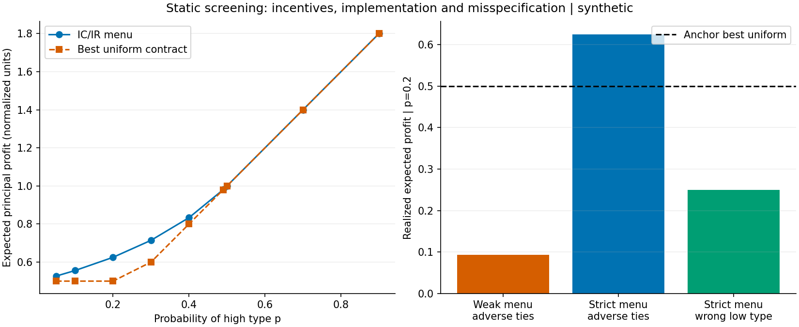

# Screening de dos tipos: incentivos, participación y ejecución

Ciclo del 26 de octubre de 2026. Se inspeccionó `main` en `674699d`; estaba abierto el PR #83 sobre propuestas de riesgo, sin solapamiento con este componente. Rama y worktree aislados; se preservaron aportes de los ciclos anteriores.

## 1. Título

Núcleo estático IC/IR con solución analítica, oráculo QP y falsaciones de implementación y especificación.

## 2. Innovación y selección entre tres ideas

| Idea | Brecha y aporte | Decisión |
|---|---|---|
| AR con errores dependientes | El contraste de econometría anterior asume independencia; extender a HAC | Diferir: requiere calibración temporal y repite línea reciente |
| Inversión robusta RD | El MVP del 25 estima saltos pero no implementa inferencia robusta al sesgo | Diferir: importante, pero requiere un comparador y nueva calibración inferencial |
| Screening estático de dos tipos | Programa microeconómico S1 contiene IC/IR como formulación, sin este núcleo auditado | **Elegida:** rota dominio y convierte una pieza formal en componente S2 pequeño |

La solución es clásica, no un algoritmo mundial nuevo. La contribución al repositorio es una implementación verificable con derivación, baseline uniforme optimizado, solución numérica independiente y controles negativos. No se afirma resolver la hipótesis principal del programa sobre pagos contingentes al flujo, ventas inciertas o riesgo moral.

Hipótesis previa: en el ejemplo θL=1, θH=2, p=0,2, c=1, beneficio del menú estricto ≥1,2 veces el valor del mejor contrato único; slacks IC/IR ≥−1e−8; error absoluto de beneficio frente al QP ≤1e−7 en la grilla declarada. No se fuerza una mejora universal.

## 3. Estado del arte real

Mussa y Rosen (1978) modelan calidad y discriminación de segundo grado. Maskin y Riley (1984) estudian mecanismos con información incompleta y descuentos por cantidad; son los antecedentes más cercanos a nuestro modelo estático. Mirrlees (1971) motiva restricciones de autorrevelación en otro contexto, tributación; no es este modelo. Rothschild y Stiglitz (1976) examinan selección adversa en competencia de seguros, diferente del monopolista aquí. Stiglitz y Weiss (1981) muestran racionamiento en mercados de crédito; este MVP **no reproduce su modelo de default o racionamiento de equilibrio**.

Se verificaron autores, títulos, años, identificadores y alcance de resúmenes el 26 de octubre mediante ScienceDirect, sitio del autor Harvard, Oxford y JSTOR. Cinco entradas reales con DOI o URL constan en `referencias.bib`. No se afirma lectura íntegra, revisión exhaustiva ni contribución original frente a toda la literatura.

## 4. Brecha comprobada y alcance S1→S2

El programa `01-financial-inclusion-mechanism-design` formulaba agente principal, IC/IR y una hipótesis de contingencia al flujo. Su README advertía ausencia de implementaciones específicas. Este directorio añade únicamente la pieza estática de selección por preferencias privadas. El programa completo no pasa a S2 ni se presenta como validado. No se añaden supuestos de impago, estimación de tipos o causalidad empírica inexistentes.

## 5. Modelo y configuración

Un principal monopolista ofrece cantidades q y transferencias t. El agente tiene tipo privado θL o θH, con 0<θL<θH y probabilidad p del alto. Utilidad cuasilineal u=θq−t, opción externa cero, coste real cq²/2 con c>0. Son unidades normalizadas de capacidad o servicio, no tasas de crédito, saldos o PD.

Se conocen distribución y preferencias; no hay riesgo, competencia, liquidez, presupuesto, impago o múltiples periodos. El menú debe satisfacer participación e incentivos. La grilla usa nueve probabilidades, tres costes y tres pares de tipos: 81 economías determinísticas. Configuración versionada; semilla 20261026 solo para casos de propiedades y microbenchmark. No son observaciones muestreadas de clientes ni se justifican intervalos Monte Carlo para una grilla determinística. Hashes, versiones y plataforma se guardan en JSON.

## 6. Derivación e implementación

Beneficio esperado Π=(1−p)(tL−cqL²/2)+p(tH−cqH²/2). Restricciones IRi: θiqi−ti≥0; ICi: θiqi−ti≥θiqj−tj. Sumar IC implica qH≥qL. Para cantidades monótonas, transferencias máximas son tL=θLqL y tH=θHqH−(θH−θL)qL: IR baja e IC alta vinculantes.

Sustituir produce una cuadrática separable estrictamente cóncava en cantidades:

- qH=θH/c.
- qL=max{0,[θL−p(θH−θL)/(1−p)]/c}.

La monotonía se satisface automáticamente; concavidad y coste coercivo garantizan óptimo global en este modelo. El alto recibe renta informativa (θH−θL)qL y el bajo cero. Es un equilibrio veraz **débil**, no selección única de contratos.

El oráculo numérico usa cuatro variables [qL,qH,tL,tH], restricciones lineales IC/IR, cotas no negativas y SLSQP inicializado en cero, sin usar la solución analítica como punto inicial. El objetivo negativo es convexo: la comprobación es un contraste de implementación, no un nuevo teorema de existencia.

Baseline: mejor contrato único entre servir a ambos (valor θL²/2c) o solo al alto (pθH²/2c). Se optimizan cantidad y transferencia dentro de ambas regiones antes de elegir. No se usa un precio arbitrario. Estos valores son máximos bajo IC/IR débil; descuentos ε permiten participación estricta. En el ejemplo se compara también baseline estricto 0,499999 frente a menú estricto 0,6249988.

## 7. Tests, costes y reproducibilidad

`bash run.sh` instala dependencias directas fijadas, ejecuta tests con cobertura, ruff, mypy, auditoría de parámetros, costes y notebook. Las pruebas incluyen solución exacta del ejemplo, invariantes IC/IR sobre 30 economías aleatorias con semilla fija, contraste analítico/QP, región de exclusión, desempates, tipo mal especificado, ablation sin IC, contratos y manejo de fallo del solver. Son propiedades parametrizadas; no se afirma una suite Hypothesis inexistente.

Resultado ejecutado: **7/7 tests pasan**, cobertura de sentencias ejecutables del núcleo **80/80 (100%)**; ruff sin hallazgos y mypy sin errores en tres archivos `src` (imports sin stubs ignorados). La suite común pasó **8/8**, sin medir cobertura. Notebook: **ocho celdas de código ejecutadas**, PNG persistido e inspeccionado legible, sin probar un frontend completo de Jupyter.

El microbenchmark compara forma cerrada y QP en las mismas economías: lotes de 1, 10 y 50, tres repeticiones, generación fuera de medición. Tiempo y pico de asignaciones Python se guardan; no son RSS, memoria BLAS ni latencia operacional. El QP siempre tiene cuatro variables; variar número de economías mide coste por lote, no complejidad en número de tipos. No hay C/C++: ctest y sanitizers no aplican.

La suite común económica solicitada se ejecuta y registra en `results/common-suite.log`; su cobertura no se mide. El notebook tiene ecuaciones, derivación, oráculo, baseline, sensibilidad, falsaciones y trazabilidad. Se ejecuta secuencialmente en IPython limpio en proceso, sin kernel/socket, con rich outputs y aborto ante errores. La inspección de figura y la validación nbformat no certifican todos los frontends de Jupyter.

## 8. Resultados numéricos

| Resultado del ejemplo | Beneficio esperado |
|---|---:|
| Mejor contrato único, valor débil |0,5000000|
| Contrato único estricto |0,4999990|
| Menú analítico veraz débil |0,6250000|
| Menú con descuentos estrictos |0,6249988|
| Menú débil, desempates adversos |0,0937500|
| Menú estricto con tipo bajo real 0,8 |0,2499996|
| Contrato único informado del tipo real 0,8 |0,4000000|

El menú débil es [qL,qH,tL,tH]=[0,75;2;0,75;3,25]. Descontar ε al pago bajo y 2ε al alto, con ε=1e−6, crea márgenes estrictos en contratos positivos y reduce beneficio solo en 1,2e−6. Mejora cercana al 25% frente al contrato único; satisface umbral previo del 20%.

En 81 casos, error máximo de beneficio analítico/QP aproximadamente 4,94e−13 y error máximo de cantidades 1,45e−6; la precisión de beneficio no implica igual precisión de parámetros cerca de restricciones. No se reportan errores estadísticos para una grilla determinística. Los valores completos y slacks están en CSV/JSON.

## 9. Falsaciones y resultados negativos

La mejora desaparece cuando p≥θL/θH; con tipos 1 y 2, p≥0,5. Entonces el óptimo excluye al bajo y coincide con el contrato único para el alto. Mayor beneficio no garantiza inclusión: la cantidad baja puede reducirse y la exclusión es endógena.

IC débil permite al alto imitar al bajo; IR baja débil le permite elegir la opción externa. Bajo desempates de menor cantidad, el beneficio del menú ancla cae a 0,09375. Esto no invalida su equilibrio veraz, pero refuta asumir selección veraz única. Los pequeños descuentos recuperan implementación estricta en el ejemplo.

Si el tipo bajo real es 0,8, rechaza el contrato diseñado para θL=1. El beneficio realizado cae a 0,2499996, inferior al contrato único de 0,4 **informado del tipo real**. Este comparador es un oráculo con información adicional, no una prueba justa de dominancia bajo el mismo conjunto informativo.

Quitar IC aparenta elevar beneficio a 0,8 asignando cantidades de primer óptimo y extrayendo todo excedente. Pero el alto prefiere el contrato bajo: IC alta es negativa. No se cuenta ese resultado como mecanismo implementable ni baseline factible.

## 10. Límites, ética y madurez

S2 únicamente del componente estático. No valida la hipótesis principal de pagos contingentes al flujo, no demuestra desempeño de originación ni resultados causales. Preferencias conocidas, quasilinealidad y opción externa cero son supuestos fuertes. No hay presupuesto, equidad, competencia, riesgo moral, impago, datos reales o operación. Beneficio del principal no equivale a bienestar ni a inclusión financiera. Los descuentos ε requieren granularidad de precios compatible; no se presume que transferencias reales puedan fraccionarse así.

## 11. Cómo correr

Desde esta carpeta: `bash run.sh`. Requiere Python 3.11+, venv y acceso a PyPI. Dependencias directas fijadas, no lock transitivo con hashes. `PYTHON` permite seleccionar intérprete. No usa servicios externos o credenciales para los datos; todos los escenarios se generan localmente.

## 12. Referencias BibTeX

Cinco entradas completas en `referencias.bib`: Mussa–Rosen, Maskin–Riley, Mirrlees, Rothschild–Stiglitz, Stiglitz–Weiss. DOI o URL primarios verificados; las diferencias entre modelos y atribuciones se explican en §3.

## 13. Rúbrica de autor, 1–5

| Novedad | Rigor | Reproducibilidad | Código | Claridad | Impacto | Honestidad | MVP |
|---:|---:|---:|---:|---:|---:|---:|---:|
|2|4|4|4|4|3|5|4|

Autoevaluación. No corresponde máxima novedad para una solución clásica ni máximo impacto sin preferencias estimadas o datos de contratos reales. El revisor independiente del ciclo reprodujo `bash run.sh` completo con salida cero, leyó el núcleo analítico, QP e implementación estricta y no identificó bloqueantes. Esta revisión de agentes no equivale a validación empírica externa.

## 14. Siguiente iteración recomendada

1. `02-microeconomics/01-financial-inclusion-mechanism-design/screening-menu-audit`: introducir presupuesto y precios discretos, midiendo factibilidad e impacto sobre IC/IR.
2. `02-microeconomics/01-financial-inclusion-mechanism-design`: más tipos y sensibilidad a distribución mal especificada, con oráculo convexo cuando corresponda.
3. `02-microeconomics/01-financial-inclusion-mechanism-design`: extender a flujos contingentes verificables y riesgo moral explícito, sin presentar el núcleo estático como prueba de esa hipótesis.
