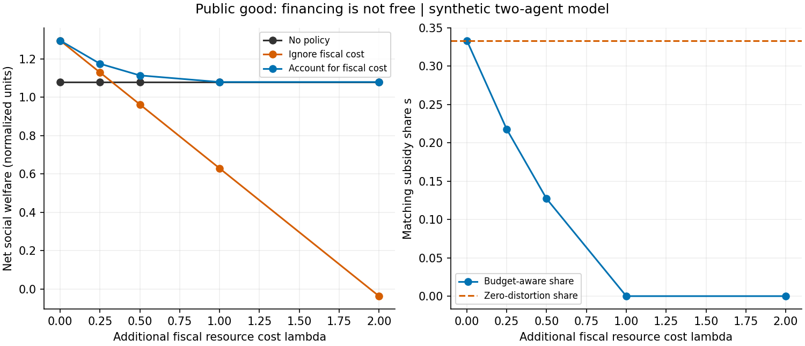

# Bien público, matching y coste fiscal

28 de octubre de 2026. Se inspeccionó `main` en `5b7d30e` y no había PR abiertos al inicio. Rama/worktree aislados. No se modificaron contratos o índices globales.

## 1. Título

Auditoría de una corrección fiscal para provisión voluntaria de un bien público.

## 2. Tres ideas y novedad incremental

| Idea | Brecha | Decisión |
|---|---|---|
| AR con errores HAC | Contrastes anteriores suponen independencia | Diferir: requiere calibración temporal |
| RD con inferencia robusta al sesgo | Un estimador puntual no entrega cobertura causal | Diferir: requiere comparador e inferencia |
| Bien público con matching y coste fiscal | Separar transferencia, recursos e incentivos en una política pequeña | **Elegida:** nueva auditoría microeconómica con solución y oráculo escalares |

No se inventa una teoría de bienes públicos. Aporte incremental: implementar la contabilidad completa y un control negativo donde el subsidio ingenuo empeora bienestar, con derivación y contraste numérico. Hipótesis previa: corrección ≥ no intervención e ingenua en 30 casos; error de bienestar frente al oráculo ≤1e−8; subsidio ingenuo daña en el ancla λ=0,5.

## 3. Literatura real verificada

Samuelson (1954) fundamenta provisión eficiente de bienes públicos. Bergstrom, Blume y Varian (1986) estudian provisión privada y estática comparativa. Warr (1983) examina neutralidad bajo condiciones específicas; no se atribuye ese teorema a nuestro modelo. Andreoni (1990) introduce warm glow, **ausente aquí**, delimitando una preferencia alternativa. Dahlby (2008) desarrolla coste marginal de fondos públicos; nuestra λ es una parametrización supuesta, no una estimación tomada del libro.

Cinco referencias con DOI/URL verificadas el 28 de octubre en publicaciones originales JSTOR, ScienceDirect, Oxford y MIT Press. Se verificaron metadatos y alcance, sin afirmar revisión exhaustiva o lectura íntegra. `referencias.bib` conserva identificadores reales.

## 4. Brecha y ubicación

Existe una formulación de competencia fiscal y spillovers regionales en teoría de juegos. Este MVP es distinto: dos contribuyentes, una autoridad y un bien, sin regiones o competencia fiscal. La búsqueda acotada de README/código no encontró esta auditoría de matching y recursos. No se afirma inexistencia en toda la historia. Nuevo directorio `02-microeconomics/10-public-goods-fiscal-audit`, enlazado desde el programa S1 de competencia fiscal como pieza microeconómica base. Avanza una parte hacia prototipo S2, sin promover el programa ni afirmar que se implementan sus spillovers.

## 5. Modelo, supuestos y datos

Dos agentes, 0<θL<θH y θH>1. Utilidad θi log(1+G)−(1−s)gi−Ti; G=gL+gH. Los impuestos fijos Ti se anuncian antes de elegir y suman sG en el equilibrio previsto. No dependen de la desviación de un contribuyente. Por tanto el presupuesto equilibra **en el Nash previsto**, no para todo perfil fuera de equilibrio. Si se ajustan impuestos marginalmente tras desviaciones, cambian los incentivos y este modelo no aplica.

Sin restricciones de ingreso, warm glow o incertidumbre. El alto aporta y el bajo no: G(s)=θH/(1−s)−1. Sin intervención G0=θH−1. Supuesto fiscal adicional: pérdida real λsG. λ no se estima ni se equipara universalmente al coste marginal de fondos públicos de otros modelos.

Grilla determinística: θL en {0,5;1;1,5}, θH en {2;3}, λ en {0;0,25;0,5;1;2}: 30 casos. Semilla 20261028 para 20 tests paramétricos, sin intervalos Monte Carlo para la grilla. Datos sintéticos locales sin información personal o de terceros; configuración, hashes y versiones guardados.

## 6. Derivación e implementación

El subsidio para implementar G≥G0 es s=1−θH/(1+G); presupuesto B=sG. Las transferencias se cancelan al sumar recursos: W=(θL+θH)log(1+G)−G−λB. Omitir impuestos fijos eleva artificialmente bienestar por B. No se resta dos veces una transferencia: G es coste real del bien y λB una pérdida adicional explícita.

Con z=1+G, condición interior: (1+λ)z²−(θL+θH)z−λθH=0. La raíz positiva y la cota G≥G0 dan la solución cerrada. W''=−(θL+θH)/(1+G)²−2λθH/(1+G)³<0, por lo que es óptimo global del modelo restringido. No se trata de una prueba de política óptima real.

Baseline principal: no intervenir. Comparador ingenuo: GFB=θL+θH−1, eficiente cuando λ=0. Oráculo: optimización escalar acotada entre G0 y GFB con extremos incluidos explícitamente. Parámetros conocidos e idénticos para todas las políticas; no selección retrospectiva de datos reales.

## 7. Tests, costes y ejecución

`bash run.sh` instala dependencias directas fijadas, corre tests con cobertura, ruff/mypy, grilla y notebook. Tests verifican ancla, identidad G(s), presupuesto, caso λ=0, esquina sin subsidio, contraste analítico/oráculo y dominancia sobre 20 economías reproducibles, transferencia frente a recursos y contratos de entrada. No se afirma una suite Hypothesis inexistente.

Resultado ejecutado: **5/5 tests pasan**, cobertura de sentencias ejecutables del núcleo **34/35 (97%)**; ruff sin hallazgos, mypy sin errores en tres archivos `src` (imports sin stubs ignorados). Suite común **8/8**; notebook de **seis celdas de código** ejecutadas con PNG persistido e inspeccionado legible, sin probar un frontend completo.

Tiempos por brazo escalar medidos una vez en cada caso; `costs.csv` agrega prefijos de 1/10/30 casos, no repeticiones independientes ni escalabilidad dimensional. Pico de asignaciones Python para todo el experimento, no RSS o memoria por brazo. CPU de ejecución: INTEL(R) XEON(R) PLATINUM 8573C, 9 procesadores lógicos visibles; tiempos sujetos a carga concurrente. No hay C/C++ ni benchmark operacional; no aplican ctest/sanitizers. Suite común económica ejecutada con registro y sin cobertura medida.

Notebook ejecutado secuencialmente en IPython limpio en proceso, sin kernel/socket, con captura de outputs y aborto ante errores. Se valida nbformat y se inspecciona figura; no se prueban todos los frontends.

## 8. Resultados reales

Ancla θL=1, θH=2, λ=0,5:

| Política | G | W neto |
|---|---:|---:|
| No intervenir |1,000000|1,079442|
| Ignorar coste fiscal |2,000000|0,962504|
| Corregir coste fiscal |1,290994|1,113975|

Pérdida ingenua frente a baseline: −0,116938 unidades normalizadas. Ganancia de corrección: +0,034533. Matching corregido s=0,127017 y presupuesto B=0,163978. En 30 casos, error máximo de bienestar frente a oráculo ≈6,66e−16; la ganancia mínima frente a cada alternativa es cero. No se reportan porcentajes de utilidad que dependan de normalización ni efectos causales.

## 9. Falsaciones y límites de la mejora

En λ=0, corrección e ingenua coinciden: no hay ganancia adicional. En el ancla, λ≥θL/(θH−1)=1 elimina el subsidio; corregir coincide con no intervenir. No mejora estricta universal. En λ=0,5, el target ingenuo socialmente eficiente sin distorsión empeora bienestar neto: ignorar financiación cambia la recomendación.

Control contable: la suma antes de pagar impuestos sobrestima bienestar por B. El resultado depende de impuestos fijos tomados como dados por cada agente. No es presupuestariamente robusto a toda desviación ni prueba de implementación política real. Warm glow, ingreso limitado o un coste fiscal endógeno cambiarían el juego.

## 10. Madurez, riesgos y límites

S2 local del componente; sin elevar un dominio completo ni equiparar S2 con M2. Modelo estático conocido y muy pequeño, parámetros supuestos, sin datos reales. No hay competencia regional, equidad distributiva, incertidumbre o equilibrio fuera del Nash previsto. La pérdida λB no proviene de un modelo tributario estimado. Riesgo principal: usar el óptimo sintético como recomendación fiscal real. No se hace esa afirmación.

## 11. Cómo correr

Desde la carpeta: `bash run.sh`. Requiere Python 3.11+, venv y PyPI. Dependencias directas fijadas, no lock transitivo por hash. No datos o credenciales externas. `PYTHON` permite seleccionar intérprete. El método de ejecución del notebook queda en metadatos.

## 12. Referencias BibTeX

Cinco entradas completas en `referencias.bib`: Samuelson, Bergstrom–Blume–Varian, Warr, Andreoni y Dahlby. §3 distingue motivación de resultados no implementados; DOI y URL verificados, no citas inventadas.

## 13. Rúbrica de autor, 1–5

| Novedad | Rigor | Reproducibilidad | Código | Claridad | Impacto | Honestidad | MVP |
|---:|---:|---:|---:|---:|---:|---:|---:|
|2|4|4|4|4|3|5|4|

Autoevaluación. Método clásico y sin datos empíricos no merece máxima novedad o impacto. El revisor independiente del ciclo reprodujo `bash run.sh` completo con salida cero, revisó la contabilidad, solución analítica y oráculo y no identificó bloqueantes. No equivale a validación empírica externa.

## 14. Siguiente iteración recomendada

1. `02-microeconomics/10-public-goods-fiscal-audit`: financiación presupuestariamente válida fuera del equilibrio y sus incentivos.
2. `02-microeconomics/10-public-goods-fiscal-audit`: restricciones de ingreso y preferencias warm glow con falsaciones.
3. `02-microeconomics/10-public-goods-fiscal-audit`: identificación de preferencias y coste fiscal con datos aprobados, manteniendo separado el modelo del efecto causal.
