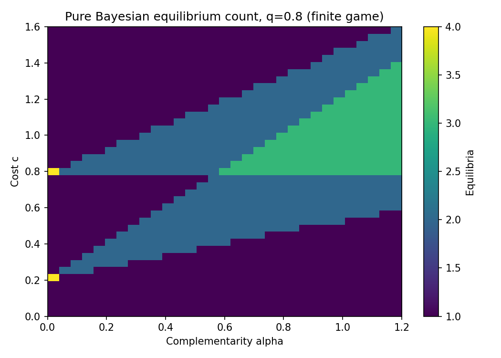

# 1. Bayesian Freeze Audit — ciclo 2026-10-13

MVP de completitud y selección de equilibrio en un juego finito de renovación de crédito.
Componente S1 → S2 del programa Endogenous Credit Freeze. El juego global continuo,
la dinámica y la identificación empírica siguen en S1; no se declara S3/S4.

Se revisó main `75423ac53aab6ed8f6d28da478307c1ce04dead1`: el aporte anterior Vintage
Audit está fusionado (#29); las mejoras matemáticas/riesgo también están en main.
El programa credit-freeze contiene formulación sin solver. `econlab.py` ofrece best response
en grilla, no enumeración BNE. Búsqueda en código económico no encontró duplicación de este
solver finito. No se afirma que no haya solvers similares en el resto de la literatura.

## 2. Hipótesis, métrica y novedad

Pregunta: ¿un punto fijo de mejores respuestas puede ocultar resultados de congelación
radicalmente diferentes, sin cambiar fundamentales ni estructura informativa?
H1 calibrada: en pi=.5, q=.8, c=.9, alpha=.8 existen >=2 equilibrios puros con amplitud de
P(no renovación | theta=1)>=.5. Métricas: número BNE, regret interim, amplitud de freeze.
Umbral de equilibrio float: regret<=1e-12. Completitud se garantiza por enumerar los 16
perfiles del espacio puro del modelo finito, no por probar algo sobre juegos continuos.
H2 negativa: al poner alpha=0, desaparece la multiplicidad en esa calibración.
Parámetros elegidos como caso pedagógico de coordinación; no hubo estimación ni
pre-registro. No se ofrece la calibración como evidencia independiente de una teoría nueva.

Novedad incremental de artefacto: contrato de completitud, oracle independiente Fraction,
comparación con mejor respuesta del núcleo del repo y bounds de selección explícitos.
Los mecanismos económicos y algoritmos son conocidos. No claim de prioridad científica.

## 3. Estado del arte

Carlsson/van Damme (1993, Econometrica) y Morris/Shin (1998, AER) estudian global games
y selección bajo hipótesis que NO se trasladan a este juego binario. Diamond/Dybvig
(1983, JPE) muestran coordinación en contratos bancarios; Goldstein/Pauzner (2005, JF)
relacionan contratos y probabilidades de corridas; Rochet/Vives (2004, JEEA/CEPR) estudian
coordinación y LOLR. Angeletos/Lian (2016, NBER) sintetizan fricciones informativas.
Este MVP no replica ninguno de sus modelos completos ni supera sus resultados teóricos.
Seis referencias reales en referencias.bib; cobertura y bloqueos en prior_art_search.md.

## 4. Brecha cerrada

El programa tenía hipótesis sin implementación. Se incorpora el primer caso finito con
payoffs económicos explícitos, posterior Bayes, alternativas estratégicas auditadas y salida
numérica reproducible. No se sustituye esa brecha por una propuesta de global game sin ejecutar.

## 5. Modelo y configuración

Dos prestamistas i=0,1; theta∈{0,1}, P(theta=1)=pi. Cada uno observa s_i∈{0,1},
P(s_i=theta|theta)=q. Señales independientes CONDICIONALMENTE a theta; no independientes
incondicionalmente. Acción a_i∈{0,1}: renovar o retirar. Payoff:

u_i=a_i*(theta+alpha*a_j-c), payoff de retirada=0.

Estrategia pura es un mapa (a_i(0),a_i(1)). Se incluyen también mapas antimonótonos; no
se presupone equilibrio umbral. 4 políticas por jugador, 16 perfiles. Ganancia interim:
D_i(s)=P(theta=1|s)+alpha*E[a_j|s]-c.
Regret=max(0, (1-2*a_i(s))*D_i(s)) sobre jugadores y tipos. BNE exige que ningún tipo
tenga desviación rentable. Oracle racional suma directamente masas theta/s_j sin reutilizar
la fórmula cerrada de posterior/gain del solver.

```json
{"prior":0.5,"accuracy":0.8,"cost":0.9,"complementarity":0.8,
 "tolerance":1e-12,"oracle_seed":20261013,"oracle_cases":100,
 "sensitivity_q":[0.6,0.8,0.95],"cost_grid":[0,1.6,41],"alpha_grid":[0,1.2,31],
 "benchmark_games":[100,1000,5000],"timing_repeats":3}
```

Calibración, no estimación. No estimando causal, población real ni contrato bancario
estimado. Los agentes usan prior común y Bayes; racionalidad y alpha son impuestos.
No equilibrio dinámico, restricción de balance ni clearing financiero. Los bounds recorren
BNE puros, excluyen mixtos y no asignan pesos/probabilidades a los equilibrios.
La suma de payoffs de prestamistas NO es bienestar social ni valor del prestatario.

## 6. Implementación

`src/game.py` tipado: Game, posterior, gain, regret, equilibria, exact_equilibria,
best_response, iterate y outcomes. Baseline usa exactamente `econlab.best_response_grid`
con acciones [0,1] (empates a retirar), iteración síncrona, max50 pasos, detección de ciclos.
Se compara un arranque bottom con enumeración exhaustiva, y se muestra top como sensibilidad.
Resultados calculados por suma exacta de los ocho estados, no Monte Carlo aproximado.
NumPy sólo genera config grids/seed cases; Fraction actúa como oracle independiente.

## 7. Tests, precisión y costo

12 tests propios pasan; dos propiedades Hypothesis×100 ejemplos, casos de indiferenicia,
q=1, c=0, costos extremos, parámetros inválidos, ciclos y agotamiento de iteraciones.
8 tests de computational-economics pasan. Cobertura src: 85/85 líneas y 30/30 ramas,
100%. No implica cobertura del programa teórico ni de todo el repo.
Ruff E4/E7/E9/F pasa (sin estilo E701/E702/E402); mypy pasa en los 2 archivos src.
Primera ejecución se detuvo por tipado de itertools.product; se reemplazó por producto
explícito de pares, sin alterar resultados. Checks del benchmark no son type checking total.

100 configuraciones seeded comparadas con oracle racional: 0 mismatches de conjunto.
Error máximo de ganancias float versus expectativa racional: 4.44e-16.
La prueba property-based usa otros 100 casos racionales; no certifica toda la grilla con Fraction.
Caso principal estable entre tolerancias 0, 1e-14, 1e-12 y 1e-8; los empates requieren
cuidado, especialmente fuera de fixtures. `Fraction(str(v))` representa el decimal dado,
no un parámetro económico con precisión infinita.

| Juegos | Método | Mediana segundos, 3 repeticiones | Máximo bytes Python |
|---|---|---:|---:|
| 100 | enumeration | 0.013557 | 1032 |
| 100 | rational_oracle | 0.611607 | 2962 |
| 100 | single_start | 0.002745 | 896 |
| 1000 | enumeration | 0.117781 | 840 |
| 1000 | single_start | 0.027252 | 728 |
| 5000 | enumeration | 0.616986 | 840 |
| 5000 | single_start | 0.141376 | 728 |

Tracemalloc instrumenta asignaciones Python del solver; excluye juegos de entrada, RSS,
NumPy/native y retención de todas las salidas. Memoria pequeña refleja procesamiento
streaming de un juego de tamaño fijo, no eficiencia para muchos agentes/tipos.
Escalabilidad O(N) en número de juegos de tamaño fijo; espacio de políticas crece
exponencialmente al ampliar agentes/tipos. Enumeración más lenta compra completitud,
no mejora un payoff por sí sola. Oracle Fraction costoso y usado sólo como validación.
Hardware/Python/platform/versiones en metadata.json/environment-lock.txt.

## 8. Resultados ejecutados

| Perfil / baseline | Regret | Crédito medio | Payoff prestamistas | P(freeze|theta=1) |
|---|---:|---:|---:|---:|
| ((0, 0), (0, 0)) | 0 | 0.000 | 0.000 | 1.000 |
| ((0, 1), (0, 1)) | 0 | 0.500 | 0.444 | 0.040 |
| ((1, 1), (1, 1)) | 0 | 1.000 | 0.800 | 0.000 |
| baseline_bottom | 0 | 0.000 | 0.000 | 1.000 |
| baseline_top | 0 | 1.000 | 0.800 | 0.000 |

El baseline bottom encuentra 1/3 equilibrios, omite 2. Top encuentra otro, sin revelar
el intermedio por sí solo. El mismo fundamental bueno admite freeze condicionado desde
0 hasta 1 entre resultados de equilibrio. NO se estima que freeze ocurrirá con probabilidad
100% ni que asignar igual peso a equilibrios sea correcto.

Grilla: 3813 juegos, 1667 con >1 BNE (43.72%),
máximo 4 en la grilla. Este porcentaje depende de la medida arbitraria de
la grilla, no frecuencia poblacional ni probabilidad de crisis.



## 9. Fallos, controles negativos y lectura crítica

H1 se cumple sólo en el caso calibrado. H2: alpha=0 reduce conteo de 3 a 1, retiro total;
es un control negativo del mecanismo de multiplicidad, no del nivel de freeze.
Con señales sin información q=.5, alpha=0 y c=pi=.5, todos son indiferentes: 16 perfiles
puros, SIN complementariedad. Refuta la afirmación amplia de que toda multiplicidad
requiere alpha>0. Empates débiles no constituyen 16 mecanismos económicos distintos.
Arranque asimétrico ((0,0),(1,1)) en el caso principal cicla bajo actualización síncrona;
se detecta, no se reporta como equilibrio ni convergencia. Una dinámica de solver
NO equivale a dinámica económica o probabilidad de selección.
No se observa ganancia de velocidad: enumeración es más lenta que single-start. No se
oculta esta ablación negativa. No se calcula una política óptima de garantías/LOLR.

## 10. Limitaciones económicas y numéricas

Sólo BNE puros de dos agentes/tipos binarios y payoffs lineales; no mixtos, continuum,
heterogeneidad, exposición bancaria, colateral, endogeneidad de señales o aprendizaje.
Conjunto de equilibrio completo relativo a este espacio, no al programa global completo.
No se deriva un nuevo teorema, no se evalúa identificabilidad con microdatos y no se
vincula a episodios colombianos. Parámetros pueden producir racionalidad/calibración
poco realistas. Input Profile es contrato interno binario; no validador genérico de
payoffs arbitrarios. Benchmarks dependen de hardware y carga. Datos son sintéticos de
parámetros y estados; sin licencias/restricciones de datos de terceros.
La búsqueda de prior art es dirigida y parcial, sin claim de ausencia ni prioridad.

## 11. Reproducción exacta

Desde raíz del repo, Python3.12, Bash y PyPI para primera instalación:

```bash
bash 01-economics-and-econometrics/03-game-theory/01-endogenous-credit-freeze/bayesian-freeze-audit/reproduce.sh
```

Comando realmente ejecutado. Tests comunes:
`python3 -m unittest discover -s 01-economics-and-econometrics/computational-economics/tests -v`.
Tests propios desde MVP: `.venv/bin/python -m unittest discover -s tests -v`.
Notebook celdas ejecutadas in-process por IPython; streams/figura capturados de ejecución
real, no kernel Jupyter por red ni outputs inventados. CSV crudos y SHA256 versionados.
Tiempo varía; no se exige hash idéntico de costs.csv entre máquinas.

## 12. Referencias BibTeX

Seis entradas reales completas en [referencias.bib](referencias.bib). Prior-art limita
la novedad a implementación/auditoría, no creación de un mecanismo ya conocido.

## 13. Rúbrica de autoevaluación 1–5

| Novedad | Rigor | Reproducibilidad | Código | Claridad | Impacto | Honestidad | MVP |
|---:|---:|---:|---:|---:|---:|---:|---:|
| 2 | 4 | 5 | 4 | 4 | 3 | 5 | 5 |

Novedad acotada y pedagógica; rigor relativo al juego finito con oracle/edge cases;
impacto potencial para auditar puntos fijos, no adopción o mejora empírica demostrada.
Checklist de MVP completo en MVP.md; revisión externa aún pendiente.

## 14. Continuación

Siguiente iteración recomendada: ampliar la cobertura estratégica antes de usar el modelo
para políticas o predicción de crisis.

1. `03-game-theory`: añadir equilibrios mixtos y comparar los bounds con el caso puro.
2. `computational-economics`: extraer API general de juegos bayesianos finitos y benchmark de crecimiento por tipos.
3. `05-macrofinance`: introducir restricciones de balance y contrafactual de liquidez sin confundir calibración con identificación.
