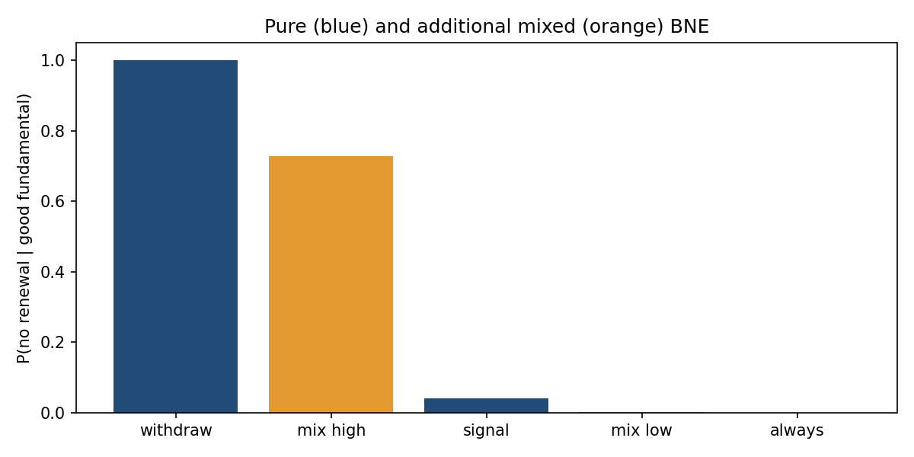

# 1. Mixed Freeze Audit — ciclo 2026-10-14

Extensión ejecutable S2 del componente finito Endogenous Credit Freeze. Main inspeccionado:
`c62ae3c8271dfe57d643e821c489efaf9f57011e`; aportes de vintages (#29), BNE puros (#33),
núcleo matemático y riesgo ya integrados. PR #36 de IA abierto, fuera del alcance.
RESEARCH_STANDARDS.md leído. No AGENTS.md encontrado en la copia inspeccionada.
No se altera el MVP anterior: se reutiliza su Game/posterior y enumeración pura.

## 2. Hipótesis y novedad incremental

Pregunta: ¿excluir randomización por tipo omite equilibrios y cambia los límites de
congelación del mismo juego calibrado?
H1: con pi=.5, q=.8, c=.9, alpha=.8, el conjunto aislado contiene >=2 equilibrios
mixtos adicionales al baseline puro, con regret<=1e-10.
H2 exploratoria: el intervalo extremo de freeze cambia en más de 1e-8 al incluirlos.
No pre-registro externo; calibración pedagógica heredada, no seleccionada mediante
búsqueda para mostrar superioridad del solver. Se fijó el diseño antes de ejecutar.
Novedad de integración/validación, no de teoría o algoritmo: 81 soportes, validación
interim, oracle racional y rechazo explícito de soportes singulares factibles.

## 3. Estado del arte y comparación justa

Harsanyi (1967) fundamenta el modelo bayesiano. Lemke/Howson (1964) es antecedente
de cálculo de equilibrios, pero aquí NO se implementa su algoritmo. Gambit documenta
enumeración de soportes, regret y cautela ante singularidad: singular no implica
familia factible. Se adopta esa cautela comprobando factibilidad mediante LP antes
de rechazar una lista finita. Diamond/Dybvig, Rochet/Vives y Angeletos/Lian aportan
contexto de coordinación financiera, no calibración de este juego.
Seis referencias reales en referencias.bib. Revisión dirigida y cobertura parcial
registradas en prior_art_search.md. Gambit no fue instalado ni benchmarkeado: no
se afirma superarlo ni reproducir sus resultados. Baseline ejecutado: solver puro
del repo; oracle ejecutado: expectativa de estado y Gauss-Jordan con Fraction.

## 4. Brecha cerrada y alcance reducido

El MVP anterior cubría los 16 perfiles puros, dejando fuera estrategias mixtas.
Se implementa extensión aislada en el mismo programa sin crear otra disciplina.
Los casos degenerados NO se fuerzan a una lista incompleta: si un soporte singular
es factible, solve() lanza DegenerateGameError y se registra el rechazo.
La clasificación de degeneración es conservadora; no parametriza ni prueba la
dimensión de una familia, y puede rechazar un soporte cuya región factible esté
restringida a una frontera. No devolver una lista no significa inexistencia de BNE.
Se mantiene S2; el juego global continuo y la identificación siguen parcialmente S1.

## 5. Modelo, identificación y configuración

Mismo juego: dos prestamistas, theta binario con prior .5; señales s_i binarias,
P(s_i=theta|theta)=.8, independientes condicionalmente a theta, no marginalmente.
u_i=a_i(theta+alpha*a_j-c); retirada=0. Agentes bayesianos, prior común, parámetros
conocidos; c=.9, alpha=.8. Estrategia de comportamiento x_i(s)∈[0,1].
Randomización independiente entre prestamistas condicional a señales, sin dispositivo
público correlacionador. Mezclas sobre planes puros pueden inducir las mismas
probabilidades de comportamiento; no se cuentan distribuciones equivalentes como
nuevos equilibrios.

D=b+A*x es la ganancia de renovar. Para cada uno de los 81 patrones ternarios:
x=0 exige D<=0; x=1 exige D>=0; 0<x<1 exige D=0. Se resuelve el sistema afín de
tipos mixtos, se comprueban límites/inecuaciones y regret=max(max(D,0)-x*D).
Casos singulares inconsistentes se descartan; singulares consistentes requieren LP
con restricciones completas. LP inviable se descarta; LP fallido es error, no
inviabilidad. LP factible bloquea la certificación de lista finita.
La enumeración completa es relativa a patrones de este modelo; tolerancias y rango
numérico NO son un teorema general. Oracle racional independiente suma estados
theta/s_j y usa eliminación exacta. Sólo se contrasta su lista para juegos que
solve() certifica como aislados; el oracle omite soportes singulares.

```json
{"main":{"prior":0.5,"accuracy":0.8,"cost":0.9,"alpha":0.8},
 "tolerance":1e-10,"seed":20261014,"oracle_cases":50,
 "support_patterns":81,"sensitivity_games":195,
 "cost_grid":[0.45,1.15,15],"alpha_grid":[0.4,1.2,13],
 "benchmark_games":[10,50,100],"repetitions":3}
```

No datos reales, estimación, equilibrio macroeconómico, causalidad ni selección
identificada. Regret interim requiere ningún tipo quiera desviarse; no basta regret
ex ante agregado. Outcomes son expectativas finitas, no simulación Monte Carlo
de crisis. Payoffs de prestamistas NO son bienestar social. Los seeds sólo generan
configuraciones del oracle, no una distribución empírica de parámetros.

## 6. Implementación

src/mixed.py modular y tipado: affine, mixed_regret, solve, rational_oracle, outcomes,
pure_baseline. Usa numpy/scipy para álgebra y diagnóstico LP, Fraction para oracle.
Reutiliza ../bayesian-freeze-audit/src/game.py, sin modificar su modelo/baseline.
Benchmarks y notebook tienen scripts; notebook ejecutado realmente en IPython
in-process con stream/display outputs. Dependencias directas fijadas y lock observado.
No kernel por sockets, Docker o GPU requerido. Entorno venv reproducido en
Python 3.12.14, INTEL(R) XEON(R) PLATINUM 8573C, Linux x86_64.

## 7. Tests, precisión, estabilidad y costos

12 tests nuevos pasan: casos principales, oracle, inclusión de puros, alpha=0,
singularidad, fallo LP, validación, mezcla completamente interior inviable en
calibración, dos propiedades Hypothesis (40 configuraciones y 100 vectores).
Propiedad oracle reconoce degeneración y omite comparación, sin marcarla como
acierto de lista finita. Benchmark documenta explícitamente cuantos son rechazados.
12 tests puros previos y 8 tests comunes pasan, 32 en total.
Ruff E4/E7/E9/F y mypy src pasan; no type checking exhaustivo del benchmark.
Cobertura src: 118/121 líneas (97.5%), 96% combinada con ramas. Tres guards de error
no están cubiertos; cobertura no valida teoría ni exhaustividad de literatura.
No se oculta ni se redondea a 100%.

Oracle: 49/50 configuraciones aisladas verificadas,
0 discrepancias, 1 rechazo por soporte singular; error máximo 4.440892098500626e-16.
Main: 5 candidatos para tolerancias 1e-12, 1e-10 y 1e-8; regret calculado 0 en float.
Ese 0 computado no prueba cero exacto para cada parámetro posible.
Probabilidades racionales nuevas del caso principal: 25/136 y 111/136.

| Juegos | Método | Mediana s, 3 repeticiones | Máximo bytes Python |
|---|---|---:|---:|
| 10 | pure_baseline | 0.003607 | 1008 |
| 10 | mixed_support | 0.193201 | 6800 |
| 50 | pure_baseline | 0.010156 | 840 |
| 50 | mixed_support | 0.837653 | 6920 |
| 100 | pure_baseline | 0.021036 | 840 |
| 100 | mixed_support | 1.733158 | 6920 |

Tiempos instrumentados por tracemalloc; memoria sólo asignaciones Python del solver,
sin RSS/nativas/inputs. Se procesa un juego por vez, no se retienen todos los resultados.
Más lento que puro: compra cobertura, no rapidez. Escala en número de juegos de
tamaño fijo; soportes 3^(agentes×tipos) crecen exponencialmente. No se extrapola
a redes bancarias grandes. Costos de LP nativos no se miden como memoria Python.

## 8. Resultados ejecutados

Perfiles simétricos (x_0(s)=x_1(s)); el solver no impone simetría.
Crédito medio es esperanza incondicional; freeze condiciona theta=1.

| Equilibrio | P(renovar|s=0) | P(renovar|s=1) | Crédito medio | Payoff agregado | P(freeze|theta=1) |
|---|---:|---:|---:|---:|---:|
| Retiro total | 0.000000 | 0.000000 | 0.000000 | 0.000000 | 1.000000 |
| Mixto ante señal alta | 0.000000 | 0.183824 | 0.091912 | 0.000000 | 0.727509 |
| Renovación ante señal alta | 0.000000 | 1.000000 | 0.500000 | 0.444000 | 0.040000 |
| Mixto ante señal baja | 0.816176 | 1.000000 | 0.908088 | 0.652941 | 0.001352 |
| Renovación siempre | 1.000000 | 1.000000 | 1.000000 | 0.800000 | 0.000000 |

Resultado: 5 aislados = 3 puros + 2 mixtos nuevos. Baseline puro cubre 3/5 del
conjunto aislado en este caso; no es un fallo respecto a su contrato original.
Baseline bottom del ciclo previo encontraba 1/3 puros; aquí se compara con enumeración
pura completa, una comparación más exigente y distinta de aquel baseline.
Sensibilidad: 195 juegos, 15 rechazos
degenerados explícitos; no se incluyen rechazos como juegos sin equilibrio.



## 9. Análisis crítico y ablations negativas

H1 satisfecha en calibración: dos equilibrios nuevos con probabilidades interiores
por uno de los tipos. H2 no apoyada: bounds puros y mixtos son ambos [0,1], cambio
0, no >1e-8. Añadir equilibrios no amplía los extremos aquí; aporta resultados
interiores, no identificación de una probabilidad de crisis.
Alpha=0/c=.9 da un único equilibrio, sin mezcla adicional. Indiferencia total
(q=.5,c=.5,alpha=0) tiene continuum de probabilidades de comportamiento: la extensión
lo rechaza en vez de reportar solamente los 16 extremos puros como lista completa.
Main completamente mixto en los cuatro tipos produce probabilidades fuera de [0,1]
y se descarta: no se proyecta una solución inviable y se la llama equilibrio.
La velocidad empeora frente a puro. No se afirma ventaja frente a Gambit ni otro
solver general de la literatura. Guards y patrones están limitados al payoff afín.

## 10. Riesgos y límites

Juego finito calibrado; no fundamentales continuos, heterogeneidad, balances,
colateral, dinámica de renovación, equilibrios correlacionados o estimación real.
No política óptima de garantías y no predicción colombiana. Probabilidades de
acción no equivalen a probabilidades de selección entre equilibrios.
Rango y tolerancias pueden alterar clasificación cerca de fronteras; main y casos
racionales se verificaron, no todas las calibraciones imaginables. Aritmética exacta
usa Fraction(str(v)), representando el decimal dado, no incertidumbre económica.
Degeneración rechazada con alcance reducido; parametrización de familias pendiente.
Grilla arbitraria, no población: sus conteos no son frecuencia empírica de crisis.
Literatura parcial; no prioridad ni validación externa. S2, no S3/S4.

## 11. Reproducción

Desde raíz del repo:

```bash
bash 01-economics-and-econometrics/03-game-theory/01-endogenous-credit-freeze/mixed-equilibrium-audit/reproduce.sh
```

Comando ejecutado con instalación, checks, todas las suites, benchmark y notebook.
Suite común: python3 -m unittest discover -s
01-economics-and-econometrics/computational-economics/tests -v.
Nuevos tests, desde MVP: .venv/bin/python -m unittest discover -s tests -v.
CSV crudos, SHA256, hardware, seed y config en results/metadata.json.
Hashes de timing no se esperan idénticos entre máquinas; resultados económicos sí
pueden contrastarse con tolerancia/oracle. Instrucciones venv reproducibles sin Docker.

## 12. Referencias BibTeX

Seis entradas reales completas en [referencias.bib](referencias.bib), con DOI/URL.
Búsqueda, acceso y cobertura detallados en prior_art_search.md. No cita inventada
para rellenar la cuota; tres referencias de método/software, tres de contexto.

## 13. Rúbrica 1–5 (autoevaluación)

| Novedad | Rigor | Reproducibilidad | Código | Claridad | Impacto | Honestidad | MVP |
|---:|---:|---:|---:|---:|---:|---:|---:|
| 2 | 4 | 5 | 4 | 4 | 3 | 5 | 5 |

Novedad incremental de integración; rigor relativo al caso aislado y oracle;
impacto potencial de evitar omisión de estrategias, sin beneficio empírico medido.
Checklist completo en MVP.md y validado antes de cerrar; CI/PR se revisan aparte.

## 14. Continuación

Siguiente iteración recomendada: parametrizar familias degeneradas antes de ampliar
el modelo financiero.

1. `03-game-theory`: representar las regiones singulares factibles como poliedros, sin falsear su dimensión.
2. `computational-economics`: añadir comparación independiente con Gambit y exportación de forma bayesiana.
3. `05-macrofinance`: incorporar balance/colateral y garantías, separando eficiencia del prestamista y bienestar social.

