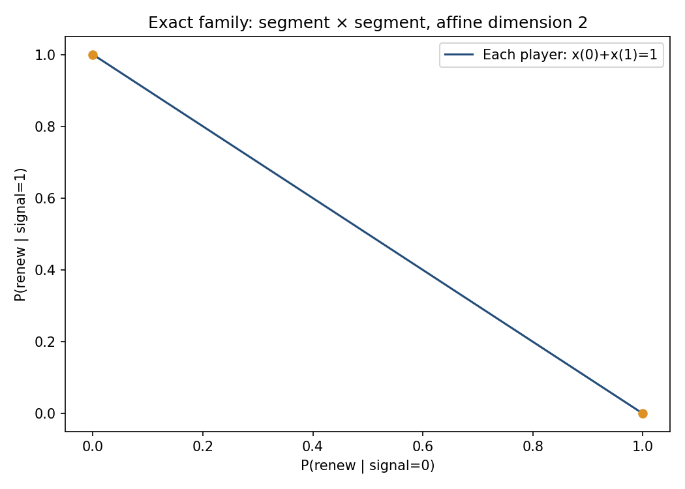

# 1. Polyhedral Freeze Audit — ciclo 2026-10-15

MVP ejecutable de representación exacta de familias degeneradas del mismo juego de
renovación crediticia. Extensión S2 del componente finito, no promoción del programa
global a S3/S4. Main inspeccionado:
`afcbc7facb17485786c02e539759afc31b5d23fd`. Se leyeron estándares, README e implementaciones.
MVP puros (#33) y mixtos aislados (#37) ya integrados; el aporte actual NO repite la
lista de cinco puntos como si fuera nuevo. PRs #36/#39 abiertos son de otras áreas;
no se modifican. No AGENTS.md encontrado en la copia inspeccionada.

## 2. Pregunta, hipótesis y novedad incremental

Pregunta: ¿cómo distinguir una región positiva de equilibrio de un punto aislado
cuando las igualdades de un soporte son singulares?
H1 calibrada: q=.5,c=.9,alpha=.8,pi=.5 admite una celda de dimensión 2, con
regret racional exactamente 0 para sus vértices y combinaciones convexas.
H2 negativa: q=1,c=1,alpha=.8 no tiene celdas de dimensión positiva, aunque el solver
previo rechace al menos un soporte singular factible.
Métricas: dimensión afín por vértices, número de celdas máximas, completitud de
representación respecto a 81 patrones y regret exacto. Umbrales: dimensión exacta
2 para H1; máxima dimensión 0 para H2; error LP<1e-9.
Protocolo calibrado antes del benchmark, sin pre-registro externo ni estimación.
Novedad de integración/certificación: H/V-regiones racionales, contención y dimensión
del conjunto factible, cerrando una limitación explícita del MVP previo. No algoritmo
general nuevo, nuevo teorema de juegos globales o claim de prioridad.

## 3. Estado del arte y comparación justa

Audet, Hansen, Jaumard y Savard (2001, SIAM JSC) describen conjuntos de equilibrios
como uniones de poliedros, posiblemente solapados; su método general NO se replica.
Gambit documenta enumeración por soportes y advierte que singularidad no basta
para afirmar una familia factible. Harsanyi fundamenta la representación bayesiana;
Lemke/Howson es antecedente de cómputo; Rochet/Vives y Angeletos/Lian dan contexto
de coordinación financiera. Bibliografía de seis fuentes reales con DOI/URL.
Se consultaron canales solicitados, con cobertura limitada registrada en prior_art_search.md.
No texto completo de pago de SIAM leído; se usó página editorial/abstract. NBER
abierto por búsqueda, apertura directa falló. Gambit no instalado ni benchmarkeado,
sin afirmaciones de superioridad frente a él.
Baseline ejecutado: mixed-equilibrium-audit/src/mixed.py, mismo Game y escenarios.
Oracle independiente de geometría: SciPy/HiGHS resuelve máximos lineales/viabilidad,
en vez de enumerar intersecciones racionales.

## 4. Brecha cerrada

El baseline anterior falla de forma honesta ante soporte singular factible y por
ello no representa familias. Este MVP devuelve la unión de celdas producto, incluidas
familias y puntos degenerados, con restricciones, vértices y dimensión.
No se mantiene una lista finita de muestras como sustituto del conjunto continuo.
El JSON guarda todas las restricciones y vértices de celdas máximas por inclusión;
los puntos de cada factor se reconstruyen mediante combinaciones convexas.
Celdas máximas NO son componentes conexas generales ni partición disjunta.

## 5. Modelo, supuestos e identificación

Dos prestamistas i=0,1; theta∈{0,1}, prior pi=.5; señal privada s_i con precisión q.
Señales independientes condicionadas a theta, no necesariamente marginalmente.
Acción de renovar a_i∈{0,1}, u_i=a_i(theta+alpha*a_j-c).
Estrategia de comportamiento x_i=(P(a_i=1|s_i=0),P(a_i=1|s_i=1)).
Randomización independiente entre agentes dada información; sin dispositivo público
correlacionador. Agentes bayesianos y parámetros conocidos son supuestos, no estimados.
No datos reales, causalidad, equilibrio macroeconómico o probabilidad identificada de selección.
Payoff de prestamistas no es bienestar social.

Para cada tipo, ganancia de renovar D_s=b_s+A_s*x_oponente. Un patrón ternario
(0 retirar,1 renovar,2 indiferente) exige respectivamente x=0/D<=0, x=1/D>=0,
o D=0 con x∈[0,1]. El cierre de soportes permite fronteras duplicadas.
En este modelo especial, condiciones de cada jugador sobre su oponente dependen
sólo de las dos probabilidades de ese oponente. Cada patrón se separa en P0×P1.
P0 y P1 son H-poliedros dentro de [0,1]^2: restricciones propias fijan coordenadas
y condiciones de incentivo del oponente imponen igualdades/inecuaciones.
Se visitan 3^4=81 patrones, incluidos antimonótonos.

Todos los vértices de estos poliedros acotados se obtienen intersectando pares
de fronteras y filtrando TODAS las restricciones con Fraction. Dimensión = rango
afín de diferencias entre vértices (0,1,2); dimensión producto = suma (0..4).
Un poliedro acotado no vacío tiene vértices; su envolvente convexa reconstruye el
factor. Unión de los 81 productos cubre BNE de comportamiento de ESTE modelo:
cualquier BNE tiene uno de los patrones; cualquier punto de cada producto satisface
incentivos por tipo. Es una justificación algebraica específica, no teorema nuevo.
Duplicados se comparan por vértices canónicos; contención se verifica mediante
restricciones exactas y vértices. Se eliminan sólo celdas contenidas en otra.
No se usa nullidad de igualdades como dimensión sin mirar restricciones activas.

```json
{
  "seed": 20261015,
  "support_patterns": 81,
  "scenarios": {
    "regular": {
      "prior": 0.5,
      "accuracy": 0.8,
      "cost": 0.9,
      "complementarity": 0.8
    },
    "coordination_family": {
      "prior": 0.5,
      "accuracy": 0.5,
      "cost": 0.9,
      "complementarity": 0.8
    },
    "full_indifference": {
      "prior": 0.5,
      "accuracy": 0.5,
      "cost": 0.5,
      "complementarity": 0
    },
    "singular_but_isolated": {
      "prior": 0.5,
      "accuracy": 1,
      "cost": 1,
      "complementarity": 0.8
    }
  },
  "lp_supports": 60,
  "lp_directions": [
    [
      1,
      0
    ],
    [
      0,
      1
    ],
    [
      1,
      1
    ],
    [
      -1,
      2
    ]
  ],
  "samples_per_cell": 20,
  "timing_games": [
    1,
    5,
    20
  ],
  "timing_repetitions": 3
}
```

## 6. Implementación

src/polyhedra.py tipado y modular: Polygon, Cell, polygon, gains, player_region,
equilibrium_cells, exact_regret y serialize_cell. Sólo biblioteca estándar en núcleo
geométrico/racional, reutilizando Game del repo. NumPy/SciPy se usan en validación,
outcomes del baseline y benchmarks; no se reimplementa una API general de poliedros.
Fraction(str(param)) representa exactamente el decimal dado, no incertidumbre
económica ni el valor binario de un float. JSON conserva fracciones como cadenas.
Notebook con celdas ejecutadas realmente en IPython in-process, streams y figura.
Dependencias directas fijadas, lock completo observado, venv reproducido.
Hardware: AMD EPYC 9V74 80-Core Processor; Python 3.12.14, Linux x86_64.

## 7. Tests, precisión, estabilidad y costo

10 tests nuevos pasan, incluidos 20 ejemplos Hypothesis de juegos y 50 rectángulos,
casos vacío, punto, segmento, redundancia, rechazo de inputs y contención tras poda.
12 tests mixtos, 12 puros y 8 comunes pasan: 42 tests en total.
Cobertura nueva: 105/105 líneas y 34/34 ramas, 100% medida; no cobertura de todo el
repo ni demostración empírica de teoría. Ruff E4/E7/E9/F y mypy src pasan; no type
checking exhaustivo de benchmarks. Estilo E701/E702/E402 excluido explícitamente.
Primera reproducción se detuvo porque benchmarks/ aún no estaba escrito; se completó
y se repitió el comando entero satisfactoriamente, sin omitir checks.

240 contrastes LP: 60 regiones de soporte ×4 direcciones; máxima discrepancia
de valor soporte racional vs HiGHS = 6.661338147750939e-16. Se contrasta
también vacío/viable; fallos de solver no se cuentan como inviabilidad.
220 puntos convexos racionales guardados, cada uno con regret exacto 0.
Regret float máximo del baseline en esos mismos puntos = 4.5306895490217785e-17.
Tests verifican todos los vértices y baricentros de juegos aleatorios; muestreo no
prueba por sí solo cobertura de toda la familia. Esa cobertura procede del contrato
de restricciones y geometría de poliedros acotados.
La dimensión racional no depende de tolerancia de rango; NO se elimina inestabilidad
económica: un pequeño cambio del parámetro exacto puede destruir una familia.
La prueba ejecutada en results/perturbations.csv confirma esa fragilidad: q=.5 da
3 celdas con dimensiones 0;0;2; q=.500000001, .500001, .51 y .8 dan cinco celdas0D.
No se redondea el primer cambio a cero ni se interpreta exactitud aritmética como
robustez económica. La configuración de costos y alpha no cambia en esta prueba.

| Juegos regulares | Método | Mediana s, 3 repeticiones | Máximo bytes Python |
|---|---|---:|---:|
| 1 | isolated_float | 0.010033 | 6928 |
| 1 | polyhedral_exact | 0.061773 | 107224 |
| 5 | isolated_float | 0.052275 | 7080 |
| 5 | polyhedral_exact | 0.331928 | 108768 |
| 20 | isolated_float | 0.198433 | 16128 |
| 20 | polyhedral_exact | 1.294426 | 128984 |

Comparación de tiempo sólo en caso regular, donde ambos métodos terminan y representan
los mismos cinco puntos. En casos degenerados el baseline rechaza, no es comparable
como solver exitoso. No se presenta rechazar más rápido como resolver mejor.
Tracemalloc mide asignaciones Python del solver, no RSS/nativas/objetos de entrada.
Más costo compra regiones exactas y dimensión; no hay promesa de mejora de velocidad.
Escalabilidad sólo en lote de juegos fijos; 81 soportes y vértices racionales no se
extrapolan a muchos agentes/tipos. La caché se limita al cálculo de cada juego.

## 8. Resultados ejecutados

| Escenario | Baseline aislado | Celdas máximas | Dimensiones por celda | Vértices sumados |
|---|---|---:|---|---:|
| Regular (q=.8,c=.9,α=.8) | 5 puntos | 5 | 0;0;0;0;0 | 5 |
| Señales no informativas (q=.5,c=.9,α=.8) | Rechazo explícito | 3 | 0;0;2 | 6 |
| Indiferencia total (q=.5,c=.5,α=0) | Rechazo explícito | 1 | 4 | 16 |
| Singular sólo aislado (q=1,c=1,α=.8) | Rechazo explícito | 2 | 0;0 | 2 |

En la familia de coordinación: x_i=(t_i,1-t_i), 0<=t_i<=1; producto de dos segmentos,
dimensión 2, cuatro vértices. Además hay dos puntos aislados (retirar/renovar siempre).
La familia tiene crédito medio 0.5 y P(freeze|theta=1)=0.25 PARA TODOS sus puntos,
porque q=.5 hace no informativas las señales. Payoff agregado de prestamistas 0.
Parámetros t distintos no implican mecanismos observables distintos: aquí son
observacionalmente equivalentes para esos agregados. No se cuentan como infinitas
probabilidades de crisis identificadas.

Indiferencia total: región [0,1]^4 de dimensión4, 16 vértices; el continuo no se
reduce a esos 16 puntos. Singular pero aislado: dos puntos, dimensión máxima0.
Caso regular: se conservan los cinco puntos anteriores, incluido 25/136.
No se altera el resultado del MVP anterior donde era válido.



La figura muestra un factor 2D; la familia total es su producto con otro segmento,
no toda la línea dibujada como si ya fuese la representación de cuatro coordenadas.

## 9. Análisis crítico, fallos y ablations negativas

H1 satisfecha para caso calibrado. H2 también: singularidad de un soporte NO basta
para inferir familia positiva. La restricción factible puede colapsar a frontera0D.
Alpha=0 en indiferencia total produce región4D: degeneración no significa coordinación
económica fuerte. Sólo la dimensión paramétrica aumenta; no es ganancia económica.
Señales no informativas producen equivalencia observacional dentro de la familia.
No se declara aprendizaje sobre cartera real ni una intervención que elimine crisis.
Tiempo y memoria aumentan frente al baseline float; resultado negativo no ocultado.
No se benchmarkeó Gambit y no se reclama novedad del método poliédrico conocido.

## 10. Límites y riesgos

Dos jugadores simétricos, dos tipos, payoff afín y calibración binaria; sin balances,
colateral, aprendizaje, continuum de agentes o variables macro. No inferencia causal,
estimación de parámetros, selección de equilibrio ni bienestar del prestatario.
Celdas de distintas restricciones pueden solaparse; contención máxima no identifica
necesariamente componentes conexas. No API H/V general en dimensión alta.
Datos sintéticos de parámetros/estrategias, sin fuente pública real incorporada.
Dimension4 o2 depende exactamente de igualdades de calibración y puede ser frágil.
Racionales evitan error de redondeo interno, no error de modelo o medición.
LP oracle es float e independiente por algoritmo, no certificación exacta externa.
Sin revisión independiente ni cobertura exhaustiva de literatura; S2, no S3/S4.

## 11. Reproducción

Desde raíz, Python3.12, Bash, venv y PyPI inicial:

```bash
bash 01-economics-and-econometrics/03-game-theory/01-endogenous-credit-freeze/polyhedral-freeze-audit/reproduce.sh
```

Comando completo ejecutado; instala, valida suites, genera CSV/JSON/figura/notebook.
Tests comunes: python3 -m unittest discover -s
01-economics-and-econometrics/computational-economics/tests -v.
Nuevos tests desde MVP: .venv/bin/python -m unittest discover -s tests -v.
Versiones en environment-lock.txt; config/seeds/hardware/hashes en metadata.json.
Timing varía; no exigir mismo hash de timing entre máquinas. JSON rational
y filas exactas pueden verificarse sin creer los números pegados en este informe.
No Docker requerido: las instrucciones venv reproducibles están ejecutadas.

## 12. Referencias BibTeX

Seis entradas reales en [referencias.bib](referencias.bib), DOI/URL y acceso/cobertura
en prior_art_search.md. Antecedentes distinguen geometría conocida de contribución
incremental al repo. No se fabrican citas ni se afirma haber leído textos bloqueados.

## 13. Rúbrica de autoevaluación 1–5

| Novedad | Rigor | Reproducibilidad | Código | Claridad | Impacto | Honestidad | MVP |
|---:|---:|---:|---:|---:|---:|---:|---:|
| 2 | 4 | 5 | 4 | 4 | 3 | 5 | 5 |

La novedad es integración, no teoría nueva. Rigor del modelo finito con aritmética
exacta, tests/LP; impacto potencial en certificación, no beneficio empírico medido.
Checklist completo en MVP.md verificado antes del cierre; CI/PR inspeccionados aparte.

## 14. Continuación

Siguiente iteración recomendada: comparar la representación con un solver independiente
antes de introducir políticas financieras más ricas.

1. `computational-economics`: exportar forma estratégica e integrar comparación verificable con Gambit/lrs.
2. `03-game-theory`: auditar perturbaciones exactas de parámetros y equivalencia observacional de familias.
3. `05-macrofinance`: incorporar balance/colateral y garantías con separación explícita de payoff y bienestar.

