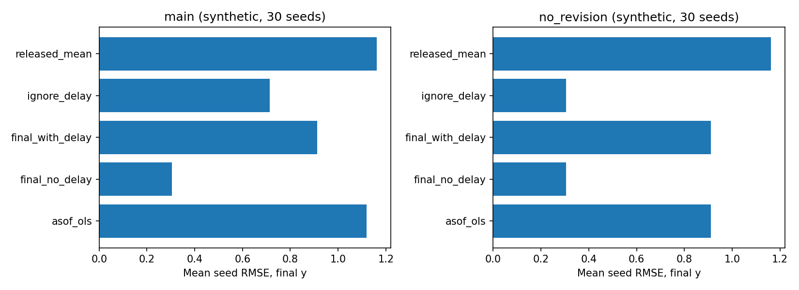

# Ciclo diario 2026-10-12 — Vintage Audit

## 1. Título y estado

Auditor factorial de filtración temporal para nowcasting OLS. Componente S2 del programa
`04-econometrics/01-real-time-causal-nowcasting`; modelo causal/factores/MIDAS todavía S1.
Revisión sobre commit base `558bde13013df8a446fbb6acf4c69447be88dd03`.
Arquitectura verificada: 12 programas, 35 notebooks adicionales, núcleo estadístico
`econlab.py`. Historial económico: cf46597, 12504b3. Búsqueda en código Python sin
implementación previa de vintage/availability/nowcast; no se afirma inexistencia global.
Se corrigen README obsoletos que decían que no había ningún código en el núcleo.

## 2. Pregunta, hipótesis y novedad incremental

¿Cuánto cambia el error retrospectivo si se elimina artificialmente el ruido de revisión
y/o el rezago de publicación, manteniendo el mismo OLS, entrenamiento y target?

H1: en el DGP principal, ΔMSE = MSE(asof)-MSE(final sin delay)>0. Umbral:
límite inferior del bootstrap de la media entre seeds >0. H0: ΔMSE<=0.
H2 exploratoria: la interacción factorial difiere de cero; criterio: intervalo 95% excluye 0.
No se pre-registró externamente el protocolo. Configuración fijada antes del benchmark;
no hubo búsqueda de parámetros para maximizar la brecha.

Novedad de integración/validación, no de estimador: ledger con dos relojes, diseño factorial,
prueba metamórfica de invariancia a datos futuros y ablations negativas. No se reclama
prioridad científica ni innovación en OLS, vintages o teoría económica.

## 3. Estado del arte

Croushore/Stark (2001, Journal of Econometrics) establecen datasets real-time;
Giannone/Reichlin/Small (2008, JME; antecedente CEPR DP5178) relacionan nowcasts con
calendarios y noticias. Bańbura/Modugno (2014, JAE; ECB WP1189) estiman modelos de
factores con datos faltantes. Clements/Galvão (2013 y 2019) estudian madurez y revisiones
para pronósticos. Aruoba/Diebold (NBER w15657, 2010) trabajan monitoring real-time.
Véase referencias.bib para seis referencias reales y prior_art_search.md para cobertura,
consultas y bloqueos. No comparamos numéricamente contra DFM/Kalman/MIDAS porque
no los implementamos aquí; este experimento no demuestra superioridad sobre ellos.

## 4. Brecha del repositorio

El programa proponía backtesting vintage, pero no tenía ledger ni estimador ejecutable.
El núcleo OLS era estático; los laboratorios adicionales no resuelven este contrato temporal.
La brecha cerrada es operativa: poder detectar un resultado contaminado por información
que todavía no estaba disponible y documentar la magnitud en una simulación controlada.

## 5. Diseño experimental y supuestos

```text
n=240; seeds=0..29; rho=0.7; beta=0.8; intercept=0.5
innovation_x ~ N(0,1); eps_y ~ N(0,0.3^2)
revision_x ~ N(0,revision^2); revision_y ~ N(0,(revision/2)^2)
scenarios=(delay,revision): main=(1,.8), no_revision=(1,0), no_delay=(0,.8), null=(0,0)
origins=60..239; expanding OLS; train events=0..origin-4
bootstrap across seeds=2000; bootstrap seed=20261012
scalability n=240/480/960, seeds=0/1/2
```

DGP: x_t=0.7*x_(t-1)+u_t; y_final_t=0.5+0.8*x_t+eps_t.
Primer x publicado en t+delay; final x en t+delay+3.
Primer y en t+1; final y en t+4. Errores preliminares independientes (modelo de noise,
no modelo de news). La agencia estadística publica mediciones y el analista decide
usando F_o={releases con available<=o}. No hay agentes optimizadores ni equilibrio.
OLS es un estimando predictivo, no parámetro causal económico: exogeneidad es impuesta
del simulador y no identificada desde datos observacionales. No hay población Colombia.

Target de scoring es y_final, consultado SOLO después del pronóstico; no se usa el
valor final corriente del target para entrenar. Historial maduro >=4 excluye por diseño
revisiones del target en entrenamiento. Por ello este MVP aísla revisión del indicador
corriente y disponibilidad; no cubre contaminación de targets preliminares recientes.

Brazos 2x2: asof_ols=(prelim/asof, delay), final_with_delay=(final, delay),
ignore_delay=(asof más primera publicación corriente adelantada, sin delay),
final_no_delay=(final, sin delay). La media histórica es baseline desplegable.
Persistencia del último x disponible completa ragged edge. Todos usan mismos seeds,
orígenes, target, kernel y eventos históricos en los escenarios 0/1. Los brazos
retrospectivos admiten releases futuras intencionalmente: controles positivos, no
competidores desplegables. No se interpreta su ganancia como mejora de algoritmo.

## 6. Implementación

`src/vintages.py`: Config/Release tipados, simulación, snapshots, forecast, evaluate.
Reutiliza exactamente `computational-economics/src/econlab.py::ols`.
`benchmarks/run.py`: CSV crudos, bootstrap, figura y trazabilidad.
`benchmarks/costs.py`: costos por brazo; `benchmarks/notebook.py`: celdas ejecutadas
realmente en IPython in-process con stream/display outputs, sin fabricar resultados.
Dependencias directas fijadas; lock del entorno observado. Dockerfile como receta no
probada; instalación venv probada en Python 3.12.14/Linux/AMD EPYC 9V74.

## 7. Tests, precisión y costos

11 tests del MVP pasan, incluyendo 100 ejemplos Hypothesis deterministas y 60 pruebas
seed/origin de invariancia del forecast. La suite común de 8 tests también pasa.
Ruff E4/E7/E9/F pasa (excluye estilo E701/E702/E402); mypy pasa en los dos módulos src.
No se afirma type checking exhaustivo de tests/benchmark. Cobertura con branch tracing:
100% líneas src (82/82), 99% combinada líneas/ramas; queda una arista de filtrado sin
cubrir. Cobertura no mide adecuación económica ni cubre todo el repositorio.
OLS coincide con NumPy lstsq dentro de atol=1e-12 en el fixture de precisión.
Se reparó el test común que exigía cobertura de una realización aislada: ahora valida
orden y cobertura Monte Carlo >=85/100, un guardrail amplio, sin cambiar bootstrap.

| n | Brazo | Segundos instrumentados | Pico bytes Python |
|---|---|---:|---:|
| 240 | asof_ols | 0.1215 | 59512 |
| 240 | final_no_delay | 0.0612 | 33024 |
| 240 | released_mean | 0.0330 | 28448 |
| 480 | asof_ols | 0.4389 | 98664 |
| 480 | final_no_delay | 0.2584 | 72008 |
| 480 | released_mean | 0.1405 | 57432 |
| 960 | asof_ols | 1.7371 | 204640 |
| 960 | final_no_delay | 1.0837 | 151104 |
| 960 | released_mean | 0.6037 | 120720 |

Los costos por brazo son una realización seed=0, sin intervalos de performance.
La escalabilidad conjunta en scalability.csv repite tres seeds. Tracemalloc excluye
RSS y asignaciones nativas; el ledger se crea antes de costs.py y no cuenta en su pico.
Implementación deliberadamente simple O(n²) por re-scan y re-fit; no escalable para
millones de releases sin índices/cumulantes. Estabilidad estadística se reporta abajo
como SD entre seeds, no como estabilidad de identificación.

## 8. Resultados ejecutados

108 000 filas predictivas (30 seeds × 4 escenarios × 5 brazos × 180 orígenes).
RMSE es media del RMSE por seed, no raíz de MSE agregado.

| Brazo, escenario main | RMSE medio | SD entre seeds |
|---|---:|---:|
| asof_ols | 1.119389 | 0.043792 |
| final_no_delay | 0.304082 | 0.012684 |
| final_with_delay | 0.911786 | 0.043131 |
| ignore_delay | 0.714430 | 0.043705 |
| released_mean | 1.162606 | 0.096694 |



| Diferencia MSE principal | Media | Bootstrap 95% entre seeds |
|---|---:|---|
| total | 1.162264 | [1.127843, 1.195985] |
| revision | 0.421733 | [0.397996, 0.446426] |
| availability | 0.742629 | [0.707680, 0.776486] |
| interaction | 0.002098 | [-0.023028, 0.026379] |

Interacción I=M00-M10-M01+M11. Identidad: total=revision+availability-I.
Bootstrap de seeds independientes evita tratar los 180 orígenes dependientes como iid;
no produce intervalos predictivos para observaciones reales ni p-valores de causalidad.

## 9. Análisis crítico, fallos y ablations negativas

H1 recibe soporte sólo en este DGP. RMSE retrospectivo ~72.8% menor que asof, producto
de dar información futura al OLS. El asof supera levemente la media: ~3.7% menor RMSE;
no hay prueba de significancia de esa comparación ni claim de mejora universal.
H2 no recibe soporte: intervalo de interacción contiene cero. No se fuerza una narrativa
no lineal novedosa donde el experimento no la demuestra.
No_revision: efecto de revisión exactamente cero. No_delay: efecto de disponibilidad
exactamente cero. Null: cuatro OLS coinciden exactamente, RMSE=0.304082.
No existe una mejora informacional si se eliminan ambas fuentes de distorsión.

Fallos reales encontrados: test de NumPy con atol=0 falló por intercepto 1.28e-15;
se fijó tolerancia 1e-12. Test bootstrap preexistente falló legítimamente en seed42
(lo=0.805632>0.8); se cambió su contrato estadístico. Kernel Jupyter murió por sockets
restringidos; se ejecutó notebook in-process y se declara el mecanismo explícitamente.
La apertura de SSRN/NBER/arXiv tuvo bloqueos; no se afirma haber leído esos textos completos.

## 10. Límites y sesgos

Dataset sintético calibrado, no estimado; un indicador, un régimen, distribución Gaussian,
ruido independiente, dos releases, delays constantes 0/1. Historial maduro elimina una
parte importante del problema de revisiones. No hay causalidad, agentes estratégicos,
política óptima, identificación estructural ni equilibrio. Evaluar contra datos finales
favorece el brazo final por construcción; otra vintage objetivo podría cambiar rankings.
No se representa el proceso DANE/BanRep. Intervalos Monte Carlo no incorporan incertidumbre
sobre el DGP. No se verificó prioridad ni literatura completa; cobertura parcial explícita.
Datos repetidos con misma serie/event/available y valores contradictorios no se validan;
el simulador y pruebas usan ledger sin esos conflictos. A escala real hace falta contrato
adicional de ingestión, licencias y calendarios históricos.

## 11. Reproducción

```bash
bash 01-economics-and-econometrics/04-econometrics/01-real-time-causal-nowcasting/vintage-audit/reproduce.sh
```

Desde raíz del repo. Tests comunes:
`python3 -m unittest discover -s 01-economics-and-econometrics/computational-economics/tests -v`.
MVP: desde vintage-audit, `.venv/bin/python -m unittest discover -s tests -v`.
El comando único instala, valida y genera los resultados/notebook. Tiempos pueden variar;
CSV predictivo y ledger tienen hashes en metadata.json. Outputs no se toman de números
pegados en este informe.

## 12. Referencias BibTeX

Seis entradas completas en [referencias.bib](referencias.bib), verificadas al nivel de
DOI/URL/metadatos descrito en el registro de búsqueda. No se inventan papers para rellenar.

## 13. Rúbrica 1–5, autoevaluación

| Criterio | Nota | Motivo |
|---|---:|---|
| Novedad | 2 | Auditoría integrada útil; problema y OLS conocidos |
| Rigor | 3 | Pareamiento, controles e incertidumbre; DGP reducido |
| Reproducibilidad | 4 | Comando real, seeds, lock, hashes; Docker sin probar |
| Código | 4 | Núcleo tipado y checks; implementación cuadrática |
| Claridad | 4 | Diferencia causal/predictivo y real-time/final explícita |
| Impacto | 3 | Previene resultados espurios; sin adopción empírica medida |
| Honestidad | 5 | Fallos y falta de prioridad/validación externa explícitos |
| MVP ejecutable | 5 | src, tests, baseline, salidas y documentación presentes |

## 14. Continuación

Siguiente iteración recomendada: ampliar primero el contrato de revisiones y la eficiencia,
antes de introducir modelos más complejos.

1. `04-econometrics`: ingestión ALFRED con vintages reales y disponibilidad histórica verificada.
2. `computational-economics`: indexar ledger y OLS incremental, comparar exactitud/costo contra este MVP.
3. `01-macroeconomics`: probar un bridge/AR desplegable con cambios de régimen y scoring por target vintage.
