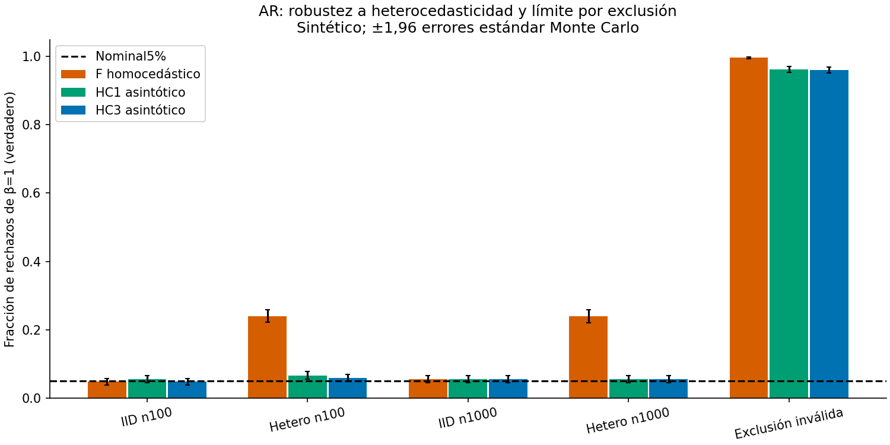

# AR con errores heterocedásticos — ciclo24-10-2026

## 1. Título

Corrección HC1/HC3 del contraste reducido AR y auditoría del cambio de garantía.

## 2. Hipótesis y novedad incremental

La nueva contribución es una extensión reproducible del componente anterior homocedástico: hipótesis previa HC3 en[3%,7%] para n1000 con heterocedasticidad y exclusión válida, y F−HC3≥5pp. HC3 no es invención de este proyecto. Se aporta implementación, contraste pareado, chequeo algebraico independiente, variación de n, falsación y límites. No prioridad mundial ni afirmación de mejora universal.

## 3. Estado del arte verificado

Anderson–Rubin(1949) motiva contraste estructural sin dividir por primera etapa. Staiger–Stock(1997) caracteriza instrumentos locales a cero. White(1980) fundamenta covarianza heterocedasticidad-consistente; MacKinnon–White(1985) estudia correcciones finitas. Andrews–Stock–Sun(2019) revisa IV débil con errores no homocedásticos. Moreira(2003) y Andrews–Stock(2005) delimitan inferencia condicional/potencia fuera del MVP. Siete entradas en referencias.bib.

Verificación web24oct: Annual Reviews/autor, JSTOR/White original, ScienceDirect/MacKinnon–White, Wiley/Moreira y NBER. Se verificaron metadata y alcance de resúmenes; no se afirma lectura completa o búsqueda exhaustiva. Búsqueda focal por relevancia, no revisión sistemática de todos los repositorios.

## 4. Brecha real del repositorio

Main53642e2 revisado; cero PR abiertos al inicio. `weak-iv-inference-audit` del ciclo anterior solo garantiza F exacto con errores gaussianos homocedásticos. Su informe identifica heterocedasticidad como brecha. Nuevo sibling conserva intacto el componente original; no altera contratos compartidos. `src/baseline.py` copia únicamente validación/F del componente anterior, con misma fórmula, para un MVP autocontenido.

## 5. Diseño/configuración

z,v,e IID N(0,1), x=cz/√n+v, y=x+u+γz. En control IID u=0,8v+0,6e; heterocedástico u=√[(0,1+z²)/1,1](0,8v+0,6e). E[u|z]=0 y varianza incondicional normalizada1, pero E[z²u²] cambia. γ=0 garantiza exclusión impuesta; γ=0,2 añade efecto directo que la viola. c=1, β=β0=1, α=5%, n∈{100,1000}, 2.000 réplicas por escenario, seeds20261024…20263023. Los tres métodos usan mismos vectores; n/escenarios comparten semillas y no son experimentos independientes.

Datos enteramente sintéticos generados localmente, sin clientes o licencias externas; configuración y10.000 filas de p-valores/seeds/decisiones guardadas. Hash datos/fuente, versiones y CPU en summary.json. No se infiere causalidad observacional a partir de DGP impuesto.

## 6. Implementación y cambio de garantía

Centrar variables; r=y−β0x. S=Σzc², b̂=Σzc·rc/S, ê=rc−b̂zc, h=1/n+zc²/S. VHC1=[n/(n−2)]Σzc²ê²/S²; VHC3=Σzc²ê²/(1−h)²/S². Q=b̂²/V se calibra con χ²1 asintótico. Bajo nula, r=u cuando γ=0: la primera etapa desaparece del contraste, por lo que c puede ser cero. La validez requiere LLN/CLT, momentos y diseño regular, independencia y exclusión; no exactitud finita, no cobertura uniforme probada por Monte Carlo. Un leverage≈1 produce error explícito; residuo degenerado tratado explícitamente.

Baseline calcula SSR=(z′r)²/(z′z), F=SSR/[SSE/(n−2)], p F(1,n−2). Exactitud condicional solo IID gaussiano homocedástico. No ajustar distribución F a HC3 y llamarlo exacto. API tipada; tipos mypy en src con dependencias sin stubs ignoradas.

## 7. Tests/benchmarks y ejecución

Resultado ejecutado:8/8 tests pasan; cobertura de líneas de los dos núcleos100%(61/61), no de todo el repo. Ruff sin hallazgos, mypy sin errores en4archivos src; suite común8/8. Notebook4celdas ejecutadas con PNG persistido y figura inspeccionada legible. No se inspeccionó un frontend completo de Jupyter.

Tests comparan HC1/HC3 con fórmula matricial sandwich independiente, invariancias traslación/escala con30 semillas, irrelevancia/fuerza c=0/10 con misma nula, contratos/NaN/rango/leverage, residuos degenerados y smoke Monte Carlo. Son propiedades determinísticas parametrizadas, no se llama suite Hypothesis. Ruff/mypy y coverage reales se registran en results/verification.log. No código C/C++: ctest/sanitizers no aplican al componente.

Coste por brazo en benchmarks/costs.py:100 evaluaciones por test con mismos datos n100/1000/10000, sin generación; tiempos instrumentados y pico asignaciones Python, no RSS ni coste operacional. Fórmulas O(n), benchmark limitado, no extrapolar latencia de servidor o escalabilidad de plataforma. Suite común económica también ejecutada en este ciclo, resultado en results/common-suite.log; no se mide su cobertura.

## 8. Resultados reales

| Escenario | F | HC1 | HC3 |
|---|---:|---:|---:|
| IID n100 |4,80%|5,55%|4,75%|
| Hetero n100 |24,00%|6,65%|5,90%|
| IID n1000 |5,50%|5,55%|5,55%|
| Hetero n1000 |23,90%|5,55%|5,55%|
| Exclusión inválida |99,65%|96,25%|96,05%|

Hipótesis se satisface en esta corrida. A n1000 hetero diferenciaHC3−F=−18,35pp, SEpareado0,866pp, banda MCnormal descriptiva aproximadamente[−20,05;−16,65]pp. Los SE marginales y pareados constan en JSON; figura usa ±1,96SE entre réplicas, no IC de efecto real.

## 9. Análisis crítico y falsaciones

HC1 como ablation: a n100 hetero rechaza6,65% frente a5,90% HC3; no prueba dominancia de HC3. n1000 ambas coinciden5,55%. En control homocedástico n100 F4,80% yHC3 4,75%: no hay mejora sustancial y F conserva garantía exacta en ese DGP. Aumentar n no corrige F heterocedástico(24,00%→23,90%), porque varianza mal especificada no es solo problema de muestra pequeña. Exclusión inválida:HC3 96,05% de rechazos aunque β verdadero=1; no es potencia, ni prueba que instrumento sea inválido en muestra identificada exactamente. Refuta inferencia de causalidad por usar un SE robusto.

## 10. Límites/ética/madurez

S2 local, sin promoción del programa ni equivalencia automática M2. Solo un instrumento y regresor, sin controles, IID gaussiano condicional, dos tamaños y una función de varianza. No HAC/cluster, dependencia temporal, colas extremas, muchos instrumentos, potencia, intervalos invertidos o datos reales. No producción, consejo de política o certificación causal. El umbral[3,7]% es criterio Monte Carlo explícito, no teorema de tamaño. No datos personales; el principal riesgo es sobregeneralizar simulación.

## 11. Cómo correr

`bash run.sh` desde esta carpeta. Python3.11+, venv y acceso PyPI; versiones directas fijadas, no lock transitivo por hash. Notebook se genera desde resultados y ejecuta secuencialmente en IPython limpio en proceso, sin kernel/socket por restricciones del entorno. Outputs ricos persistidos; cualquier error aborta. Validación estructural nbformat y revisión visual de figura, no prueba de todos los frontends Jupyter.

## 12. Referencias BibTeX

`referencias.bib` incluye7 referencias reales con DOI/URL; White y MacKinnon–White añadidas a las cinco verificadas del ciclo previo. Se contrastaron nuevamente los enlaces pertinentes en búsqueda24oct; no citas ni resultados fabricados.

## 13. Rúbrica de autor1–5

|Novedad|Rigor|Reproducibilidad|Código|Claridad|Impacto|Honestidad|MVP|
|---:|---:|---:|---:|---:|---:|---:|---:|
|2|4|4|4|4|3|5|4|

Autoevaluación; revisión independiente pendiente hasta el informe del revisor, sin simular aprobación.

## 14. Siguiente iteración recomendada

1. `04-econometrics/05-instrumental-variables/heteroskedastic-ar-audit`: incluir leverage extremo y colas pesadas como stress de calibración finita.
2. `04-econometrics/05-instrumental-variables`: HAC/cluster con DGP dependiente y baseline apropiado.
3. `04-econometrics/05-instrumental-variables`: invertir test preservando conjuntos vacíos/no acotados/desconectados y comparar potencia.
