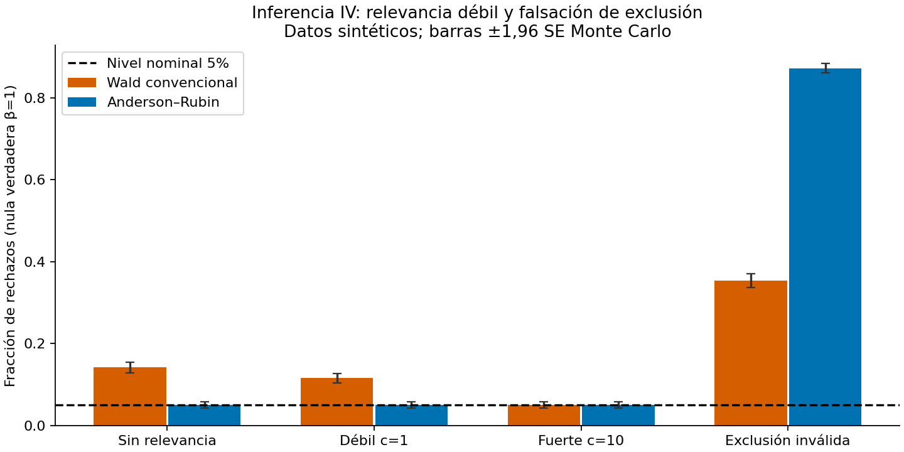

# Auditoría de inferencia IV débil: Anderson–Rubin frente a Wald

¿Podemos conservar el tamaño nominal cuando el instrumento apenas identifica el efecto causal? Este componente amplía el laboratorio vecino, que ya mostraba inestabilidad del estimador IV, con una comparación **pareada de inferencia** y una falsación de exclusión.

**S2, prototipo sintético local** según `RESEARCH_STANDARDS.md`; no eleva la madurez de la carpeta o programa completo. AR es un método clásico: la contribución incremental al repositorio es su implementación verificable, contraste, incertidumbre Monte Carlo y contraejemplo a interpretar “robusto a debilidad” como “robusto a invalidez”.

## Reproducir

Desde esta carpeta, con Python 3.11 o superior, acceso a PyPI y venv disponible:

```bash
bash run.sh
```

Instala dependencias fijadas en un venv local, corre tests, lint, comprobación de tipos de `src`, experimento, benchmark y notebook. `PYTHON` permite seleccionar intérprete. No requiere datos externos ni credenciales. Si ya existe un entorno equivalente, `python -m src.run` ejecuta solo el experimento.

## Evidencia ejecutada

3.000 réplicas por escenario, n=250, nivel 5%, β verdadero=β nulo=1, Corr(u,v)=0,8. Datos normales independientes entre observaciones; x=c/√n·z+v. La comparación usa idénticos shocks por réplica.

| Escenario | Wald | AR |
|---|---:|---:|
| c=0, exclusión válida | 14,17% | 4,97% |
| c=1, exclusión válida | 11,60% | 4,97% |
| c=10, exclusión válida | 4,97% | 4,97% |
| c=1, efecto directo γ=0,2 | 35,33% | 87,27% |

La última fila es **fallo del supuesto de exclusión**, no ganancia de potencia: β verdadero sigue siendo 1, pero el momento IV es inválido. No es un test de validez del instrumento con identificación exacta.



Ver `informe.md`, `results/replications.csv`, `results/summary.json`, `results/costs.csv`, `notebook.ipynb` y `referencias.bib`. El código prueba p-valores puntuales; **no calcula intervalos de confianza** ni trunca conjuntos AR no acotados. No cubre heteroscedasticidad, series correlacionadas, clustering, varios instrumentos, poder bajo alternativas ni calibración con datos reales.
