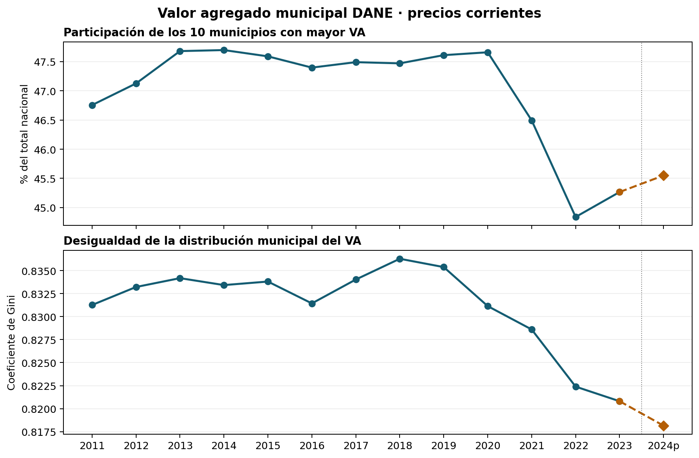

# Aplicación observada: concentración municipal del valor agregado

## Resultado

Entre 2011 y 2023, la participación conjunta de los diez municipios con mayor valor agregado cayó de 46.76% a 45.27% del total nacional (-1.49 puntos porcentuales). El Gini municipal del valor agregado pasó de 0.8313 a 0.8208 (-0.0105). La distribución sigue muy concentrada: en 2023 los diez mayores municipios reúnen 45.3% del total.

El dato 2024p se conserva como referencia provisional: top 10 = 45.55%; Gini = 0.8181. No se incluye como cierre del cambio 2011–2023.



## Método y grano

Se usan los 1.123 códigos DIVIPOLA de cinco dígitos del Cuadro 1, una fila por municipio/unidad territorial publicada, con valor agregado total anual. El corte incluye Nuevo Belén de Bajirá (código 27493) en años previos a su creación con valor cero, según la nota del propio cuadro; también mantiene los ceros reportados para Mapiripana (94663) desde 2020. El Gini se calcula sobre la distribución de niveles, incluidos los ceros reportados: `G = 2 Σ(i·x_(i)) / (n Σx) − (n+1)/n`, con `x` ordenado de menor a mayor. La participación top 10 es la suma de los diez valores municipales mayores dividida por la suma nacional. No se prorratea ni se interpolan observaciones.

El archivo reporta precios corrientes en miles de millones de pesos; por ello las métricas son participaciones/dispersiones dentro de cada año. No deben interpretarse como crecimiento real ni bienestar per cápita. Los ceros que aparecen están preservados y contados como reportados; no se recodifican como datos faltantes.

## Fuente, vintage y reproducción

Fuente primaria: DANE, [Cuentas Nacionales Departamentales](https://www.dane.gov.co/index.php/estadisticas-por-tema/cuentas-nacionales/cuentas-nacionales-departamentales), archivo “Valor agregado por municipio: serie 2011–2024 provisional”, Base 2015. La [ficha metodológica VAM](https://www.dane.gov.co/files/operaciones/PIB/departamental/DSO-VAM-FME-001-V2.pdf) documenta la operación y el tratamiento provisional/definitivo; el [boletín departamental](https://www.dane.gov.co/files/operaciones/PIB/bol-PIBDep-2023p.pdf) presenta el agregado municipal como una desagregación territorial anual de cuentas departamentales. El dato crudo se lee desde el archivo canónico de Drive indicado al runner, sin copiarse al producto. El SHA-256 esperado del manifiesto del Atlas (corte 2026-10-08) es `083bb4b8501db9572867faf7ed71bc5fd9fbd9e269f576dbc1fb2379ade2281d`. La actualización publicada por DANE está fechada 3 de julio de 2026. La fuente se lee sin transformación; este runner solo procesa el Cuadro 1 y genera agregados descriptivos.

Requisitos: Python 3, `openpyxl`, `numpy`, `matplotlib`. El archivo fuente debe estar disponible desde la copia canónica/sincronizada de Drive; no forma parte de este repositorio.

```bash
python3 -m pip install openpyxl numpy matplotlib
python3 observed_application.py --source "/ruta/a/Master_DATOS/ATLAS_ECONOMICO_COLOMBIA/01_RAW/dane_valor_agregado_municipal_2011_2024p.xlsx"
```

Salidas: `reports/municipal_va_concentration.csv`, `reports/figures/municipal_va_concentration.png` y `data/manifest.json`. El runner verifica antes de leer que el hash de `--source` sea el esperado, y valida unicidad del código DIVIPOLA, 1.123 filas, cobertura anual, no negatividad y completitud. La ruta local completa no se escribe en el manifiesto.

## Lectura, decisión admisible y límites

El companion permite dimensionar la concentración de actividad económica municipal y priorizar preguntas territoriales, cortes departamentales o requerimientos de desagregación. La reducción de concentración en la métrica top 10 es descriptiva; su magnitud no identifica convergencia de productividad, reasignación causal ni spillovers geográficos. Los montos nominales también mezclan volumen y precios relativos sectoriales.

Este resultado no estima `ρ` en `y = ρWy + Xβ + ε`. No hay matriz espacial `W` en esta entrega. Antes de una especificación espacial se requiere congelar geometría oficial DIVIPOLA con vintage compatible, verificar correspondencia de códigos y ensayar matrices alternativas (contigüidad y distancia), además de definir controles y estrategia de identificación. La unidad estadística es valor agregado territorial estimado en cuentas departamentales; el uso admisible aquí es monitoreo distributivo y diseño de preguntas, no inferencia causal ni asignación de recursos por sí sola.

El laboratorio sintético y su notebook permanecen intactos: continúan siendo el espacio para estudiar dependencia espacial, endogeneidad y desempeño de estimadores bajo un DGP controlado. La aplicación observada comprueba que el insumo económico tiene grano municipal anual y revela el tipo de concentración que un análisis posterior debe explicar.
