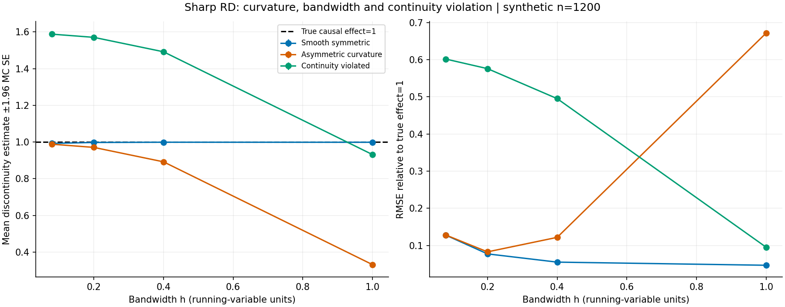

# Auditoría RD: curvatura, localización e identificación

25 de octubre de 2026. Se inspeccionó `main` en `98659cc`; no había PR abiertos al iniciar. Se preservaron las auditorías IV de los ciclos anteriores y los contratos compartidos.

## 1. Título

Estimación sharp RD local lineal: sesgo por curvatura, sensibilidad del ancho de banda y contraejemplo de identificación.

## 2. Innovación, tres ideas y elección

| Idea candidata | Brecha | Aporte posible | Decisión |
|---|---|---|---|
| AR con errores HAC | El MVP del 24 asume independencia | Extender el contraste a dependencia temporal | Diferir: requiere calibración temporal y mantiene el mismo estimando |
| Inversión analítica AR | Los MVP anteriores solo producen p-valores | Conjuntos vacíos, no acotados o desconectados | Diferir: exige un contrato nuevo para representar conjuntos |
| Auditoría RD de curvatura | No se encontró un componente equivalente en la revisión del dominio | Nueva familia de estimandos y falsación de continuidad | **Elegida:** experimento acotado con verdad y sesgo poblacional conocidos |

Local linear RD es un método clásico. La novedad incremental para el repositorio es combinar estimador auditado, comparación pareada que cambia solo la ventana, sesgo analítico y resultados negativos. Se eligió para diversificar métodos económicos, no por prometer superioridad universal.

Hipótesis registrada antes de redactar conclusiones: con curvatura asimétrica de 4 y continuidad válida, RMSE con h=0,2 no supera el 50% del RMSE global h=1. La ventana h=0,08 evalúa varianza; un salto latente de 0,6 falsifica identificación. No se reivindica prioridad mundial.

## 3. Estado del arte verificado

Hahn, Todd y Van der Klaauw (2001) estudian identificación de efectos mediante continuidad. Imbens y Lemieux (2008) presentan especificación y diagnóstico. Lee y Lemieux (NBER, 2009) contextualizan el diseño en economía. Calonico, Cattaneo y Titiunik (2014) desarrollan inferencia robusta al sesgo, **no implementada aquí**. Gelman e Imbens (2019) critican polinomios globales de orden alto; nuestro baseline es de orden uno, de modo que ese artículo no demuestra el resultado particular de este experimento.

Se verificaron títulos, autores, DOI y alcance de resúmenes el 25 de octubre mediante Wiley, ScienceDirect, Taylor & Francis, NBER y copia del autor en Columbia. No se afirma lectura íntegra ni revisión sistemática o exhaustiva. Cinco entradas reales constan en `referencias.bib`.

## 4. Brecha del repositorio

Econometría ya contiene nowcasting vintage, diferencias en diferencias, paneles, IV y otros laboratorios. La búsqueda por discontinuidad, bandwidth y local linear en los README y archivos inspeccionados no encontró este experimento. “No encontrado” describe la revisión realizada, no demuestra inexistencia en toda la historia del repositorio. Se crea `04-econometrics/10-regression-discontinuity/curvature-audit` sin modificar componentes anteriores.

## 5. Diseño y supuestos económicos

Running variable x uniforme en [-1,1], tratamiento T=1[x≥0], efecto verdadero constante τ=1. El potencial sin tratamiento es Y0=0,4x+3x²+κTx²+λT+ε, con ε normal independiente de desviación 0,3. Se observa Y=Y0+T.

Con λ=0, la esperanza de Y0 es continua incluso con curvatura asimétrica κ=4. Con λ=0,6, la continuidad falla pero el efecto del tratamiento sigue siendo uno. Esta discontinuidad adicional es una violación de identificación, no un cambio del efecto causal.

Configuración: n=1200, 1500 réplicas por escenario, semillas 20261025–20262524, h en {1; 0,4; 0,2; 0,08}. Escenarios: curvatura simétrica, asimétrica y continuidad violada. Mismos datos entre ventanas y mismas semillas entre escenarios: las comparaciones son pareadas. El CSV guarda 18.000 estimaciones, semillas y recuentos por lado. Son datos sintéticos locales, sin datos personales o de terceros. Hashes, versiones y hardware se guardan en JSON. No hay evidencia causal empírica de una política real.

## 6. Implementación y cálculo analítico

Kernel uniforme: retener |x−c|≤h. Ajustar Y=a_s+b_s(x−c) por OLS en cada lado; estimar el salto a_+−a_−. El baseline h=1 cubre todo el soporte y utiliza exactamente las mismas pendientes separadas: **solo cambia la ventana**. No se impone al baseline una especificación artificialmente más débil.

La API rechaza valores no finitos, dimensiones incompatibles, ventana inválida, soporte insuficiente y rango numérico degenerado. El mínimo de ocho observaciones por lado es una protección computacional, no un certificado de identificación.

Para x uniforme en [0,h], E[x]=h/2, E[x²]=h²/3 y E[x³]=h³/4. La proyección lineal de qx² tiene pendiente qh e intercepto −qh²/6. Por simetría ocurre igual en [-h,0]. El salto de la proyección poblacional resulta 1+λ−κh²/6. Es una deducción para este DGP cuadrático uniforme, no un teorema universal sobre RD. Un test de malla densa sin ruido comprueba la fórmula numéricamente.

## 7. Tests, costes y ejecución

`bash run.sh` crea un entorno, instala dependencias directas fijadas y ejecuta tests, cobertura, lint, tipos, simulación, costes y notebook. Resultado propio: **7/7 tests**, cobertura de líneas de `src.rd` **37/37**, ruff sin hallazgos y mypy sin errores en tres archivos de `src` (imports sin stubs ignorados). No implica cobertura de todas las condiciones o de todo el repositorio. La suite común solicitada pasa **8/8**, con registro en `results/common-suite.log`; no se midió su cobertura.

Los tests verifican salto lineal exacto, equivalencia con OLS matricial [1,x,T,Tx], invariancias sobre 25 semillas, sesgo poblacional, salto latente, contratos y reproducibilidad. Son propiedades determinísticas parametrizadas; no se presenta una suite Hypothesis inexistente. No hay C/C++, por lo que ctest y sanitizers no aplican.

Benchmark: n de 120, 1200 y 12000; ventanas 1, 0,4 y 0,2; 100 llamadas por brazo, mismos datos y generación excluida. Se mide tiempo instrumentado y memoria Python con tracemalloc, no RSS o memoria BLAS. El microbenchmark usa mínimo de dos puntos por lado, frente a ocho en el experimento; no es evidencia de estabilidad científica. Las operaciones son O(n), pero tres tamaños no prueban rendimiento operacional.

Notebook: ocho celdas de código ejecutadas secuencialmente en IPython limpio en proceso, sin kernel/socket; tablas y PNG persistidos. Errores abortan. Se validó nbformat y se inspeccionó la figura legible sin recortes; no se inspeccionó un frontend completo de Jupyter.

## 8. Resultados reales

| Escenario | RMSE h=1 | RMSE h=0,4 | RMSE h=0,2 | RMSE h=0,08 |
|---|---:|---:|---:|---:|
| Simétrico |0,04688|0,05534|0,07751|0,12808|
| Asimétrico válido |0,67192|0,12197|0,08295|0,12844|
| Continuidad violada |0,09525|0,49527|0,57595|0,60179|

En el escenario elegido, ratio de RMSE=0,123456: reducción del **87,65%**, superior al umbral previo del 50%. Diferencia pareada de MSE h=0,2 menos global: −0,444600, con SE Monte Carlo de 0,002269. Banda normal MC descriptiva aproximada: [−0,44905; −0,44015]. No es un intervalo del efecto causal en una muestra.

Media, sesgo, desviación, cuantiles y errores MC se guardan en JSON. Los cuantiles 2,5–97,5% son cuantiles entre simulaciones, no intervalos inferenciales. Los resultados proceden del código y conservan un ledger crudo con hash.

## 9. Fallos y ablations negativas

Estrechar más no siempre mejora: en el escenario asimétrico, h=0,08 tiene RMSE 0,12844, superior a 0,08295 con h=0,2, por mayor varianza. En el escenario simétrico, h=1 es mejor entre las ventanas auditadas: la curvatura igual a ambos lados cancela sesgo y la muestra mayor reduce varianza. No se propone una ventana óptima general usando la verdad conocida del simulador.

Con continuidad violada, h=0,2 promedia 1,57069 y h=0,08 promedia 1,58804. Se acercan al salto observable 1,6, no al efecto causal uno. Global h=1 promedia 0,93133 y parece mejor por cancelación del sesgo de curvatura −0,6667 y el salto latente +0,6. Su buen RMSE accidental tampoco identifica el efecto. La simulación refuta “localizar resuelve identificación” y muestra por qué precisión numérica no valida un diseño causal.

## 10. Límites, ética y madurez

**S2 local**, según el estándar S0–S4; no se promueve todo el programa ni se equipara S2 con M2. No se implementan inferencia robusta al sesgo, cobertura, selección automática de ventana, fuzzy RD, running discreto, manipulación, clustering, series, efectos heterogéneos o validación con datos reales. Cuatro ventanas y tres DGP no representan todas las aplicaciones. El principal riesgo es confundir un experimento sintético exitoso con identificación observacional. No hay datos sensibles ni producto operacional.

## 11. Cómo correr

Desde esta carpeta: `bash run.sh`. Requiere Python 3.11+, venv y acceso a PyPI. Dependencias directas fijadas; no es un lock transitivo por hash. La variable `PYTHON` permite seleccionar intérprete. La ejecución del notebook en proceso evita sockets de kernels restringidos y conserva orden y outputs; no certifica todos los frontends de Jupyter.

## 12. Referencias BibTeX

Cinco entradas completas en `referencias.bib`: Hahn (2001), Imbens (2008), Lee (NBER 2009), Calonico (2014), Gelman (2019). DOI y URL se verificaron el 25 de octubre. Su alcance y las atribuciones limitadas se explican en §3. No se atribuye inferencia CCT a este código.

## 13. Rúbrica de autor, 1–5

| Novedad | Rigor | Reproducibilidad | Código | Claridad | Impacto | Honestidad | MVP |
|---:|---:|---:|---:|---:|---:|---:|---:|
|2|4|4|4|4|3|5|4|

Autoevaluación; la ausencia de datos reales, inferencia robusta al sesgo y selección de ventana impide puntajes máximos. Revisión independiente del ciclo: el revisor reprodujo `bash run.sh` completo con salida cero y no identificó bloqueantes; esa revisión de agentes no equivale a validación externa empírica.

## 14. Siguiente iteración recomendada

1. `04-econometrics/10-regression-discontinuity/curvature-audit`: agregar comparador rdrobust e inferencia robusta al sesgo, contrastando cobertura en el DGP controlado.
2. `04-econometrics/10-regression-discontinuity`: seleccionar ventana con objetivo predefinido sin usar la verdad desconocida para el analista.
3. `04-econometrics/10-regression-discontinuity`: diseñar falsaciones con covariables previas, manipulación y continuidad; declarar qué no puede verificarse desde Y y X solos.
