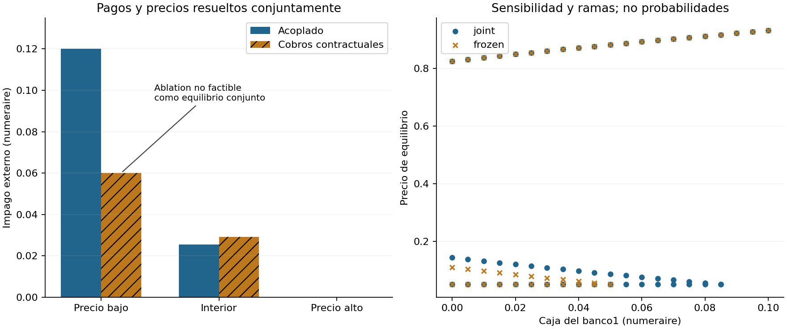

# Coupled Clearing Audit — pagos y liquidación endógena

**Componente S2; Sovereign–Bank Strategic Nexus permanece S2 parcial.**
Un MVP estático pequeño conecta dos componentes que antes estaban separados:
clearing interbancario EN y precio endógeno de un activo. No modela gobierno
estratégico, default soberano, garantías, colateral ni identificación empírica.

## Un comando instala y reproduce

Desde la raíz del repo, Python3.12/Linux x86_64, acceso a PyPI:

```bash
bash 01-economics-and-econometrics/05-macrofinance/01-sovereign-bank-strategic-nexus/coupled-clearing-audit/reproduce.sh
```

Crea `.venv`, instala dependencias fijadas, ejecuta Ruff,mypy estricto,cobertura,
tests propios/comunes y regresiones de los dos MVP anteriores, benchmarks y el
notebook narrativo con outputs. No requiere credenciales ni datos externos.
`requirements.txt` fija dependencias directas; `environment-lock.txt` también
transitivas. Estas son las instrucciones de entorno reproducible; Docker y
Windows no fueron validados. Los tiempos varían entre hosts.

## Pregunta, hipótesis y mecanismo rival

¿Ignorar defaults de contrapartes cambia los precios y pagos de liquidación?
H1:recuperar tres raíces analíticas con error de precio≤1e-10 y residual conjunto≤1e-9.
H2:en la rama baja, congelar cobros contractuales subestima el impago externo
en al menos.05 y viola factibilidad conjunta. No se presenta la ablación
como otro equilibrio. EN a precio fijo sí es un baseline válido **condicionado
al precio**, pero no pretende resolver el mercado.

### Supuestos y derivación

Con \(\bar p_i=\sum_jL_{ij}+o_i\) y \(\Pi_{ij}=L_{ij}/\bar p_i\):

\[
p_i=\min(\bar p_i,c_i+q s_i+(\Pi^Tp)_i),\quad
\gamma_i=\min(s_i,[\bar p_i-c_i-(\Pi^Tp)_i]^+/q),
\quad q=\max(q_{min},q_0-a\sum_i\gamma_i).
\]

Precio uniforme final, ventas mínimas, pasivos nominales fijos y acreedores externos.
Tres estados por banco:default/vende todo;solvente/vende;solvente/sin ventas.
En cada uno de los3^n regímenes, p(q) es afín y la venta agregada es A+B/q.
El precio interior resuelve q²−(q0−aA)q+aB=0 sobre un intervalo racional.
El método enumera las raíces y el piso, auditando el residual de pagos y precio.
Se usa Fraction/Decimal80 con salida float; no intervalos certificados.

**Alcance duro:1–4 bancos**, cada deudor con ancla externa≥1%,inputs≤100,
piso≥1e-6. El tamaño5 se rechaza explícitamente, no se simula escalabilidad.
Existencia del sistema continuo no implica unicidad ni selección de equilibrio.

## Resultados ejecutados, seed20261020

L12=L21=.1, deuda externa(.1,.1), caja(0,.02),stock(1,.2),impacto.8,piso.05.

| Precio acoplado | Bancos en default | Impago externo |
|---:|---:|---:|
| .05 |2|.12|
| .144405323239 |1|.025559467676|
| .825576411922 |0|0|

La ablación de cobros nominales da.06 en la rama baja,pero equity mínimo−.035
y residual conjunto.035:es inconsistente con los cobros realizados.
La rama interior cambia de.109516506075 a.144405323239; la alta coincide
cuando no hay defaults. La identidad contable por sí sola no prueba factibilidad.



## Tests, baselines y evidencia

- **35 métodos de test pasan**:8 propios+8 comunes+10 EN+9 mercado anterior.
- 70 ejemplos Hypothesis nuevos; cobertura propia combinada96%,144/148 statements,
 64 ramas,5 parciales. No es cobertura del repo ni del benchmark externo.
- Ruff y mypy estricto pasan. Regresiones reales contra ambos MVP anteriores.
- 12 mercados sintéticos contrastados con EN anidado del repo y SciPyBrent/malla501:
 error máximo observado2.25e-13. Esta malla no certifica completitud general.
- n2/3/4,3 repeticiones por método,stock y deuda externa agregados constantes;
 tiempo de pared y asignaciones Python, no RSS ni toda la memoria nativa.
- Sensibilidad de caja, tolerancia interna1e-6/1e-9/1e-12 y tangencia negativa.

Además pasan cuatro tests del auditor estático:39 métodos en el comando completo.
Su reporte de47 proyectos conserva75 avisos medios y2 bajos históricos; no es
peer review ni una aprobación científica del modelo.

Código tipado en `src/coupled.py`; tests en `tests/`; scripts en `benchmarks/`;
ocho CSV,config/metadataJSON,figura y logs en `results/`;
[notebook.ipynb](notebook.ipynb) ejecutado con derivación,contraejemplo y gráficos
editables. El informe y el registro de búsqueda declaran límites y bloqueos.

## Límites y referencias

No se atribuye novedad teórica a EN ni a la liquidación mínima de Feinstein.
Ver `referencias.bib`(seis fuentes primarias reales),`informe.md` y `MVP.md`.
El piso es liquidez externa supuesta, no rescate óptimo. Las pérdidas marcadas
no son bienestar; el activo común no es deuda soberana empíricamente calibrada.
No se han estimado probabilidades de selección,causalidad ni dinámica económica.
