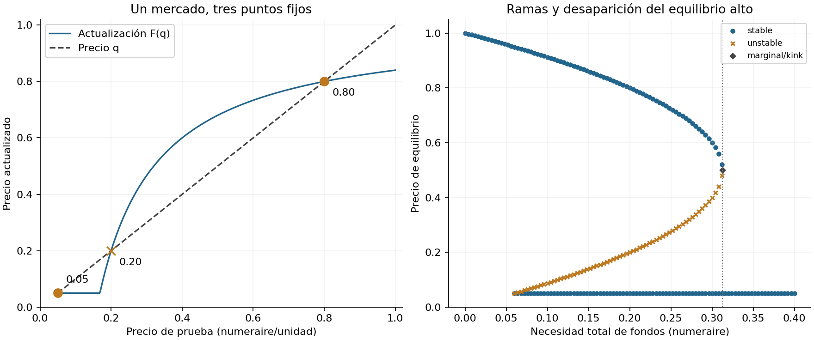

# Fire-Sale Price Audit — censo de precios, no solo convergencia

**Componente S2; programa Sovereign–Bank Strategic Nexus S2 parcial.**
Una extensión sintética del clearing a precio fijo: un activo compartido,
liquidación mínima y enumeración algebraica por regímenes. No implementa todavía
una red interbancaria con precios endógenos simultáneos ni un gobierno estratégico.

## Reproducción con un único comando

Desde la raíz de Portafolio, con Python **3.12**, Linux x86_64 y acceso a PyPI:

```bash
bash 01-economics-and-econometrics/05-macrofinance/01-sovereign-bank-strategic-nexus/fire-sale-price-audit/reproduce.sh
```

El comando crea `.venv`, instala el lock de dependencias, ejecuta Ruff, mypy,
coverage+unittest, la suite común, los tests del componente anterior, benchmarks
y el notebook narrativo con outputs reales. No necesita credenciales ni datos
externos. `requirements.txt` fija dependencias directas; `environment-lock.txt`
fija también transitivas. El lock describe la ejecución Python3.12 en Linux;
no se afirma portabilidad ya verificada a Windows u otras versiones.
No se validó Docker: estas son las instrucciones de entorno reproducible.

## Pregunta e hipótesis falsables

¿Una solución desde el precio fundamental oculta otros equilibrios de liquidez?
H1: fixture c=(0,0), D=(.1,.1), s=(1,1), impacto=.8, q0=1,piso=.05:
exactamente tres precios {.05,.2,.8} con error≤1e-10; Picard superior omite2/3.
H2: D=(.15625,.15625) produce una raíz tangente .5 recuperada por enumeración.
Controles negativos: impacto0 o caja suficiente ⇒ solo precio1.
Son umbrales de verificación de este modelo, no una prueba estadística empírica.

## Modelo mínimo

\[
d_i=(D_i-c_i)^+,\qquad \gamma_i(q)=\min(s_i,d_i/q),\qquad
q=\max(q_{min},q_0-a\sum_i\gamma_i(q)).
\]

En cada régimen de bancos saturados S, las raíces interiores satisfacen
\(q^2-(q_0-a\sum_{S}s_i)q+a\sum_{i\notin S}d_i=0\).
`src/market.py` evalúa los regímenes con coeficientes racionales, raíces
Decimal64 y resultados float; añade el piso y elimina duplicados. No es una
prueba formal de cálculo en intervalos; rechaza raíces distintas demasiado
próximas (<1e-10). Ver derivación, pendientes laterales y contabilidad en
[notebook.ipynb](notebook.ipynb), ejecutado con seis celdas de código.

## Resultados ejecutados

| Precio | Ventas totales | Impago externo | Estabilidad de Picard |
|---:|---:|---:|---|
| .05 | 2 | .1 | estable |
| .20 | 1 | 0 | inestable |
| .80 | .25 | 0 | estable |

La malla+Brent101 sí recupera las tres raíces del fixture: no se oculta este
resultado favorable al baseline. En el pliegue tanto malla101 como1001 omiten
la raíz doble; cerca de él ambas omiten dos raíces. Ni una iteración ni una
discretización finita acreditan unicidad. El precio fijo1 no satisface F(q)=q
en este fixture (residual.16); sí es un contrafactual económico declarado.



## Evidencia y estructura

- `src/market.py`: mercado tipado, ventas, enumeración, Picard y balance.
- `tests/`:9 métodos de test,120 ejemplos Hypothesis, tangencia, quiebres,
  caja suficiente, nulos, datos inválidos y presupuesto de iteración.
- `benchmarks/run.py`:40 mercados contrastados con malla4001+SciPy Brent;
  barrido, ablations y n=8/32/128 con3 repeticiones por método.
- `results/`:7 CSV crudos, config/metadataJSON, figura, logs y cobertura.
- `benchmarks/notebook.py`:autoría y ejecución real IPython, stdout e imágenes.
- `referencias.bib`, `informe.md`, `MVP.md`:fuentes, crítica y alcance.

27 métodos de test pasan:9 nuevos+8 comunes+10 del clearing anterior.
Cobertura propia medida96% combinada statements/branches;111/114 statements
ejecutadas. No es cobertura de todo el repositorio. Ruff y mypy `src/` pasan.
Los tests anteriores añaden60 ejemplos generados; no son tests nuevos.

Se contrasta con EN del repo **solo en la reducción sin aristas**, a cuatro
precios exógenos; diferencia de pagos máxima8.33e-17. No se atribuye a EN un
solver de precios que nunca prometió. OLS/ECL del núcleo no resuelven este
problema: no se inventa una comparación de precisión no comparable.

## Lectura económica y límites

El piso positivo es una oferta de liquidez externa postulada, no gratuita ni
calibrada. No hay identificación, datos bancarios, predicción de crisis,
colateral, préstamos, optimización de ventas, efectos fiscales ni bienestar.
La pérdida marcada incluye transferencias a compradores externos; no equivale
a pérdida social. La estabilidad reportada es de la iteración, no de la economía.
La novedad es incremental dentro del repo, no prioridad frente a la literatura.
