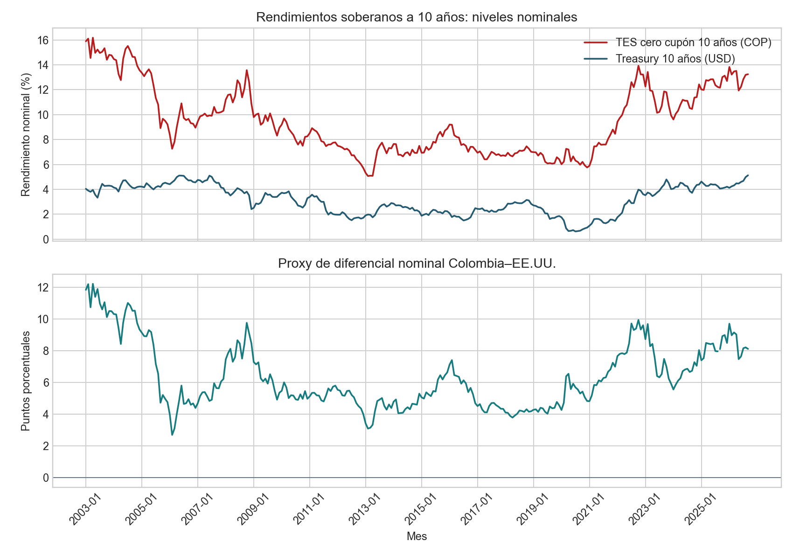

# Diferencial nominal TES–Treasury: proxy comparativo

## Qué aproxima

El rendimiento de deuda soberana en moneda local incorpora compensaciones por inflación, duración, liquidez, riesgo cambiario y riesgo crediticio. Para hacer observable una parte de esas condiciones, se calcula el **proxy de diferencial nominal a 10 años**:

`TES cero cupón colombiano a 10 años (COP) − Treasury estadounidense a 10 años (USD)`.

La unidad es puntos porcentuales. La serie TES de BanRep es una curva estimada con metodología Nelson–Siegel a partir de operaciones de mercados locales SEN/MEC; Treasury `DGS10` es el rendimiento de referencia estadounidense a vencimiento constante de 10 años. El TES mensual se empareja con la media de días hábiles del Treasury en cada mes.

## Evidencia reproducible

La muestra común contiene 285 meses de enero de 2003 a octubre de 2026. El extracto de BanRep no contiene septiembre de 2025; no se interpola. El diferencial medio es 6,34 pp, el mínimo 2,69 pp, el máximo 12,22 pp y el último valor (octubre de 2026) 8,12 pp.

## Supuestos, sesgos y uso admisible

El diferencial intenta resumir condiciones nominales de financiamiento colombiano frente a un benchmark líquido en dólares. Para interpretarlo comparativamente se asume que ambas curvas aproximan vencimientos de diez años y que la diferencia temporal está correctamente emparejada.

El proxy no separa default risk de inflación esperada ni de devaluación esperada. Al contrastar COP y USD sin cobertura cambiaria, la compensación por depreciación y las diferencias de regímenes monetarios pueden elevar o reducir el diferencial aun si el riesgo de incumplimiento no cambia. Las curvas también difieren en liquidez, profundidad de mercado, convenciones y primas por plazo. Por ello el sesgo respecto a una prima de crédito pura puede ir en ambas direcciones; el diferencial puede sobrestimar o subestimar ese riesgo según el periodo.

Usos admisibles: monitoreo descriptivo de condiciones de financiación nominal relativas y escenarios de sensibilidad que llamen explícitamente a la variable “proxy”. No es un spread CDS/EMBI, una probabilidad de default, una pérdida esperada, una valoración de bono ni una señal de inversión. El companion no estima la relación causal entre deuda pública y primas.

## Decisiones y límites

| Decisión | Alternativa | Consecuencia |
|---|---|---|
| Usar TES en COP menos Treasury en USD | Llamarlo prima soberana pura | Produce un indicador transparente y replicable, pero mezcla crédito, moneda, inflación, política monetaria y liquidez. |
| Emparejar rendimientos mensuales | Comparar vencimientos distintos o cotizaciones de un solo día | Reduce desalineamiento diario; suaviza volatilidad y puede ocultar saltos intramensuales. |
| Omitir septiembre de 2025 | Rellenar el dato TES faltante | Mantiene la observación y señala explícitamente la brecha de origen. |

El tramo comienza en 2003 por la disponibilidad capturada del TES a 10 años. Se conserva el XML completo del flujo TES, el CSV diario Treasury, sus hashes, controles y transformaciones en [la tarjeta de datos](../data/README.md). No hay una serie oficial colombiana comparable en la misma moneda ni un indicador directo CDS/EMBI incluido aquí.
