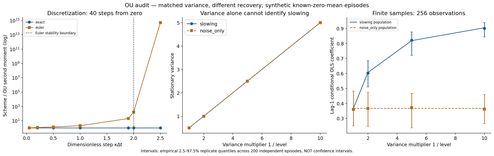

# Informe crítico — 2026-10-17

## Tema y pregunta
¿Puede el aumento de ruido imitar la señal de varianza de una pérdida de recuperación y puede Euler distorsionar estos indicadores OU?

## Brecha y alcance S2
El programa 01 solo tenía protocolo S1. Ahora tiene una auditoría OU ejecutable; NO se valida el detector no lineal completo descrito en el protocolo original. La revisión encontró métodos y advertencias conocidos; la novedad es integración verificable en el portafolio, no un algoritmo nuevo. No es una revisión sistemática ni exhaustiva.

## Hipótesis falsable y umbrales fijados en config.json
Transición exacta versus exponencial matricial independiente: error escalado ≤1e-12. Emparejamiento de varianzas poblacionales: error ≤1e-12. Error Monte Carlo del segundo momento exacto: |z|≤6 usando SE gaussiano conocido. Euler en κΔt=1: sesgo relativo ≥0.99. Separación poblacional de φ al nivel 0.1: ≥0.5. No se modificaron los umbrales tras ejecutar. El criterio z es una comprobación de ejecución, no una prueba de calibración general.

```json
{
  "checks": {
    "max_transition_scaled_error": 1.4210854715202004e-14,
    "max_variance_match_error": 3.552713678800501e-15,
    "max_exact_mc_z": 2.473310511441326,
    "min_euler_relative_bias_at_dt1": 1.0,
    "min_ac1_population_separation_at_kappa01": 0.5369579768645172
  },
  "passed": {
    "max_transition_scaled_error": true,
    "max_variance_match_error": true,
    "max_exact_mc_z": true,
    "min_euler_relative_bias_at_dt1": true,
    "min_ac1_population_separation_at_kappa01": true
  }
}
```

## Formalización y supuestos
Para κ>0 y ruido blanco aditivo, la solución lineal existe y su transición es X(t+h)=exp(-κh)X(t)+ε, con ε gaussiano independiente de varianza σ²(1-exp(-2κh))/(2κ). La varianza estacionaria es σ²/(2κ). Euler induce AR(1) con a=1-κh y q=σ²h: si 0<κh<2, V_E=σ²/[κ(2-κh)] y V_E/V_OU=1/(1-κh/2). La recurrencia V(n+1)=a²V(n)+q permite evaluar también casos sin estacionariedad. El test de semigrupo y el oráculo matricial validan la implementación, no sustituyen una demostración formal en aritmética exacta.

### Contraejemplo de identificación
A: κ=level, σ=1. B: κ=1, σ=sqrt(1/level). Ambos tienen V=1/(2 level), pero sus correlaciones son exp(-level*h) y exp(-h). Por tanto, el indicador poblacional V no identifica κ sin controlar σ. Esto NO significa que la distribución conjunta temporal sea idéntica: la información serial sí distingue los dos modelos OU especificados. Son episodios estacionarios con 200 réplicas independientes dentro de cada celda y Gaussianas emparejadas entre mecanismos, no una trayectoria con bifurcación o cambio continuo.

## Diseño y evidencia
84 corridas temporizadas, 3,200 episodios estacionarios y 20 comparaciones con exponencial matricial. Configuración, semillas y versiones guardadas; mismos pasos, h, número de trayectorias e innovaciones normales para ambos esquemas. El horizonte 40h varía entre h, no entre métodos del mismo escenario. X0=0 en discretización; X0 estacionario en identificación, sin burn-in. No selección por colapso. El baseline Euler fino h=0.05 está incluido; las inestabilidades de h≥2 son estrés deliberado, no una comparación de precisión a presupuesto equivalente.

## Resultados estadísticos al nivel 0.1
| Mecanismo | Longitud | Mediana segundo momento | Mediana phi | Mediana kappa válida | Tasas indefinidas |
|---|---:|---:|---:|---:|---:|
| slowing | 256 | 4.870851 | 0.900712 | 0.104569 | 0 |
| slowing | 2048 | 4.881708 | 0.903054 | 0.101973 | 0 |
| noise_only | 256 | 4.972191 | 0.362242 | 1.015442 | 0 |
| noise_only | 2048 | 5.007256 | 0.366284 | 1.004346 | 0 |

Tasas logarítmicas indefinidas totales: **0** de 3200. Se guardan como campo vacío y se cuentan; las medianas de kappa son solo de tasas válidas. No se recortan coeficientes a [0,1]. El segundo momento usa media cero conocida; no se interpreta como varianza muestral insesgada con media estimada.

## Tiempo, memoria y escalabilidad
Medianas sobre tres semillas, 40 pasos. Memoria: pico rastreado por tracemalloc, NO RSS total; medición separada de tiempo. Orden fijo exacto→Euler y sin warm-up, por lo que NO se reclama superioridad universal de velocidad.

| h | Trayectorias | Método | Tiempo mediano ms | Pico rastreado mediano bytes | Error relativo esperado vs OU |
|---|---:|---|---:|---:|---:|
| 0.05 | 1000 | exact | 1.295 | 1026256 | 0 |
| 0.05 | 1000 | euler | 0.932 | 1026256 | 0.0275219 |
| 0.05 | 10000 | exact | 12.883 | 10251256 | 0 |
| 0.05 | 10000 | euler | 11.844 | 10251256 | 0.0275219 |
| 1.0 | 1000 | exact | 1.013 | 1026256 | 0 |
| 1.0 | 1000 | euler | 0.952 | 1026256 | 1 |
| 1.0 | 10000 | exact | 11.982 | 10251256 | 0 |
| 1.0 | 10000 | euler | 11.818 | 10251256 | 1 |
| 2.5 | 1000 | exact | 1.059 | 1026256 | -2.88658e-14 |
| 2.5 | 1000 | euler | 0.937 | 1026256 | 4.89058e+14 |
| 2.5 | 10000 | exact | 11.771 | 10251256 | -2.88658e-14 |
| 2.5 | 10000 | euler | 11.692 | 10251256 | 4.89058e+14 |



## Qué funcionó, qué no y por qué
El generador exacto evita el sesgo de discretización de momentos OU. No elimina variabilidad Monte Carlo ni sesgo de estimación finita. La varianza falla como identificador aislado por construcción algebraica; la correlación funciona bajo estos supuestos y muestra dispersión entre réplicas. Euler con κh=1 duplica la varianza estacionaria y con κh≥2 carece de ley estacionaria aunque la EDE continua sea estable. Esos casos negativos permanecen en el CSV. No se descartan trayectorias ni escenarios que contradigan una narrativa de mejora. La aproximación Euler es razonable para pasos pequeños; aquí se muestra también ese control.

## Limitaciones y riesgos
Modelo lineal gaussiano escalar, media conocida, observación regular sin error y parámetros constantes dentro de cada episodio. No hay transición crítica simulada: κ permanece positivo. Correlación de ruido, cambio de media, estacionalidad y errores de observación pueden volver insuficiente el diagnóstico serial; no se evaluaron. No hay umbrales de alarma aprendidos, ROC, anticipación, CUSUM ni ajuste fuera de muestra: no se afirma mejora predictiva. Soporte float64 acotado explícitamente en src/ou.py. El oráculo Van Loan tiene dominio más pequeño para evitar desbordamiento de la exponencial por bloques. Dependencias directas fijadas, sin lock transitivo. No se valida provisión, capital, IFRS9 ni decisiones crediticias.

## Tests y calidad
Comando: make run (incluye Ruff, mypy y pytest). benchmarks/tests.txt y coverage.json registran tests y cobertura de src/ou.py y src/reference.py, no de toda la aplicación. Hypothesis prueba semigrupo e identidad estacionaria con ejemplos deterministas; los casos límite incluyen ruido cero, paso pequeño, inestabilidad y tasas estimadas indefinidas. El notebook se ejecuta realmente con IPython en proceso y conserva cuatro celdas de código con salidas. La primera ejecución nbclient falló por sockets locales restringidos; no se simula como exitosa. La opción --kernel usa nbclient en entornos convencionales; CI Notebook Reliability lo ejecuta por separado.

## Referencias y revisión
Se verificaron registros primarios de Uhlenbeck–Ornstein (1930), Higham (2001), Van Loan (1978), Scheffer et al. (2009), Dakos et al. (2012) y Boettiger–Hastings (2012). Ver referencias.bib y fuentes.md. La advertencia sobre sesgo de selección motiva no condicionar por colapso; no se replica ese artículo completo.

## Rúbrica (1–5)
Novedad 2; rigor 4; reproducibilidad 4; código 4; claridad 4; impacto potencial 3; honestidad 5; MVP ejecutable 5. Son valoraciones propias, no certificación externa.

## Siguiente iteración recomendada
1. advanced-research: añadir ruido de observación y forzamiento coloreado.
2. advanced-research: comparar contra CUSUM y un baseline de tendencia con falsas alarmas calibradas en réplicas independientes.
3. quantitative-methods: añadir discretización exacta multivariante y comparación a presupuesto temporal equivalente.
