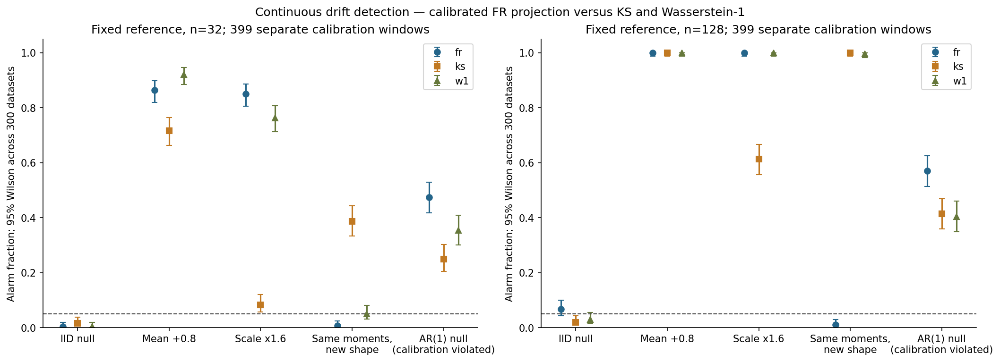

# Geometría de información para detección de cambios — revisión 2026-10-21

## Alineación y pregunta del programa
¿Cuándo un detector Fisher–Rao basado en proyección gaussiana distingue cambios de media/escala y
cuándo pierde cambios de forma frente a KS y Wasserstein-1?
La entrega anterior solo auditaba equivalencias categóricas. Era un componente numérico útil,
pero no cerraba esta pregunta de detección continua. Se conserva como regresión y anexo
docs/categorical-audit.md. Este informe, drift_notebook.ipynb y src/drift.py son ahora el hilo principal.

## Modelo implementado y supuestos
Se estima cada ventana con N(mu,sigma²) usando media y desviación MLE (ddof=0).
Se compara en la variedad normal, con métrica ds²=(dmu²+2 dsigma²)/sigma².
La distancia exacta es sqrt(2)*acosh(1+z), con
z=((mu1-mu2)²+2(sigma1-sigma2)²)/(4 sigma1 sigma2).
Se evalúa como 2sqrt(2)*asinh(sqrt(z/2)) para evitar cancelación cerca de igualdad.
Esta fórmula conocida coincide con Miyamoto et al., sección 4.4.1; no es un algoritmo nuevo.
El oráculo usa acosh a 80 dígitos y los tests verifican simetría, identidad e invariancia afín.

El nombre correcto es FR entre PROYECCIONES gaussianas. Si P y Q no son normales,
la distancia calculada no es la distancia Fisher–Rao entre sus leyes originales.
Por ejemplo, N(0,1) y la mezcla equiprobable N(-.95,1-.95²)/N(.95,1-.95²)
tienen ambos media cero y varianza uno: las proyecciones coinciden, aunque las leyes no.
Con muestras finitas el score puede diferir por variación de los estimadores.

## Detector y calibración implementados
API: calibrate(reference, independent_baseline_windows, alpha=.05, delta=.05);
Detector.predict(current) retorna tres scores y tres decisiones independientes.
Una ventana de referencia se fija por tamaño, separada de las 399 ventanas de calibración.
Los tres métodos usan las MISMAS ventanas: FR, KS y W1 dividido por la desviación de referencia.
Se calibra la ESTADÍSTICA KS; no se interpreta el p-valor asintótico que SciPy también calcula.

Para controlar la incertidumbre de calibración se usa un límite de tolerancia no paramétrico.
Con B scores IID del nulo y p=1-alpha, se toma
k=1+Q_Binomial(B,p)(1-delta/3); el umbral es el k-ésimo score ordenado.
Si k>B, el umbral es infinito y no se dispara una alarma.
Se rechaza solo con score > umbral; los empates son conservadores.
La razón: la probabilidad de que S_(k) quede por debajo del cuantil p es
P(Binomial(B,p)>=k)<=delta/3. Unión de los tres métodos da probabilidad de fallo <=delta.
No requiere independencia entre métodos.

**Alcance exacto:** con probabilidad al menos 1-delta sobre la calibración, cada detector tiene
probabilidad condicional de falsa alarma por nueva ventana <=alpha, bajo la misma ley de
ventanas limpias e independientes y referencia fija. No garantiza que en 300 ensayos la tasa
observada sea <=.05; tampoco controla la unión de alarmas de los tres métodos ni un horizonte
secuencial infinito. Si se desea una alarma conjunta, hay que recalibrar la regla combinada.
NIST documenta límites de tolerancia; la implementación binomial específica se deriva aquí y se testea.

## Diseño e hipótesis
experiments/drift.json fija n=32/128, 399 ventanas limpias de calibración y 300 datasets de evaluación
por escenario/tamaño (3.000 ventanas de evaluación; 9.000 decisiones).
Media desplazada .8; escala 1.6; mezcla de iguales momentos; nulo IID; nulo AR(1) estacionario phi=.8.
Referencia y calibración se generan con seed=20261021+n.
Cada evaluación usa una semilla distinta guardada en CSV; ninguna evaluación entra en el umbral.
La mezcla y AR1 son controles negativos esenciales, no se borran de las conclusiones.
El AR1 conserva marginales N(0,1) pero viola la ley IID de ventanas de calibración.

Hipótesis de potencia acotada: FR >=.60 para los desplazamientos de media y escala especificados
a n=128; error absoluto del oráculo <=1e-10. No se plantea superioridad universal.
Los tamaños de cambio son relativamente grandes: 100% observado no implica sensibilidad a drift pequeño.
Una sola referencia y calibración por n: Wilson cuantifica evaluación condicionada a esa calibración,
no variación entre múltiples referencias o conjuntos de calibración.
Es una revisión exploratoria motivada por problemas de alineación; no un estudio confirmatorio independiente.

## Resultado con n=128
Tasas sobre 300 datasets; corchetes Wilson 95% (no simultáneos).

| Escenario | FR proyectado | KS calibrado | W1 calibrado |
|---|---:|---:|---:|
| null | 6.67% [4.36, 10.07] | 2.00% [0.92, 4.29] | 3.00% [1.59, 5.60] |
| mean_shift | 100.00% [98.74, 100.00] | 100.00% [98.74, 100.00] | 100.00% [98.74, 100.00] |
| scale_shift | 100.00% [98.74, 100.00] | 61.33% [55.71, 66.67] | 100.00% [98.74, 100.00] |
| matched_mixture | 1.00% [0.34, 2.90] | 100.00% [98.74, 100.00] | 99.67% [98.14, 99.94] |
| correlated_null | 57.00% [51.34, 62.48] | 41.33% [35.90, 46.98] | 40.33% [34.94, 45.97] |

```json
{
  "oracle_error": 8.881784197001252e-16,
  "mean_power_n128": 1.0,
  "scale_power_n128": 1.0
}
```

### Resultado negativo de calibración conservado
El piloto con rango marginal ceil((B+1)(1-alpha)) dio 9% de falsas alarmas FR a n=128.
Se conservan drift-exploratory-summary.csv y drift-exploratory-results.json.
Un control marginal sobre calibraciones aleatorias no es un control condicional para cada conjunto fijo.
Se añadió el rango de tolerancia con delta y Bonferroni, manteniendo las mismas muestras para comparar
el efecto de la corrección; esto NO es una nueva validación externa independiente.
La evaluación final FR observada puede superar .05 por azar; su intervalo debe leerse completo.
No se relajan umbrales para ocultar el resultado.

## Interpretación crítica
FR aprovecha su estructura para cambios gaussianos de localización/escala; W1 también.
Para la mezcla de iguales momentos, KS/W1 detectan el cambio que la proyección descarta.
El nulo AR1 dispara demasiadas alarmas: confirma el riesgo de trasladar calibración IID a series temporales.
No se promete detector macroeconómico, regulatorio ni de drift bancario listo para producción.
El aporte es una comparación de modelos de distribución, sus pérdidas de información y calibración,
en lugar de contar tests como si demostraran impacto científico.

## Artefactos, arquitectura y reproducción
Un comando desde esta carpeta: make run.
src/ contiene API, geometría, oráculos y benchmarks; tests/ valida contrato, bordes, propiedades,
estadísticos de orden y baselines. experiments/drift.json configura el estudio continuo.
data/drift-examples.npz guarda referencias y vistas previas de calibración/evaluación; CSV guarda scores,
decisiones y semillas completas para reconstruir todo, no solo las vistas previas.
benchmarks/drift-calibration.csv conserva 798 filas; drift-raw-32/128.csv 1.500 filas cada uno.
drift-summary.csv conserva los 30 resultados, incluidos fallos y sus intervalos.
drift_notebook.ipynb se ejecuta con outputs y código gráfico editable.
notebook.ipynb mantiene la auditoría categórica como anexo ejecutable.
La figura se inspecciona por separado; la inspección visual integral de notebooks en visor no se reclama.

Los tiempos de drift-raw incluyen las tres funciones y validación; excluyen generación de datos.
Memoria tracemalloc en llamada separada, no RSS. Hardware: {"platform": "Linux-6.18.55-x86_64-with-glibc2.39", "python": "3.12.14"}.
Dependencias directas fijadas; environment.txt registra transitivas sin garantizar lock completo.
Ruff, formato, mypy, pytest y cobertura medida también de src/drift.py, más numerical-core.
Las pruebas de cobertura no certifican calibración económica ni equivalen a revisión científica externa.



## Integración y trazabilidad
Se resolvieron conflictos del PR con main en ambos índices y requirements-research.in, conservando el programa 05.
Los índices contabilizan ahora 8 prototipos S2 acotados y 12 S1.
El avance del programa 02 sigue acotado a datos categóricos/continuos univariados y escenarios sintéticos.
Los módulos previos y sus resultados se mantienen como evidencia auxiliar, sin vender la equivalencia conocida
como la contribución principal. El mismo PR concentra la corrección, sin crear otro proyecto paralelo.

## Límites pendientes
Calibración por bloques para dependencia temporal; varias referencias y calibraciones independientes;
drifts pequeños/locales; Student/colas pesadas y degeneración; familias multivariantes;
datos públicos licenciados y evaluación financiera; monitoreo secuencial con presupuesto de falsas alarmas.
El validador declara qué se ejecutó y no presenta estos pendientes como resueltos.

## Referencias y rúbrica
Fórmulas gaussianas: Miyamoto et al. v3 (2024). Calibración por rangos: Shafer–Vovk (2008) como contexto;
límites de tolerancia NIST; KS y Wasserstein: documentación oficial SciPy 1.17.0.
referencias.bib conserva las cinco entradas originales y añade cuatro pertinentes a la corrección.
Novedad incremental 2/5; rigor 4/5; reproducibilidad 4/5; código 4/5; claridad 4/5;
impacto potencial 3/5; honestidad 5/5; MVP ejecutable 5/5.

Siguiente iteración recomendada:
1. advanced-research: calibración por bloques y evaluación con dependencia temporal.
2. advanced-research: replicar referencias/calibraciones e incorporar cambios pequeños y colas pesadas.
3. quantitative-methods: evaluar una regla conjunta FR/KS/W1 con control explícito de múltiples alarmas.
