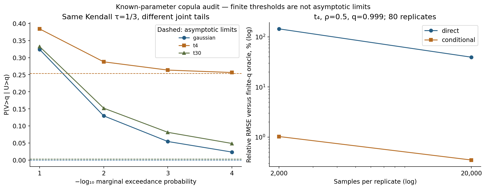

# Informe crítico — 2026-10-18

## Pregunta y brecha
¿Basta igualar Kendall tau para extrapolar coexcedencias extremas, y cuánto mejora Monte Carlo condicional frente a simulación directa? El programa 04 estaba en S1. La cartera gaussiana de 03-financial-risk ya simula pérdidas de 200 deudores, pero no contrasta familias con igual tau ni separa umbral finito de límite asintótico. Este MVP bivariado cubre esa brecha sin duplicar ni sustituir el motor de cartera.

## Hipótesis y umbrales anteriores a la ejecución
config.json fija: discrepancia entre coordenadas de cuadratura ≤2e-7; identidad gaussiana independiente ≤1e-10; error empírico de Kendall ≤0.03 en muestras de 10,000; razón de coexcedencias t4/gaussiana ≥2 en rho=.5,q=.999; ratio RMSE condicional/directo ≤0.25 y RMSE relativo condicional ≤3% para t4,q=.999,N=20,000; violación de la cota de varianza ≤1e-10. Son comprobaciones de este escenario, no umbrales universales ni certificación de inferencia.

```json
{
  "checks": {
    "max_quadrature_disagreement": 3.993009983532976e-11,
    "max_independence_error": 9.71445146547012e-17,
    "max_empirical_kendall_error": 0.006670627062706214,
    "min_t4_to_gaussian_joint_ratio": 4.856196277246979,
    "max_conditional_to_direct_rmse_ratio": 0.008863733701078102,
    "max_conditional_relative_rmse": 0.0034776536357575827,
    "max_variance_bound_violation": 0.0
  },
  "passed": {
    "max_quadrature_disagreement": true,
    "max_independence_error": true,
    "max_empirical_kendall_error": true,
    "min_t4_to_gaussian_joint_ratio": true,
    "max_conditional_to_direct_rmse_ratio": true,
    "max_conditional_relative_rmse": true,
    "max_variance_bound_violation": true
  }
}
```

## Formulación: finito no es asintótico
Para U,V uniformes con cópula C, p=1-q y L(q)=P(V>q|U>q)=P(U>q,V>q)/p. El coeficiente lambda_U es el límite de L(q) al tender q a uno; NO es L(.99) o L(.999). En cópulas elípticas tau=(2/pi)asin(rho), pero tau no identifica los grados de libertad. Para gaussiana no singular lambda_U=0. Para t con nu grados: lambda_U=2*T_(nu+1)(-sqrt((nu+1)*(1-rho)/(1+rho))). El mismo rho implica igual tau poblacional en las familias comparadas, no igualdad de toda su dependencia ni de correlación Pearson de pérdidas financieras transformadas.

### Representación y condición
Gaussiana: X=Z1, Y=rho*Z1+sqrt(1-rho²)*Z2. t: dividir ambas componentes por el MISMO sqrt(S/nu), S chi-cuadrado independiente. Escalas independientes producirían otro modelo. En t, Y|X=x tiene nu+1 grados, localización rho*x y escala sqrt((nu+x²)*(1-rho²)/(nu+1)). Por eso rho=0 no implica independencia para t. El dominio soportado es rho en [-.95,.95], nu en [2.1,100] o gaussiana, q en [.5,.99999]; se rechazan valores fuera de él y parámetros no finitos.

### Proposición: cota de varianza a igual N
Sea A={U>q}, B={V>q}, p=P(A) conocido y L=P(B|A). El estimador directo promedia D=1_(A∩B)/p: E[D]=L y Var(D)=L/p-L². El condicional promedia H=P(B|X) con X muestreado bajo X|A: E[H]=L por esperanza iterada. Como 0≤H≤1, E[H²]≤L y Var(H)≤L(1-L). Por tanto Var(media H)/Var(media D)≤p(1-L)/(1-pL)≤p para 0<L<1. La demostración es algebraica y no nueva; la cuadratura del segundo momento y los tests verifican su implementación. No es una garantía a igual tiempo: invertir cuantiles y evaluar CDF cuesta más. No es un Rao–Blackwell puro sobre las mismas muestras: también se cambia al muestreo truncado.

## Diseño reproducible
48 escenarios de cuadratura: rho=-.5,0,.5,.9; q=.9,.99,.999,.9999; gaussiana,t4,t30. Dos coordenadas: supervivencia marginal truncada en (0,1) y variable latente x desde su umbral hasta infinito. Comparten SciPy y fórmulas distributivas: son una comprobación numérica cruzada, no dos bibliotecas independientes ni intervalos certificados.

Simulación: rho=.5; dos familias, dos umbrales, N=2,000 y 20,000; dos estimadores; 80 réplicas independientes por celda, 1,280 corridas. Semillas SeedSequence por familia/q/N/método/réplica guardadas en raw.csv; no se seleccionan réplicas favorables. Los métodos usan streams distintos. El estimador directo usa denominador N*p conocido; no se confunde con el cociente de conteos aleatorios, que se guarda aparte con indefinidos explícitos. Un estimador directo de L puede exceder uno; no se recorta.

## Resultados poblacionales con rho=.5 (tau=1/3)
| Cópula | q | P conjunta | L(q) | lambda límite |
|---|---:|---:|---:|---:|
| gaussian | 0.99 | 0.00129392442 | 0.129392 | 0.000000 |
| gaussian | 0.999 | 5.42591682e-05 | 0.054259 | 0.000000 |
| gaussian | 0.9999 | 2.3311437e-06 | 0.023311 | 0.000000 |
| t4 | 0.99 | 0.00287678435 | 0.287678 | 0.253170 |
| t4 | 0.999 | 0.000263493171 | 0.263493 | 0.253170 |
| t4 | 0.9999 | 2.56378509e-05 | 0.256379 | 0.253170 |
| t30 | 0.99 | 0.00151965463 | 0.151965 | 0.003047 |
| t30 | 0.999 | 8.11101054e-05 | 0.081110 | 0.003047 |
| t30 | 0.9999 | 4.84719277e-06 | 0.048472 | 0.003047 |

## Monte Carlo: escenario predefinido t4, q=.999
| N | Método | Media L estimada | RMSE relativo | Tiempo medio ms | Proxy tiempo×MSE | Ceros conjuntos |
|---|---|---:|---:|---:|---:|---:|
| 2000 | conditional | 0.263398 | 1.023% | 1.154 | 8.389e-09 | no aplica |
| 2000 | direct | 0.243750 | 144.067% | 0.275 | 3.968e-05 | 0.65 |
| 20000 | conditional | 0.263529 | 0.348% | 7.385 | 6.201e-09 | no aplica |
| 20000 | direct | 0.239375 | 39.235% | 1.391 | 1.487e-05 | 0.0125 |

### Memoria y escalabilidad
Picos rastreados por tracemalloc en una repetición separada de la réplica cero; NO RSS ni máximo sobre todas las réplicas.
| N | Método | Pico rastreado bytes, t4 q=.999 |
|---|---|---:|
| 2000 | direct | 82373 |
| 2000 | conditional | 154713 |
| 20000 | direct | 801509 |
| 20000 | conditional | 1502941 |



## Qué funcionó y qué no
Igual tau no preserva la coexcedencia extrema entre gaussiana y t. Una gaussiana asintóticamente independiente todavía presenta coexcedencia finita positiva: sustituir L(q) por cero sería erróneo. En t, usar el límite en un umbral finito también introduce error de aproximación. El condicional resuelve mejor el escenario predeclarado a igual N; el directo sigue siendo válido e insesgado con denominador conocido, pero su ruido aumenta al bajar p y puede dar cero eventos. No se ocultan esos ceros ni se construyen intervalos Wald a partir de ellos.

El coste por muestra condicional es distinto; tiempo×MSE es un proxy local de eficiencia, NO un experimento a presupuesto temporal idéntico. Orden fijo, sin warm-up; tiempos variables por máquina, incluyen RNG. Los 80 resultados no establecen cobertura de intervalos ni superioridad fuera del dominio probado. Los percentiles en summary.csv son dispersión empírica de réplicas, no intervalos de confianza.

## Supuestos, riesgos y alcance reducido
Parámetros y p conocidos, observaciones IID, dimensión dos y familias elípticas simétricas. No hay ajuste semiparamétrico, selección de cópula, incertidumbre de rho/nu, EVT estimado, asimetría, vines ni series financieras. El supuesto paramétrico hace posible integrar la condicional: un dato empírico escaso no ofrece automáticamente esa información. Dependencia extrema positiva a rho=0 en t es resultado del factor de escala compartido, no evidencia causal de contagio. No se valida VaR/ES, capital, PD conjunta de una cartera real ni cumplimiento normativo. En rho negativa algunas colas tienen probabilidad muy pequeña y la diferencia absoluta de cuadraturas no garantiza precisión relativa; se guardan ambas estimaciones y sus errores numéricos informados. Dominio float64 explícito. Dependencias directas fijadas, no lock transitivo.

## Tests, notebook y revisión
make run instala y ejecuta Ruff, formato, mypy, pytest con Hypothesis, benchmark, informe, notebook y checklist. Cobertura medida solo en src/copulas.py y src/reference.py; logs y coverage.json son evidencia. Se ejecutan además las ocho pruebas preexistentes de numerical-core. Notebook ejecutado con IPython en proceso, sin sockets; --kernel usa nbclient en un entorno convencional y el CI general de notebooks lo verifica. Figura inspeccionada por el autor; la revisión visual integral en un visor del notebook se declara por separado en el checklist. Las guías de notebooks y visualización motivaron separar métodos, datos, resultados, incertidumbre y límites.

## Antecedentes y novedad
referencias.bib contiene cinco referencias reales verificadas: Demarta–McNeil (2005), Ledford–Tawn (1996), Embrechts–McNeil–Straumann (2002), Nelsen (2006) y Glasserman (2003, fecha impresa del registro Springer). Ver fuentes.md para URLs y barreras. No es revisión sistemática de todas las plataformas sugeridas. La novedad defendible es la integración del contraejemplo, dos coordenadas de cuadratura, cota de varianza, réplicas y semántica de denominadores dentro de este programa del portafolio; los métodos son conocidos.

## Autoevaluación (1–5)
Novedad 2; rigor 4; reproducibilidad 4; código 4; claridad 4; impacto 3; honestidad 5; MVP ejecutable 5. Autoevaluación, no certificación externa.

## Siguiente iteración recomendada
1. advanced-research: estimar rho y nu con entrenamiento independiente y cuantificar incertidumbre del ajuste.
2. advanced-research: probar cópulas asimétricas y analizar extrapolación con pocos extremos.
3. quantitative-methods: comparar a presupuesto temporal fijo e incrementar réplicas para estudiar cobertura de intervalos.
