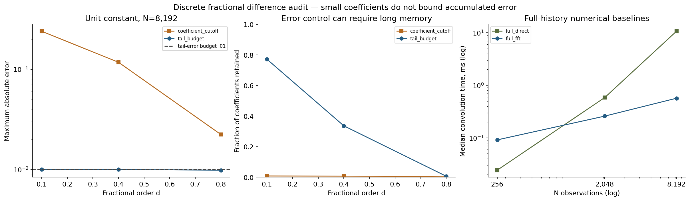

# Informe crítico — 2026-10-19

## Pregunta y brecha

¿Un último coeficiente pequeño controla el error acumulado de una diferencia fraccional truncada? El programa 05 era un protocolo S1 sin código. Este MVP S2 implementa el operador discreto, verifica su aritmética y explicita el coste de truncar memoria. No resuelve todavía la pregunta mayor de distinguir memoria larga genuina de rupturas estructurales.

## Hipótesis falsable y umbrales

Antes de ejecutar se fijaron en config.json: error escalado FFT frente a convolución completa ≤1e-10; violación numérica de la cota de cola ≤1e-10; error escalado del selector de presupuesto ≤0.0100000001; diferencia frente a oráculo de 80 dígitos ≤1e-11; un contraejemplo constante con error del corte por coeficiente ≥20 veces epsilon; igualdad de cota y error constante a tolerancia 1e-10; y contaminación por FFT circular ≥0.1. Ningún umbral se relajó tras ver resultados. Son comprobaciones del operador y del benchmark, no inferencia económica.

```json
{
  "checks": {
    "max_fft_scaled_error": 1.0685896612017132e-15,
    "max_tail_bound_violation": 1.0685896612017132e-15,
    "max_budget_error": 0.009999418935581428,
    "max_oracle_scaled_error": 6.106226635438361e-16,
    "min_cutoff_error_over_epsilon": 117.60242701828483,
    "max_constant_bound_gap": 4.996003610813204e-16,
    "min_circular_wraparound_error": 0.4
  },
  "passed": {
    "max_fft_scaled_error": true,
    "max_tail_bound_violation": true,
    "max_budget_error": true,
    "max_oracle_scaled_error": true,
    "min_cutoff_error_over_epsilon": true,
    "max_constant_bound_gap": true,
    "min_circular_wraparound_error": true
  }
}
```

## Definición y condiciones iniciales

Se calcula y_t=Σ_(k=0)^t w_k x_(t-k), t=0,...,N-1, con x_t=0 para t<0, paso del rezago igual a uno y w_k=(-1)^k binom(d,k). El dominio soportado es d en [.01,.99], N entero entre 1 y 32768, entradas finitas con norma sup ≤1e8. No es automáticamente una derivada Caputo ni una aproximación de una EDE fraccional continua. La extensión inicial cero forma parte del contrato.

Los coeficientes cumplen w_0=1 y w_k=w_(k-1)(k-1-d)/k. Para 0<d<1 todos los coeficientes posteriores son negativos. La identidad binomial y Gamma da r_m=Σ_(k=0)^m w_k=Γ(m+1-d)/[Γ(1-d)Γ(m+1)], que decae como m^(-d)/Γ(1-d). En una constante con historia infinita el resultado sería cero; con inicio en t=0 el resultado correcto es r_t, no cero. Confundir esas inicializaciones atribuiría al algoritmo un error que viene del modelo de frontera.

## Proposición: cota finita de truncación

Si se retienen rezagos 0,...,m y |x_t|≤M, entonces para t>m, |y_t^(m)-y_t|≤M Σ_(k=m+1)^t |w_k|≤M T_(m,N), donde T_(m,N)=Σ_(k=m+1)^(N-1)|w_k|=r_m-r_(N-1). La prueba es la desigualdad triangular y el signo de los pesos. Para x_t=1 desde t=0 se alcanza la cota al final del horizonte: el error es exactamente T_(m,N) en aritmética real.

El selector escoge el menor m con T_(m,N)≤eta. Por tanto controla el error absoluto por M*eta, no el error relativo respecto de una salida que pueda ser casi cero. Se evalúa T mediante suma inversa de pesos absolutos para evitar restar ratios Gamma cercanos. Son cotas matemáticas verificadas con tolerancia float64, no certificados de aritmética de intervalos. La constante hace que la cota no sea solo una desigualdad muy holgada en todos los casos.

### Por qué cortar por un coeficiente no basta

El baseline descarta el primer w_k con |w_k|≤epsilon y todos los siguientes. Controla ese coeficiente individual, no su suma. No se afirma que toda implementación financiera use esta regla ni se atribuye un fallo universal a una librería concreta. Se compara esta heurística explícita frente a dos memorias fijas (32 y 128), convolución completa directa, FFT lineal completa y el selector por presupuesto.

## Diseño y baselines

36 escenarios: d=.1,.4,.8; N=256,2048,8192; constante, sinusoide de periodo 64, AR(1) de parámetro .95 y pulso. Las entradas tienen norma sup ≤1 y las 12 series se guardan en inputs.npz; las semillas constan en CSV/config. No se simulan procesos ARFIMA para inferir d: se audita aplicar un operador conocido a señales conocidas. Seis métodos producen 216 resultados, con tres repeticiones temporales cada uno (648 registros). Las repeticiones de tiempo no son réplicas estadísticas independientes.

La referencia principal es la convolución causal completa de los mismos pesos. Para no limitarse a concordancia entre dos algoritmos float64, seis casos cortos (64/256 × tres d) se contrastan con coeficientes binomiales de mpmath y sumas a 80 dígitos. El prefijo Gamma se comprueba por separado. La FFT usa convolución lineal con relleno a longitud suficiente; el ejemplo circular deliberadamente incorrecto es una ablación de frontera, no un baseline competitivo justo.

## Contraejemplo predefinido

Constante unitaria, d=.4, N=8192, epsilon=.001: el corte conserva el rezago máximo **54**. El error máximo es **0.117602427**, frente a cota **0.117602427**; equivale a **117.60 veces epsilon**.

| Método | Rezago máximo | Coeficientes retenidos | Error máximo | Cota de truncación |
|---|---:|---:|---:|---:|
| full_direct | 8191 | 8192 | 0 | 0 |
| full_fft | 8191 | 8192 | 4.78783679e-16 | 0 |
| fixed_32 | 32 | 33 | 0.148979845 | 0.148979845 |
| fixed_128 | 128 | 129 | 0.0780605357 | 0.0780605357 |
| coefficient_cutoff | 54 | 55 | 0.117602427 | 0.117602427 |
| tail_budget | 2750 | 2751 | 0.00999941894 | 0.00999941894 |

## Coste y escalabilidad

Pesos y selección se preparan fuera del cronómetro y se registran en setup.csv. La llamada medida incluye validación de entradas/pesos y el filtrado; no incluye RNG ni selección. Se calcula una referencia directa antes de medir, sin calentamiento separado y con orden fijo. Son tiempos descriptivos locales, no una garantía universal de velocidad. Pico tracemalloc en una llamada separada; no es RSS.

| N | Método, AR1 d=.4 | Mediana ms | Pico rastreado bytes | Error escalado |
|---|---|---:|---:|---:|
| 256 | full_direct | 0.024 | 6755 | 0 |
| 256 | full_fft | 0.091 | 18007 | 2.77556e-16 |
| 256 | tail_budget | 0.029 | 6755 | 0.00191793 |
| 2048 | full_direct | 0.585 | 49763 | 0 |
| 2048 | full_fft | 0.259 | 132708 | 2.77556e-16 |
| 2048 | tail_budget | 0.403 | 49763 | 0.000697054 |
| 8192 | full_direct | 10.682 | 197219 | 0 |
| 8192 | full_fft | 0.567 | 525924 | 2.77556e-16 |
| 8192 | tail_budget | 3.615 | 197219 | 0.000325802 |



## Qué funcionó y qué no

La FFT conserva el operador de historia completa dentro de tolerancia y el selector controla la truncación bajo las hipótesis indicadas. El corte por un coeficiente falla el presupuesto de error en el contraejemplo. No se eliminan las familias donde una memoria fija basta ni donde el selector conserva casi toda la historia. Con d pequeño, la cola decrece despacio y el control de error puede exigir muchos rezagos; no se afirma que la memoria corta siempre sea barata.

La ablación circular produce un primer valor **-0.400000** para un pulso situado en el último instante, cuando el valor causal correcto es **0.000000**: usar FFT sin relleno introduce información del final al inicio. Para la constante con extensión cero, el último valor completo es **0.018268719**, no cero. Ambos fallos se guardan explícitamente en results.json.

## Límites y riesgos

Operador lineal discreto escalar, no estimación de Hurst/d ni prueba de estacionariedad, y sin datos económicos reales. No diferencia memoria larga de cambios de régimen; ese objetivo del programa sigue pendiente. Cota escalada por max(1,||x||∞), no por ||y||∞. La cota es de truncación y se admite tolerancia adicional de redondeo: no garantiza todos los bits de una FFT. El oráculo de alta precisión se limita a N≤256; en N grande la referencia directa también es float64.

El selector conoce el horizonte N; la garantía no se extiende automáticamente a futuras observaciones ni a prehistoria desconocida. No se usa información futura para calcular y_t: los coeficientes dependen solo de d/N/tolerancia, y el filtro es causal. Este prototipo prepara y almacena los N pesos para seleccionar m, así que no se reclama implementación streaming ni reducción del almacenamiento total del programa. No cubre d=0/1, d negativo, órdenes variables, Caputo, EDE fraccionales o inferencia financiera. Dependencias directas fijadas, no lock transitivo.

## Calidad, notebook y trazabilidad

make run instala, comprueba Ruff/formato/mypy, ejecuta pytest/Hypothesis, mide cobertura solo de src/fractional.py y src/reference.py, reproduce benchmark, informe, notebook y checklist. Se corren también las pruebas existentes de numerical-core. Los logs son evidencia de lo realmente medido. Notebook con ocho celdas ejecutadas en IPython en proceso; --kernel permite nbclient convencional. Figura revisada, notebook estructuralmente validado; la revisión visual integral en un visor se declara por separado. Las guías de notebooks y visualización orientaron la separación de supuestos, datos, resultados y límites.

## Prior art y novedad incremental

Diferenciación fraccional y FFT no son nuevos: Granger–Joyeux (1980), Hosking (1981), Lubich (1986), Jensen–Nielsen (2014), NIST DLMF y documentación SciPy. referencias.bib contiene seis entradas verificadas; fuentes.md documenta barreras de acceso. No se declara revisión exhaustiva de todas las plataformas sugeridas. La aportación es el paquete reproducible de cotas, contraejemplos de truncación/frontera y benchmarks dentro de este programa del portafolio.

## Rúbrica (1–5)

Novedad 2; rigor 4; reproducibilidad 4; código 4; claridad 4; impacto potencial 3; honestidad 5; MVP ejecutable 5. Autoevaluación, no certificación externa.

## Siguiente iteración recomendada

1. advanced-research: contrastar memoria larga y rupturas estructurales con pruebas calibradas en réplicas independientes.
2. advanced-research: estudiar sensibilidad a la prehistoria y al horizonte de la cota.
3. quantitative-methods: añadir implementación por bloques/streaming y benchmarks a presupuesto de error común.
