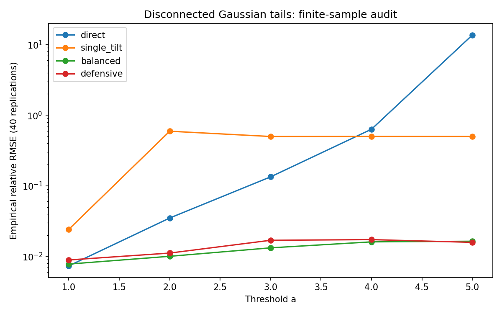

# Auditoría de importance sampling para eventos desconectados

Fecha: 2026-10-13. Programa 18: **S1 → S2**, prototipo acotado. Base del repositorio: `8f2b11f9bc0e2b23f775c84cec2b2242d17d8e8d`.

## 1. Tema y pregunta
¿Cuándo un tilt gaussiano hacia una sola cola oculta errores al estimar P(|X|>a)?

## 2. Estado del arte y originalidad
Referencias verificadas en sus páginas primarias el 2026-10-13:
- Glasserman y Wang (1997), DOI 10.1214/aoap/1034801251: contraejemplos de IS basado en grandes desviaciones. Página de los autores: https://business.columbia.edu/faculty/research/counterexamples-importance-sampling-large-deviations-probabilities.
- Chan y Lai (2007), DOI 10.1214/105051606000000664, https://arxiv.org/abs/math/0703910: mezclas de medidas inclinadas para probabilidades de excedencia.
- He y Owen (2014), https://arxiv.org/abs/1411.3954: optimización de pesos de mezclas; NO implementamos su algoritmo adaptativo ni controles.
- Owen (2013), https://artowen.su.domains/mc/: estimación ordinaria, mezclas y diagnósticos de IS.
- Dembo y Zeitouni (1998, edición 2; impresión corregida 2009), DOI 10.1007/978-3-642-03311-7: fundamento de grandes desviaciones; no usamos sus teoremas para afirmar optimalidad de este MVP.

La mezcla balanceada y la mezcla defensiva son métodos conocidos. La novedad incremental del portafolio es integrar un benchmark de geometría desconectada con momentos poblacionales, réplicas, pruebas y diagnóstico del error oculto. No es originalidad algorítmica ni réplica completa de alguno de los artículos. La búsqueda fue focalizada, no exhaustiva; no se afirma ausencia de prior art.

## 3. Brecha
El programa 18 contenía solo README y diseño S1. El numerical-core existente ofrece kernels y Monte Carlo de opciones, pero no este experimento ni un diagnóstico de cobertura de colas desconectadas. La brecha cerrada es computacional: separar error observado, error estándar muestral y varianza poblacional, evitando que una región no visitada parezca precisión.

## 4. Hipótesis y umbral preespecificados
En a=4, N=20,000, 40 réplicas, la mezcla balanceada logra RMSE/ RMSE directo ≤0.20 y RMSE relativo ≤0.05. `config.json` se creó antes de ejecutar. Resultado: ratio **0.02544641**, RMSE relativo **0.01612579**; ambos umbrales pasan. No se ajustaron tras observar los resultados.

## 5. Diseño
X~N(0,1), A={x: |x|>a}; verdad p=2Φ(-a). Umbrales 1,2,3,4,5; N=2,000/20,000; 40 réplicas independientes para cada método: 1,600 corridas, 17.6 millones de draws en el benchmark. Seed base 20261013; fórmula y todas las semillas están en código/raw.csv. PCG64 vía numpy.default_rng. Datos sintéticos, sin entrenamiento ni calibración financiera.
Comparadores: q=φ(x), q=φ(x-a), q=.5φ(x-a)+.5φ(x+a), y q=.1φ(x)+.45φ(x-a)+.45φ(x+a). Mismo presupuesto de draws, con tiempo y memoria medidos. El tilt de una sola cola es una ablación deliberadamente inadecuada para dos colas, no la única comparación. La mezcla defensiva es un comparador competitivo y su desempeño negativo también se conserva.
Hardware/entorno: Python 3.12.14 (main, Aug 25 2026, 14:00:49) [Clang 22.1.3 ], plataforma Linux-6.18.44-x86_64-with-glibc2.39, procesador x86_64; NumPy 2.2.6. La marca exacta de CPU no está disponible; tiempos de pared son locales y no una garantía de velocidad. Memoria: máximo de allocations rastreadas por tracemalloc en una corrida separada; no RSS total.

## 6. Implementación y formalización
Y=1_A(X)φ(X)/q(X), X~q. Como q>0 en R, E_q[Y]=∫_A φ=p. Es IS ordinario no autonormalizado; una mezcla se evalúa con su densidad completa, no solo su componente sorteado. Densidades en log-space mediante logsumexp. `src/estimators.py` está tipado; `src/benchmark.py` conserva las réplicas y métricas.
Para q=φ(x-a): φ(x)^2/q(x)=exp(a²)φ(x+a), por completar cuadrados. Así E_q[Y²]=exp(a²)[Φ(0)+Φ(-2a)] y Var(Y)=E[Y²]-p². La mitad izquierda del segundo momento crece exponencialmente. El estimador sigue siendo insesgado en expectativa; la media finita cercana a p/2 NO es un sesgo estructural del estimador.
Para la mezcla balanceada, en x≥a, q≥.5φ(x-a), entonces φ/q≤2exp(-ax+a²/2)≤2exp(-a²/2); por simetría también en x≤-a. Luego Y≤M=2exp(-a²/2) y Var(Y)≤Mp-p². La prueba algebraica es exacta; el property test verifica instancias numéricas, no reemplaza una demostración. Mezcla defensiva: q≥.1φ, φ/q≤10 globalmente.
Momentos de mezclas por quadrature SciPy (error relativo solicitado 1e-9); no se presentan como valores simbólicos exactos. Dominio computacional documentado: 0<a≤8, N entero ≥2, precisión float64.

## 7. Tests y reproducción realmente ejecutados
`make run` finalizó con exit code 0. Ruff sin incidencias y mypy sin errores en tres módulos. **32 tests pasan**, incluyendo 16 integrales de insesgamiento, límites, semilla repetible, evento sin hits, momentos poblacionales, simetría, cota defensiva y cota en el evento (Hypothesis). Cobertura de líneas de `src.estimators`: **100% (61/61)**; no es cobertura del benchmark/runner ni prueba de corrección total. Evidencia en benchmarks/tests.txt y coverage.json.
Notebook ejecutado realmente celda a celda mediante IPython en el mismo proceso, con stdout y figura capturados en outputs. Intento inicial con nbclient falló porque el entorno bloquea descubrimiento de interfaces/kernel TCP. El runner final evita ese requisito; no rellena salidas inventadas. No se validó un kernel Jupyter externo en este entorno.

## 8. Resultados (a=4, N=20,000)
Verdad: **6.33424836662e-05**.

| Método | Media de réplicas | RMSE relativo | Cobertura Wald 95% | Var(Y) poblacional | Mediana ms | Peak bytes rastreados |
|---|---:|---:|---:|---:|---:|---:|
| direct | 5.25e-05 | 63.372% | 77.5% | 6.33385e-05 | 1.468 | 663103 |
| single_tilt | 3.15606786e-05 | 50.181% | 0.0% | 4.44306e+06 | 3.424 | 1483831 |
| balanced | 6.33600629e-05 | 1.613% | 92.5% | 1.80998e-08 | 7.985 | 1725605 |
| defensive | 6.36378741e-05 | 1.736% | 95.0% | 2.05555e-08 | 7.977 | 1839559 |



Resultados crudos: raw.csv (1,600 filas), summary.csv (40 escenarios), results.json. El resumen muestra error observado; el RMSE teórico de un estimador insesgado es sqrt(Var(Y)/N). No debe inferirse ese momento poblacional a partir de solo 40 réplicas cuando eventos extremadamente raros dominan la varianza.

## 9. Análisis crítico y resultados negativos
La mezcla balanceada reduce RMSE por un factor 39.30 frente a directo. El tilt simple no observa ninguna muestra de cola izquierda en 40/40 réplicas de a=4; la cobertura Wald observada es cero, aun cuando reporta SE pequeño. Su varianza poblacional es enorme y su RMSE empírico no la estima bien: hay una región rara con contribuciones gigantes.
La mezcla defensiva aumenta Var(Y) frente a balanceada en este evento simétrico (protección adicional no gratuita). En a=1 la mezcla balanceada no aporta mejora clara frente a directo, y cuesta más por draw. En a=5 el directo produce RMSE relativo muy alto dominado por pocos hits; se conserva, no se suaviza. Los intervalos Wald se computan sin clipping y sin asumir calibración en eventos escasos. 40 réplicas son un diagnóstico inicial; la diferencia entre 92.5% y 95% observados no demuestra superioridad de cobertura.
Contribution ESS=(ΣY)²/ΣY² es un diagnóstico de contribuciones al evento, NO ESS global de los pesos ni certificado de cobertura. Costos dependen de BLAS, scheduler y máquina. No se reclama aceleración solo por reducción de varianza; se entregan los tiempos.

## 10. Limitaciones
Solo una dimensión, distribución y geometría conocidas, mezcla fijada por simetría. No adaptación, cross-entropy, control variates, colas pesadas, dependencia temporal, muchos modos, calibración o carteras reales. S2 se limita a este experimento; no S3/S4. Dependencias directas fijadas; resolución transitiva no bloqueada. Sin sanitizers porque no hay C/C++ nuevo. EL=83 no cambia porque no se modifica quant-libraries. No se establece error relativo acotado asintótico ni optimalidad general.

## 11. Cómo correr
Desde `02-mathematics-statistics-and-quant/advanced-research/18-rare-event-geometry-importance-sampling`:
```bash
make run
```
Python 3.11+, make e internet para pip. El mismo comando instala, valida, genera CSV/JSON/PNG y ejecuta notebook. Los números por semilla son reproducibles dentro del entorno; tiempos y fecha de cobertura varían. Workflow CI añadido para repetir el comando en Python 3.12; el estado remoto se informa aparte, no se presume.

## 12. BibTeX
Cinco entradas completas con DOI/arXiv/URL en `referencias.bib`.

## 13. Rúbrica 1–5
| Criterio | Valor | Fundamento |
|---|---:|---|
| Novedad incremental | 2 | Métodos conocidos; auditoría nueva en el portafolio |
| Rigor | 4 | Verdad exacta, identidades, réplicas; cobertura limitada |
| Reproducibilidad | 4 | Un comando probado, deps directas fijadas; sin lock transitivo |
| Código | 4 | Modular, tipado, lint, tests; solo Python |
| Claridad | 4 | Separa momentos, error observado y sesgo |
| Impacto | 3 | Diagnóstico reutilizable; sin aplicación externa |
| Honestidad | 5 | Registra fallos, costo defensivo y límites |
| MVP ejecutable | 5 | Comando completo con todos los artefactos |

## 14. Checklist
- [x] src/ ejecutable
- [x] comando único ejecutado
- [x] 32 tests pasando
- [x] baselines comparados con números
- [x] CSV/JSON/PNG verificables
- [x] README.md, informe.md, referencias.bib, MVP.md
- [x] notebook con outputs ejecutados
- [x] subcarpeta correcta; programa 18 S2

Siguiente iteración recomendada: estudiar regiones desconectadas menos favorables.
1. advanced-research: incorporar umbrales asimétricos y pesos elegidos por piloto separado, con costo de adaptación incluido.
2. advanced-research: extender a dos dimensiones y unión de semiespacios, con verdad por integración independiente.
3. quantitative-methods: añadir comparación a presupuesto de tiempo fijo y 1,000 réplicas para evaluar cobertura con incertidumbre binomial.
