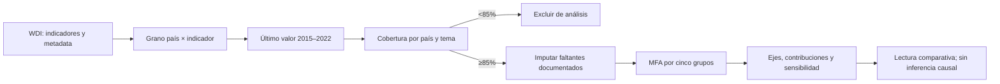
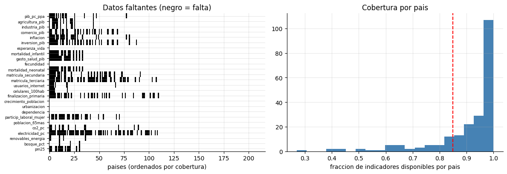
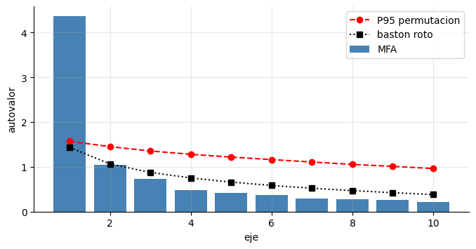
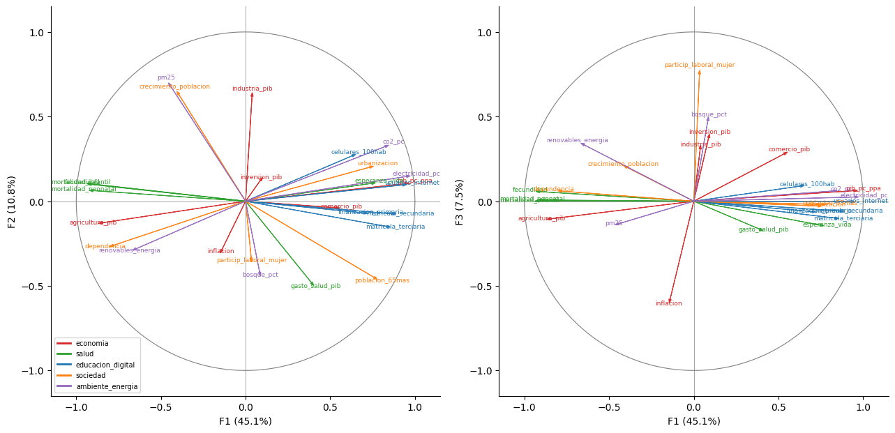
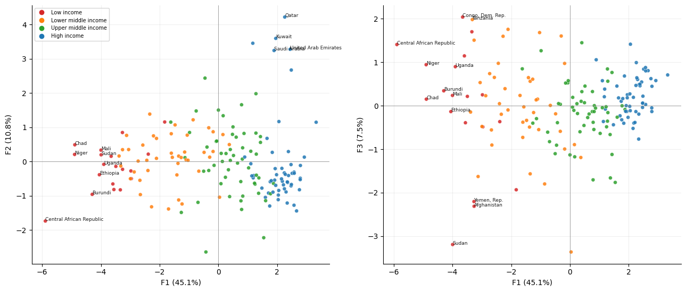
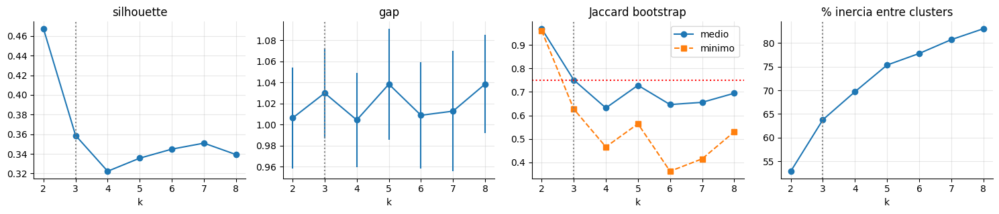

# Análisis factorial múltiple (MFA) de indicadores de desarrollo

## Caso ejecutivo: comparar países sin dejar que un tema domine la lectura

Una institución que compara perfiles de países necesita integrar dimensiones económicas, de salud, educación y conectividad, sociedad y ambiente. Un ACP aplicado a todas las variables puede dar más peso al tema que tenga más indicadores correlacionados. El análisis factorial múltiple (MFA) escala los grupos para que el primer eje común no quede dominado por un solo bloque y permite examinar qué dimensiones hacen parecidos o distintos a los países.

La aplicación observada usa 26 indicadores del [World Development Indicators (WDI)](https://databank.worldbank.org/source/world-development-indicators), agrupados en cinco temas. El snapshot local contiene valores más recientes disponibles dentro de 2015–2022, no una medición sincronizada en un único año. De 217 economías en los metadatos, 171 superan el umbral de cobertura fijado en 85%; 107 tienen todos los indicadores y 46 quedan fuera. Se imputan 112 celdas de 4.446 (2,5%) en el conjunto analítico. La falta de datos se concentra de forma desigual, por lo que la imputación y la selección de países se someten a sensibilidad.

En esta muestra, el primer eje explica 45,1% de la inercia, recibe entre 19% y 21% de cada tema y correlaciona con la categoría externa de ingreso en 0,92. Esta relación es descriptiva, no causal, y el ingreso no participa en el ajuste. La solución de tres clusters tiene fronteras difusas: 36 de 171 países tienen pertenencia máxima menor a 70%, y su estabilidad cambia al retirar ciertos temas. La decisión ejecutiva es usar el eje como resumen comparativo, mostrar la partición binaria más estable junto a cualquier segmentación exploratoria y evitar presentar los clusters como tipos naturales de países.

La **versión controlada** valida identidades del motor MFA con una estructura conocida; la **aplicación oficial** evalúa el método con datos WDI observados. Son evidencias distintas. El manifiesto registra cobertura y hashes de los archivos usados; como la extracción histórica no guardó hora ni vintage de revisión de la API, el snapshot local queda congelado para reproducir el análisis.

**Brief ejecutivo:** los resultados, decisiones de modelación, sensibilidad y figuras están en este README y en el [informe de evidencia oficial](reports/official-evidence.md).

## Flujo de análisis



## Registro de decisiones

| Decisión | Alternativa | Motivo y coste |
|---|---|---|
| Igualar el peso inicial de cada tema con MFA | Aplicar ACP al bloque unido | Evita que un tema con variables redundantes domine el eje común; no obliga a que los ejes 2 y 3 aporten igual por tema. |
| Usar umbral mínimo de cobertura de 85% | Exigir casos completos | Retiene 171 países y limita la imputación a 2,5% de las celdas; excluye 46 economías y no elimina sesgo de cobertura. |
| Retener 3 ejes por estabilidad bootstrap del subespacio | Seguir solo Horn/bastón roto o retener por análisis paralelo condicional | Los criterios discrepan; el subespacio de 3 es más estable que el de 4. Los ejes 2–3 pueden intercambiarse. |
| Tratar clusters como perfiles difusos | Presentar tres grupos como categorías naturales | La partición en 2 es más estable; k=3 tiene Jaccard mínimo 0,63 y 21% de membresías débiles. |

## Evidencia oficial y controlada

El notebook [`notebook.ipynb`](notebook.ipynb) contiene diagnóstico de datos, MFA, ACP por grupo, correlación RV con permutación, selección de ejes, proyección de países, clusters y análisis de sensibilidad. Las cinco figuras siguientes son salidas del notebook ejecutado sobre el snapshot WDI indicado en [`datos/manifest.json`](datos/manifest.json).

### Cobertura y faltantes



### Selección de ejes y temas





### Perfiles y estabilidad de los clusters





## Gobierno, límites y puerta de uso

- **Fuente y semántica:** WDI agrega series de proveedores estadísticos diversos. Consultar metadatos por indicador, definición, unidad, disponibilidad y fuente primaria antes de comparar países. La licencia y atribución pueden depender de la serie y su proveedor; se conserva la referencia de [licenciamiento de datos del Banco Mundial](https://datacatalog.worldbank.org/public-licenses).
- **Tiempo:** el análisis mezcla el último año disponible por indicador y país entre 2015 y 2022; no es un panel sincronizado ni un ranking actual. La extracción heredada no preservó timestamp ni vintage de revisión de la API.
- **Ausencia y selección:** los faltantes no son aleatorios por ingreso o región. El umbral y la imputación se sometieron a sensibilidad, pero no recuperan información no observada ni garantizan comparabilidad.
- **Interpretación:** los ejes describen covariación; la relación con ingreso es validación externa descriptiva. No identifica políticas, bienestar causal, desempeño institucional ni una clasificación oficial de países.
- **Clusters:** k=2 es la partición más estable; k=3 se comunica con incertidumbre de pertenencia. No usar etiquetas duras para focalizar recursos sin una finalidad, umbrales y validación independiente específicos.

La [nota de evidencia](reports/official-evidence.md) registra resultados calculados, sensibilidades y condiciones para una actualización con vintages contemporáneos.

## Reproducibilidad

Desde la raíz de este proyecto, con las dependencias de investigación del repositorio:

```bash
jupyter nbconvert --to notebook --execute notebook.ipynb
python3 scripts/export_official_figures.py
```

La ejecución utiliza los CSV congelados en `datos/`. El script [`descargar_datos.py`](descargar_datos.py) consulta la API del Banco Mundial en una ventana fija 2015–2022; al volver a consultarla, el proveedor puede haber revisado observaciones. Para actualizar el caso, guardar los nuevos CSV como una nueva versión, registrar timestamps y hashes, revisar metadatos/cobertura y recalcular todas las conclusiones antes de sustituir el snapshot actual.
