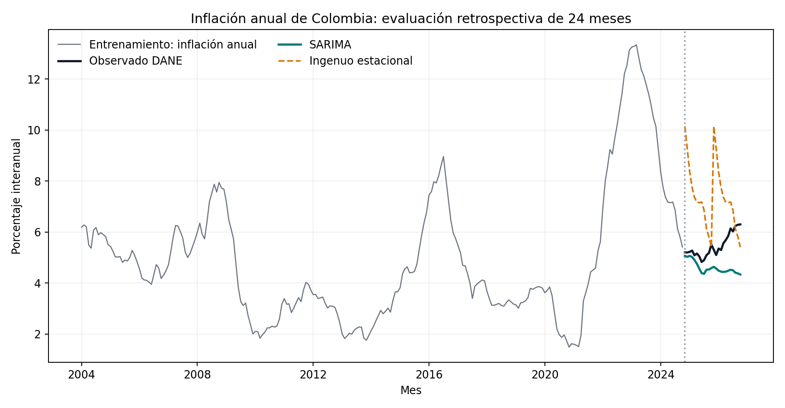

# Pronóstico con ARIMA y selección por AIC

Pronóstico de una serie con tendencia y estacionalidad: selección de orden ARIMA por AIC en una malla, validación en un tramo reservado y comparación contra un pronóstico ingenuo estacional.

## Dos capas: dinámica controlada y aplicación observada

`main.py` y el notebook conservan el laboratorio de serie **sintética** con semilla fija. Sirve para aislar tendencia, estacionalidad y ruido y comparar el método en condiciones controladas.

`official_application.py` evalúa el mismo esquema de selección SARIMA sobre el IPC total nacional publicado por DANE. La fotografía actual está en `data/dane-ipc-indices-oct2026.xlsx`: anexo “Índices — Serie de empalme 2003–2026 (octubre)”, publicado el 9 de noviembre de 2026. La fuente describe el IPC como cambio promedio de precios al por menor de la canasta de consumo de hogares ([DANE, IPC información técnica](https://www.dane.gov.co/index.php/estadisticas-por-tema/precios-y-costos/indice-de-precios-al-consumidor-ipc/ipc-informacion-tecnica)). El snapshot de septiembre y sus resultados se conservan en `data/dane-ipc-indices-sep2026.xlsx` y `reports/vintage-sep2026/`; el runner usa el corte de octubre.

La transformación es inflación anual: `100 × (IPC_t / IPC_{t-12} − 1)`. El grano es un índice mensual nacional, base diciembre de 2018 = 100. Se entrena hasta 2024-10 y se reserva 2024-11–2026-10 como holdout de 24 meses. Una rejilla AIC declarada en el código selecciona SARIMA(1,1,2) × (1,0,0,12); se compara con repetir la inflación de los mismos meses del último año de entrenamiento.

En este holdout el RMSE fue **1,027 puntos porcentuales** para SARIMA y **2,477** para el ingenuo estacional; MAE: 0,850 y 2,062 pp, respectivamente. El resultado respalda que este flujo pudo seguir mejor esa ventana histórica que el benchmark simple. No demuestra una ventaja persistente, causal ni aptitud para decisiones de política o producción.



### Gobierno, controles y límites

- `reports/official_results.json` registra fuente, periodos, transformación, configuración y métricas; `snapshot_sha256` identifica el Excel exacto utilizado.
- El lector exige un mes por periodo, sin duplicados ni huecos. La evaluación conserva orden temporal y no usa el holdout para elegir el modelo; el ingenuo estacional funciona como referencia mínima.
- La ventana es única y el objetivo interanual tiene 11 meses solapados. No se evaluaron orígenes móviles, intervalos, cambios de régimen/metodología, ni recalibración en tiempo real. Para uso institucional harían falta pruebas walk-forward, benchmarks adicionales, criterios de tolerancia y validación independiente.
- El diseño mide calidad predictiva retrospectiva de una serie pública; no se interpreta como recomendación de inversión ni como estimación de inflación futura garantizada.

## Reproducir la aplicación observada

Desde esta carpeta:

```bash
pip install numpy pandas statsmodels matplotlib openpyxl
python3 official_application.py
```

El comando genera `reports/official_forecast.csv`, `reports/official_forecast.png` y `reports/official_results.json`. El hash del Excel de octubre es `4e8366bf2d03d4bdc15d14b1b21b12a6eec6c3695926abd503a430858ef74e2e`. La vintage de septiembre conserva la evaluación anterior y el snapshot original.

## Reproducir el laboratorio controlado

## Cómo ejecutar

```bash
pip install numpy pandas statsmodels
python3 main.py
```

## Resultado de ejemplo

```text
Orden elegido por AIC: ARIMA(1, 1, 1) x (1,0,0,12) | AIC=775.9
RMSE modelo   = 1.731
RMSE ingenuo estacional = 2.869
```

## Notebook

[`notebook.ipynb`](notebook.ipynb) desarrolla el tema de forma extensa: versión ingenua, diagnóstico, mejoras, robustez y **pruebas automáticas** (`assert`) que fallan el notebook si un hallazgo deja de cumplirse. Las cifras de sus conclusiones se calculan desde los datos. `main.py` es la versión corta del mismo tema.
