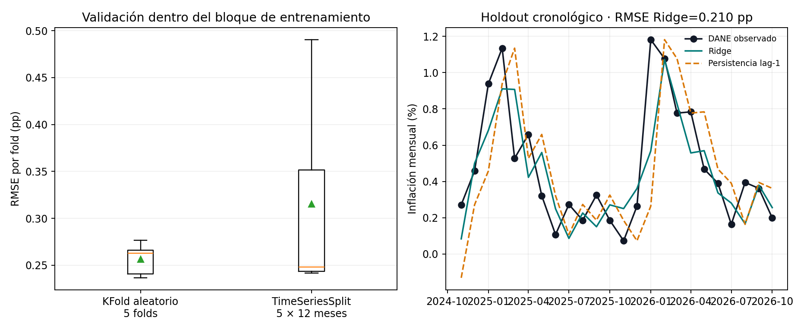

# Validación cruzada temporal y fuga de información

Demostración de por qué la validación cruzada aleatoria es engañosa en series de tiempo: sobre una serie persistente sin poder predictivo real, la validación aleatoria reporta un R² alto, mientras la validación temporal muestra el desempeño verdadero.

## Dos capas: fuga controlada y serie observada

`main.py` y el notebook mantienen la demostración **sintética**: una serie persistente sin señal predictiva real permite aislar cómo un KFold aleatorio mezcla observaciones cercanas y puede inflar el desempeño.

`official_application.py` lleva la comparación a una serie observada: variación mensual del IPC total nacional de Colombia, calculada sobre los índices mensuales DANE (serie empalmada 2003–2026, octubre; base diciembre de 2018 = 100). La fuente define el IPC como medida del cambio promedio de precios de la canasta de consumo ([DANE, información técnica](https://www.dane.gov.co/index.php/estadisticas-por-tema/precios-y-costos/indice-de-precios-al-consumidor-ipc/ipc-informacion-tecnica)). Snapshot: [anexo de índices DANE](https://www.dane.gov.co/files/operaciones/IPC/oct2026/anex-IPC-Indices-oct2026.xlsx), publicado el 9 de noviembre de 2026. El extracto actual (`data/dane-ipc-monthly.csv`, 286 filas) tiene SHA-256 `9dd8621dc3f979ea39d1728d1f35d682ea08746d089deea82d2db92cc00016bd`; el anexo Excel tiene SHA-256 `4e8366bf2d03d4bdc15d14b1b21b12a6eec6c3695926abd503a430858ef74e2e`. CSV, outputs y figura del corte de septiembre se conservan bajo `data/dane-ipc-monthly-sep2026.csv` y `reports/vintage-sep2026/`.

La pregunta aplicada es si dos esquemas de validación producen estimaciones comparables al predecir inflación mensual con sus 12 rezagos. Se usa `StandardScaler` dentro de cada fold y Ridge con α=1. Los últimos 24 meses (2024-11–2026-10) quedan fuera de ambos CV; el entrenamiento termina en 2024-10. En el bloque de entrenamiento, RMSE medio de KFold aleatorio: **0,257 pp** (DE 0,017); TimeSeriesSplit: **0,315 pp** (DE 0,108). En el holdout el modelo obtuvo 0,210 pp, frente a 0,311 pp para persistencia del último mes.



En esta ejecución KFold dio un error medio menor que las particiones temporales, compatible con una lectura más optimista en entrenamiento; la ventana final tuvo error menor que ambos, lo que también muestra variación entre periodos. Una sola serie y una sola partición final no bastan para cuantificar un sesgo general ni para concluir qué método/modelo funcionará en producción. La edición aplicada sirve para ilustrar la diferencia entre interpolar dentro de la historia y evaluar en orden temporal; no valida riesgo crediticio ni una cartera institucional.

### Controles y límites

- `reports/official_cv_results.json` registra fuente, huellas, grano, transformación, periodos, diseño y métricas; `reports/official_holdout.csv` conserva predicciones y observados.
- El orden mensual es cronológico; no se emplean los últimos 24 meses durante ajuste/CV. La normalización se ajusta dentro de cada fold y el mismo estimador/variables se aplica a ambas estrategias.
- No hay búsqueda de hiperparámetros, análisis de revisiones/vintages ni múltiples orígenes de holdout. El IPC interanual no se usa aquí; la variable objetivo es inflación mensual para evitar solapamiento anual del objetivo.

## Reproducir la aplicación observada

Desde esta carpeta:

```bash
pip install numpy pandas scikit-learn matplotlib
python3 official_application.py
```

Genera la figura, el CSV de holdout y los resultados JSON en `reports/`.

## Reproducir el laboratorio controlado

## Cómo ejecutar

```bash
pip install numpy scikit-learn
python3 main.py
```

## Resultado de ejemplo

```text
Serie persistente sin senal predictiva real (solo indice de tiempo como variable)
R2 con KFold aleatorio (con fuga temporal): 0.961
R2 con TimeSeriesSplit (sin fuga):         -0.588
```

## Notebook

[`notebook.ipynb`](notebook.ipynb) desarrolla el tema de forma extensa: versión ingenua, diagnóstico, mejoras, robustez y **pruebas automáticas** (`assert`) que fallan el notebook si un hallazgo deja de cumplirse. Las cifras de sus conclusiones se calculan desde los datos. `main.py` es la versión corta del mismo tema.
