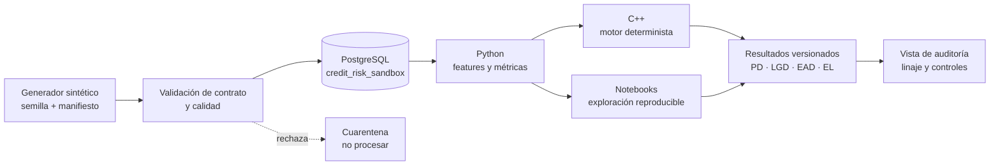
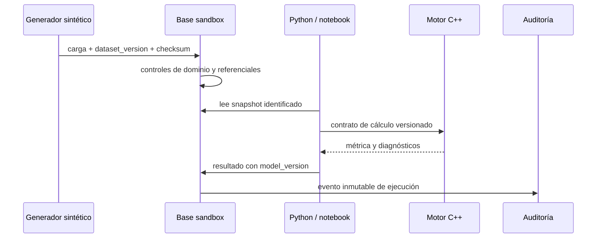

# Arquitectura de referencia — riesgo de crédito

## Objetivo y límite operacional

Esta es una arquitectura lógica para demostrar cómo los módulos de este portafolio podrían intercambiar **datos sintéticos** de manera trazable. No es una arquitectura productiva, no conecta a fuentes externas y no debe recibir identificadores personales, expedientes ni decisiones reales.

## Fronteras de confianza

| Zona | Permitido | Prohibido |
|---|---|---|
| `synthetic` | IDs ficticios, semilla, datos generados y resultados ilustrativos | PII, datos de clientes, decisiones operativas |
| `sandbox` | DDL, pruebas, métricas y auditoría de demostración | credenciales, endpoints o secretos |
| `production` | No está implementada en este repositorio | inferir que estos artefactos están aprobados para producción |

## Secuencia de cálculo reproducible

## Decisiones de diseño

1. **Inmutabilidad lógica:** `dataset_version`, `model_version` y `run_id` son obligatorios en los resultados; nunca se sobrescribe una corrida.
2. **Explicabilidad de grano:** exposición mensual (`exposure_snapshot`) es el grano analítico; las métricas se agregan desde allí.
3. **Separación de deberes:** la generación/carga, ejecución de modelo y aprobación de resultados son roles diferentes en un sistema institucional.
4. **Contrato antes que implementación:** Python, SQL y C++ comparten unidades, horizontes y nombres definidos en `contracts/`.

## Ecuaciones y convenciones

Para la observación \(i\) en horizonte \(h\), con moneda homogénea:

\[
EL_{i,h}=PD_{i,h}\,LGD_{i,h}\,EAD_{i,h}
\qquad\text{y}\qquad
EL_{p,h}=\sum_{i \in p} EL_{i,h}.
\]

Las probabilidades están en \([0,1]\), `ead` y pérdida están en unidades monetarias no negativas, y cada corrida declara explícitamente `horizon_months`. La fórmula no sustituye la política IFRS 9 ni una metodología de capital regulatorio.
