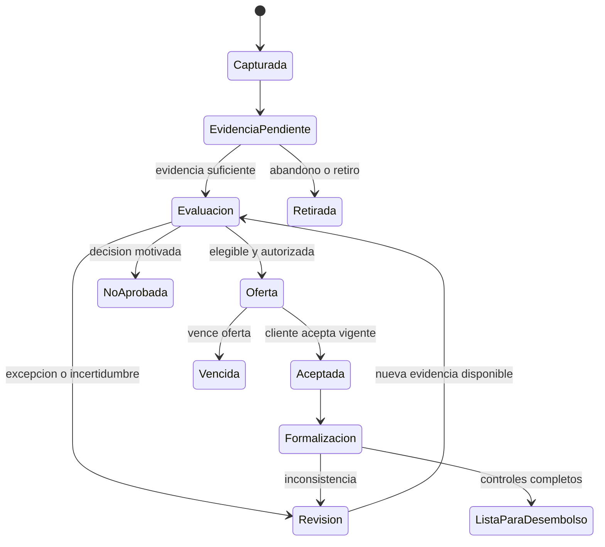
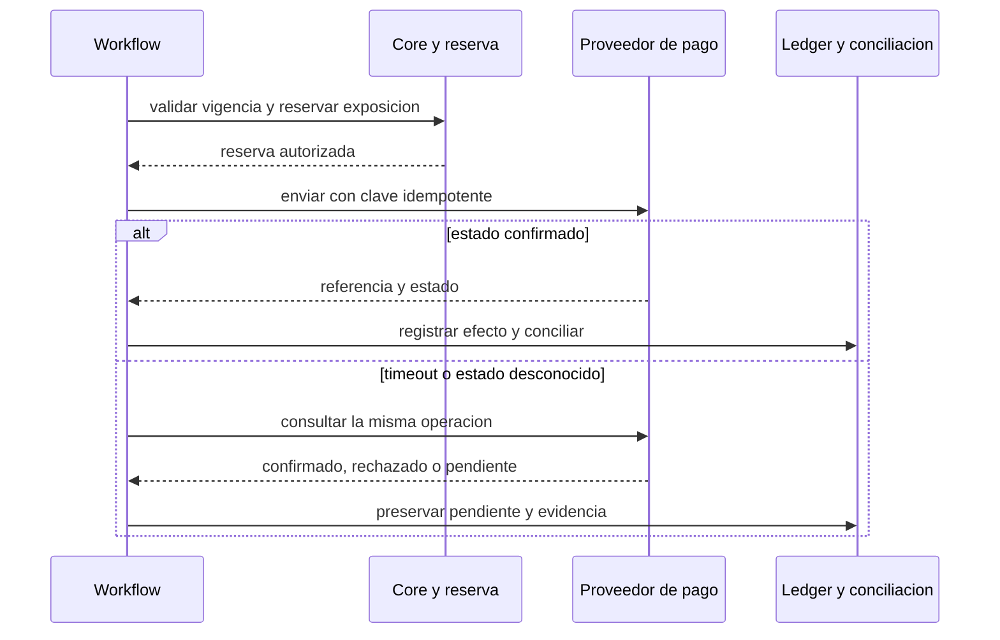

# Flujos del proceso de crédito y rutas de excepción

Las ocho fichas cubren productos de referencia de consumo/microcrédito y adaptación a comercial. El producto determina el documento, el tratamiento de garantías y el nivel de comité. No son políticas aprobadas ni workflows implementados. [Nueve vistas draw.io](diagrams/README.md) y [cuatro defensivas](../../fraud-and-anomaly-research/ai-enabled-fraud-defense/diagrams/README.md).

## F1. Captación, oferta y solicitud

**Dueño:** producto/canales. **Inicio:** interés del cliente u oferta habilitada. **Ruta:** producto vigente → información y condiciones → permisos/finalidades → captura mínima → validación → expediente único → entrega a evaluación. Registrar canal, aliado, asesor y versión de oferta.

**Alternativas:** simulación sin solicitud; abandono; duplicado; dato faltante; producto no elegible; necesidad de atención accesible. Diferenciar rechazo de negocio, error de captura y retiro del interesado. No consultar todo proveedor antes de saber si su dato es necesario. Un consentimiento no aceptado tiene ruta explícita y no se transforma en score adverso.

**Control de salida:** case_id único, estado, moneda, plazo y versión de producto. **Métricas:** conversión por etapa, abandono, tiempo y duplicados; sin presionar conversión a costa de permisos o crédito inadecuado.

## F2. Identidad, fraude, cumplimiento e ingresos

**Dueño:** operaciones de originación, fraude y cumplimiento en sus competencias. **Ruta:** plan de evidencias por producto → verificación documental/identidad → integridad de captura → validaciones habilitadas → contraste de ingresos → snapshot al corte. Los resultados tienen estados propios.

**Alternativas:** timeout (pendiente/reintento acotado); documento no soportado (ruta alternativa); discrepancia (verificación dirigida); señal de listas (gestión en cola competente); ingreso irregular (fuente/modelo apropiado); biometría no disponible (alternativa evaluada). Resolver homónimos y falsos positivos; no llamar fraude a toda inconsistencia.

**Control de salida:** cobertura, fuentes, fecha de disponibilidad, versiones y discrepancias resueltas o declaradas. **Métricas:** falsos positivos por familia/canal, casos inconclusos, necesidad de revisión, costo de fuente e investigación. Un pase KYC no es un pase de capacidad de pago ni SARLAFT completo.

## F3. Capacidad, riesgo, cupo y precio

**Dueño:** riesgo de crédito/política; analista/comité en atribuciones. **Ruta:** snapshot permitido → reglas/elegibilidad → capacidad/endeudamiento → PD y severidad → fraude separado → límites/garantías → oferta, revisión o decisión motivada. Conservar razones y versión de modelo/política.

**Alternativas:** faltantes críticos; baja cobertura de población; incertidumbre alta; restricción de exposición; precio/plazo no viable; excepción autorizada; revisión/reclamación. Las causas técnicas se presentan como técnicas. La explicación proviene de reglas/evidencia y debe ser fiel a la decisión; un LLM no inventa motivos.

**Control de salida:** oferta vigente o estado de decisión con trazabilidad y autoridad. **Métricas:** aprobación, margen esperado, tasa de malos madura, calibración, cobertura y carga de revisión. Congelar validación antes de test; no seleccionar modelo mirando el test.

Este es el estado de **solicitud**. Estados de pagos, cuenta de préstamo y cobranza viven en agregados separados; aceptar una oferta no significa fondos liquidados.

## F4. Oferta, formalización y garantías

**Dueño:** operaciones/jurídica según producto. **Ruta:** oferta aceptada → versión contractual → evidencia de aceptación/firma → pagaré/instrumento aplicable → custodia/garantías → verificación de condiciones precedentes → autorización para desembolso.

**Alternativas:** oferta vencida o modificada (nueva aceptación), firma inconclusa, certificado/validación no favorable, discrepancia de titular, garantía pendiente. No reutilizar aceptación de otra tasa/plazo. Deceval, certificados de firma y un proveedor de e-signature cubren funciones diferentes; la combinación contractual se valida por producto.

**Control de salida:** paquete documental verificable, condiciones cumplidas y referencia a la oferta. **Métricas:** defectos, reprocesos, tiempos, pendientes y controles omitidos; no medir éxito solo por documentos firmados.

## F5. Desembolso, pago incierto y conciliación

**Dueño:** pagos/tesorería y core. **Ruta:** condiciones precedentes → revalidación de cuenta/titular y señales vencidas → reserva de exposición/cupo → intención de desembolso con clave única → envío → consulta/confirmación → asiento y conciliación. Registrar fecha efectiva y valor.

**Alternativas:** cuenta cambió (revalidar), cupo ya usado por solicitud concurrente (reserva atómica), respuesta desconocida (consultar antes de reenviar), devolución/rechazo (nuevo evento y ruta contable), pago liquidado (no borrar para «compensar»). La reserva no es desembolso; su liberación depende del estado confirmado.

**Control de salida:** estado del pago conciliable y exposición consistente. **Métricas:** dobles efectos, pendientes por edad, diferencias contables, devoluciones y tiempo de conciliación. PSE es candidato de recaudo; el riel de desembolso se contrata y valida por separado.

## F6. Administración y seguimiento

**Dueño:** LMS/core, riesgo de cartera y atención. **Ruta:** activar obligación conforme al evento aplicable → cronograma/calendario → imputaciones y extractos → saldo conciliado → cosechas/roll rates/alertas → acciones de servicio. Definir operaciones de prepago, novedades, refinanciación y reestructuración con su política.

**Alternativas:** pago tardío de proveedor, imputación incorrecta, calendario equivocado, reclamo, saldo cero, novedad retroactiva. Recalcular con trazabilidad y reglas contables; no reescribir el pasado sin una versión/corrección registrada.

**Control de salida:** snapshot de exposición/saldo/DPD con procedencia. **Métricas:** mora madura, errores de saldo, conciliación, promesas vs pagos, concentración y cobertura de fuentes. Una alerta temprana es señal para actuar, no default confirmado ni fraude.

## F7. Cobranza, acuerdos y recuperación

**Dueño:** cobranza, atención y jurídica según etapa. **Ruta:** saldo conciliado → segmentación de necesidad/riesgo → elegibilidad de contacto → tratamiento autorizado → resultado → acuerdo → pago conciliado o nueva ruta. Atención de vulnerabilidad, controversia y posible error antes de escalar una presión de cobro.

**Alternativas:** canal no autorizado o límite alcanzado (no enviar), consumidor no identificado (no revelar deuda), controversia (cola competente), promesa incumplida (reevaluar), dificultad persistente (alternativa permitida), recuperación jurídica (responsable y requisitos específicos). No usar GPS ni familiares como sustituto de una estrategia de contacto admisible.

**Control de salida:** registro de contacto/permiso, acuerdo y flujo recuperado sin duplicación. **Métricas:** recuperación neta de costo y tiempo, cura sostenible, acuerdos cumplidos, quejas y errores de terceros. No atribuir eficacia a una estrategia elegida solo para deudores más fáciles; evaluar selección/causalidad.

## F8. Aprendizaje, provisiones y gobierno

**Dueño:** datos/modelos, riesgo, contabilidad y validación en ámbitos separados. **Ruta:** eventos/ledger → snapshot bitemporal → maduración/adjudicación → modelos y métricas → validación → aprobación → sombra/canary → monitoreo y rollback. Provisiones, estrés y capital tienen reglas/objetivos separados de la política de aprobación.

**Alternativas:** etiquetas incompletas, fuga temporal, cambio de proveedor, deriva de población, diferencia contable o mala calibración. Un cambio abre diagnóstico; no activar reentrenamiento/liberación automática por una sola alerta.

**Control de salida:** dataset/model/policy version, población, horizonte, límites y responsable. **Métricas:** discriminación, calibración, pérdida madura, estabilidad, subgrupos, incertidumbre y conciliación. Las pérdidas de fraude/default se atribuyen sin contar dos veces el mismo flujo.

## Flujo comercial/microcrédito frente a consumo

Consumo puede privilegiar ingreso y obligaciones personales. Microcrédito necesita flujo de negocio, estacionalidad, costos, mezcla hogar/negocio y verificación adecuada; no importar coeficientes de consumo sin validar. Comercial incorpora entidad/beneficiario final según caso, estados financieros, grupos relacionados, covenants, garantías y atribuciones de comité. Los diagramas muestran responsabilidades comunes; los modelos y evidencias específicas se parametrizan por producto, sin declarar cumplimiento de Anexo 1/2 SFC con una plantilla genérica.
