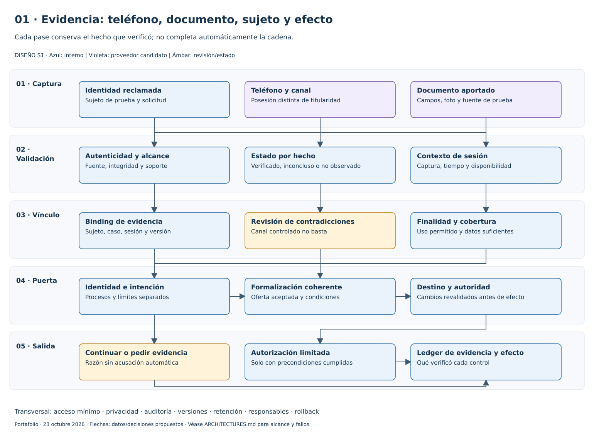
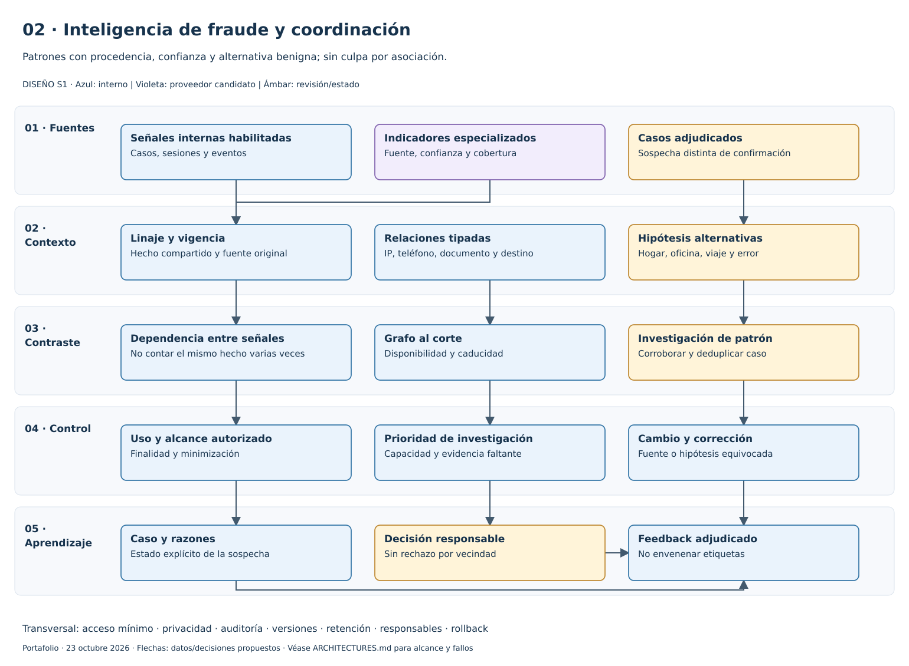
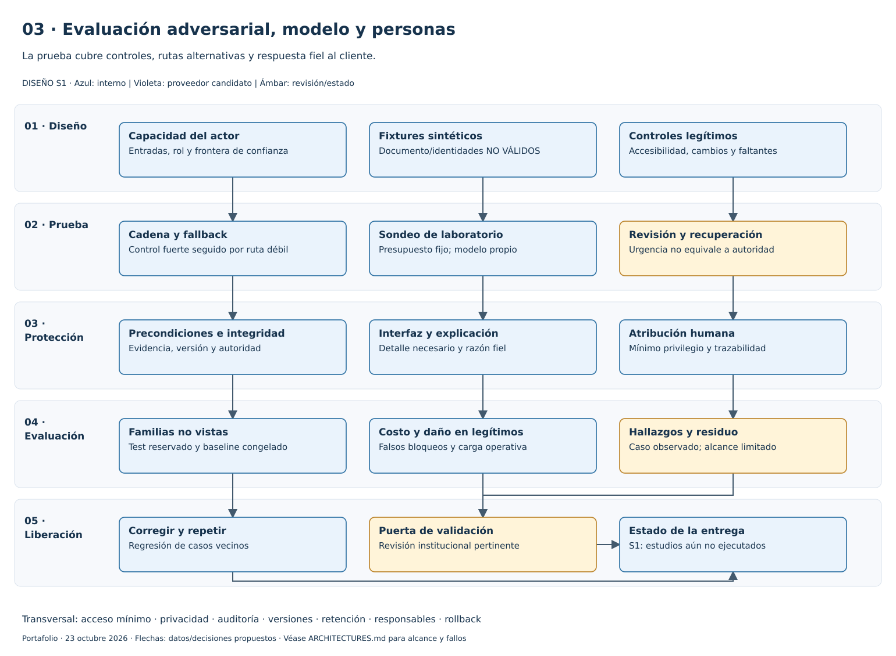
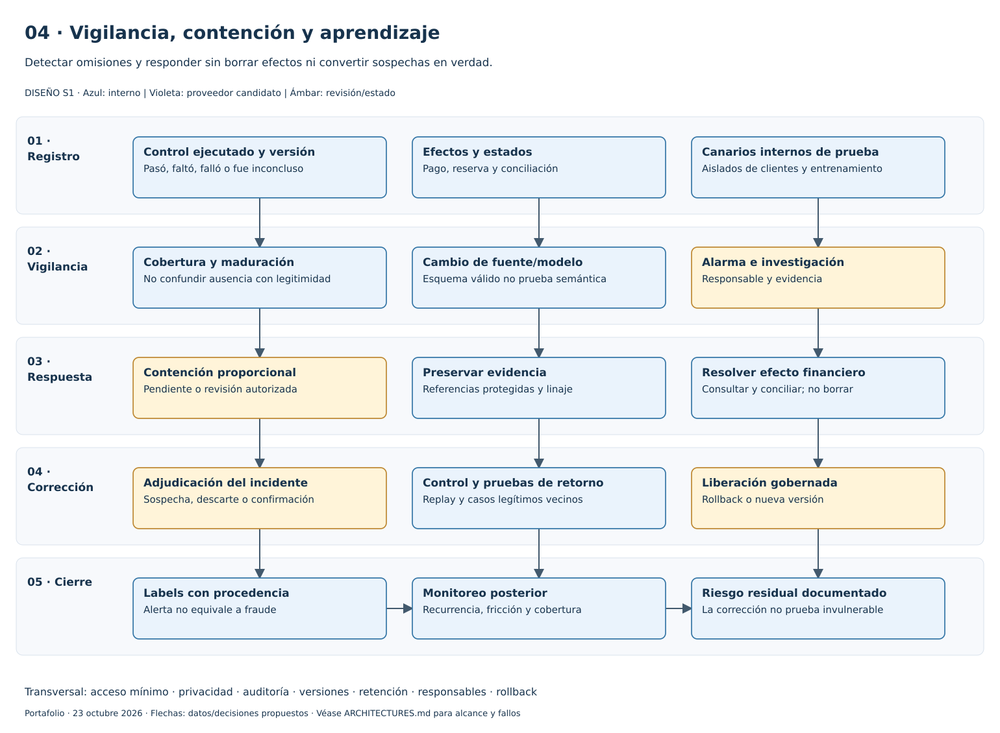

# Cuatro superposiciones defensivas editables

[defense-layers.drawio](defense-layers.drawio) contiene cuatro páginas con 60 componentes y 58 conectores nativos editables. Abrir en diagrams.net/draw.io mediante Archivo → Abrir desde → Dispositivo. Las capas son responsabilidades lógicas representadas con contenedores, no ocho capas de visibilidad independientes.

| Página | SVG | Relación con la arquitectura de crédito |
|---|---|---|
| Evidencia y vínculo | [01-evidence-chain.svg](01-evidence-chain.svg) | Teléfono, documento, sujeto, oferta y efecto con estados distintos |
| Inteligencia y red | [02-intelligence-network.svg](02-intelligence-network.svg) | Procedencia, dependencia y coordinación sin culpa por asociación |
| Adversarial/modelo/personas | [03-adversarial-model-human.svg](03-adversarial-model-human.svg) | Fallback, sondeo controlado, atribución y razones fieles |
| Vigilancia/respuesta | [04-assurance-response.svg](04-assurance-response.svg) | Detección de omisiones, preservación y retorno gobernado |

Estas cuatro vistas complementan las [nueve del ciclo](../../diagrams/README.md) y las [cuatro defensivas previas de fraude](../../../../fraud-and-anomaly-research/ai-enabled-fraud-defense/diagrams/README.md). Son 17 vistas en tres archivos draw.io; no 17 arquitecturas de plataforma ni servicios implementados.

Reproducir: `python <ruta-a-defense-layers>/build_diagrams.py`. El script reutiliza el renderer original de fraude sin modificar sus páginas ni las nueve del ciclo. [Manifiesto](manifest.json), [arquitectura](../ARCHITECTURES.md) y [alcance de QA](../../projects/evidence/qa.json).

SVG generado mediante geometría compartida y renderer propio; no exportación certificada por la GUI de draw.io. Los dibujos son S1; flechas y controles representan diseño propuesto, no pruebas de eficacia ni conexiones reales.
