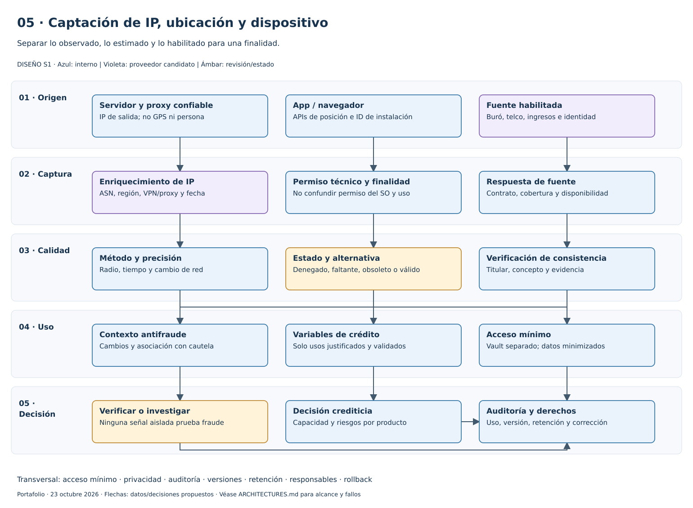
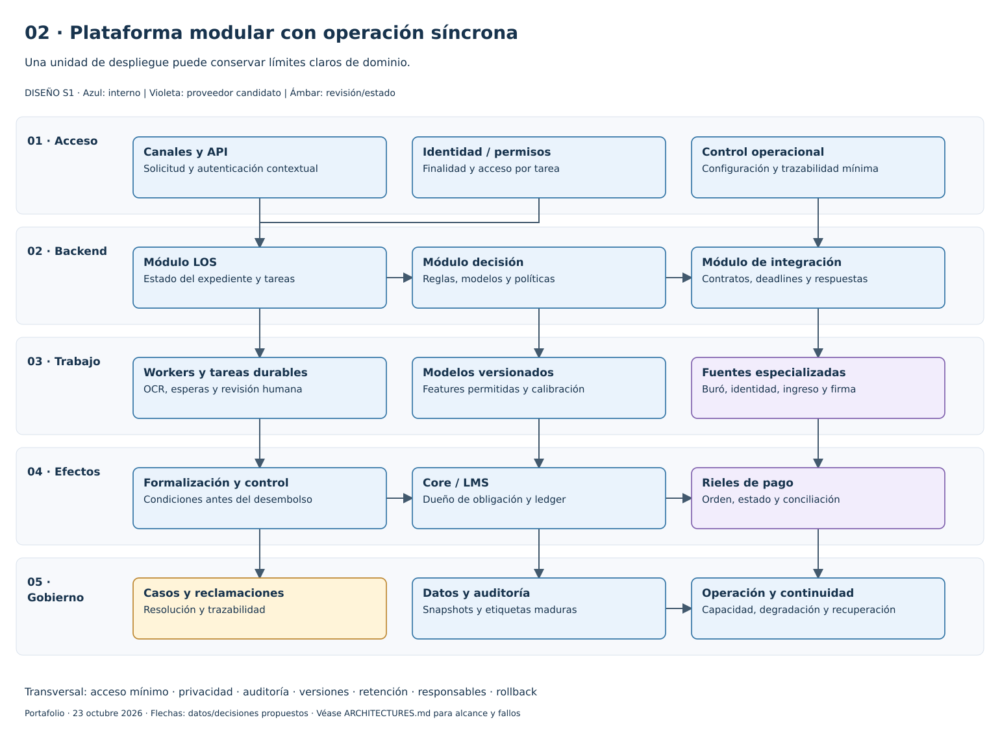
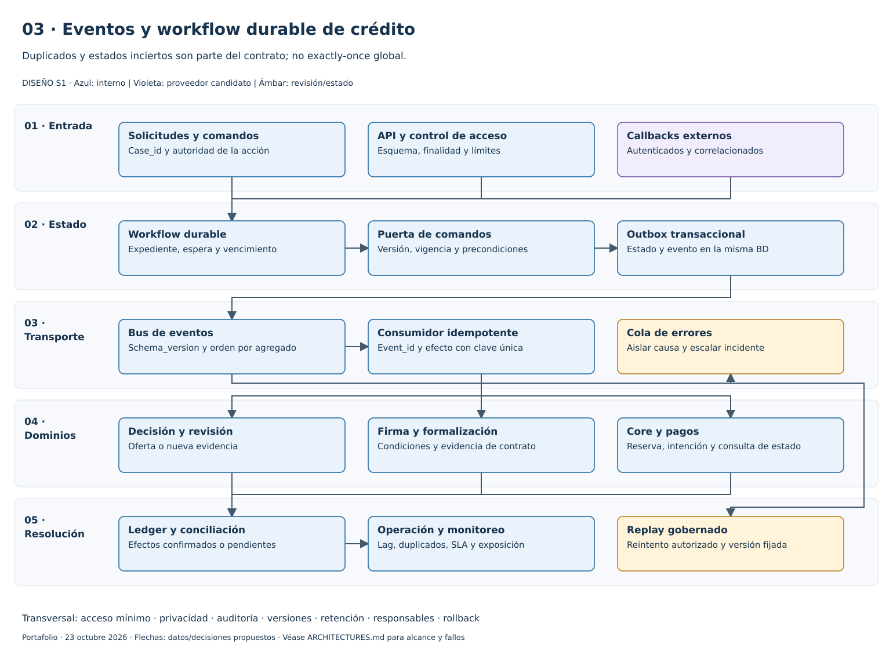
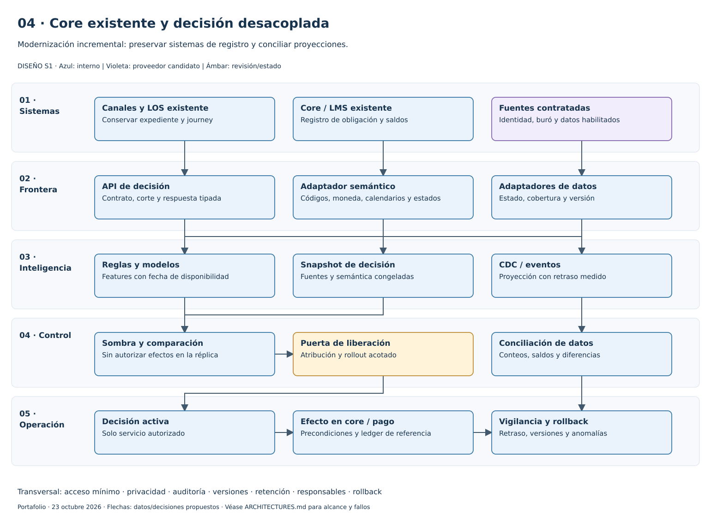
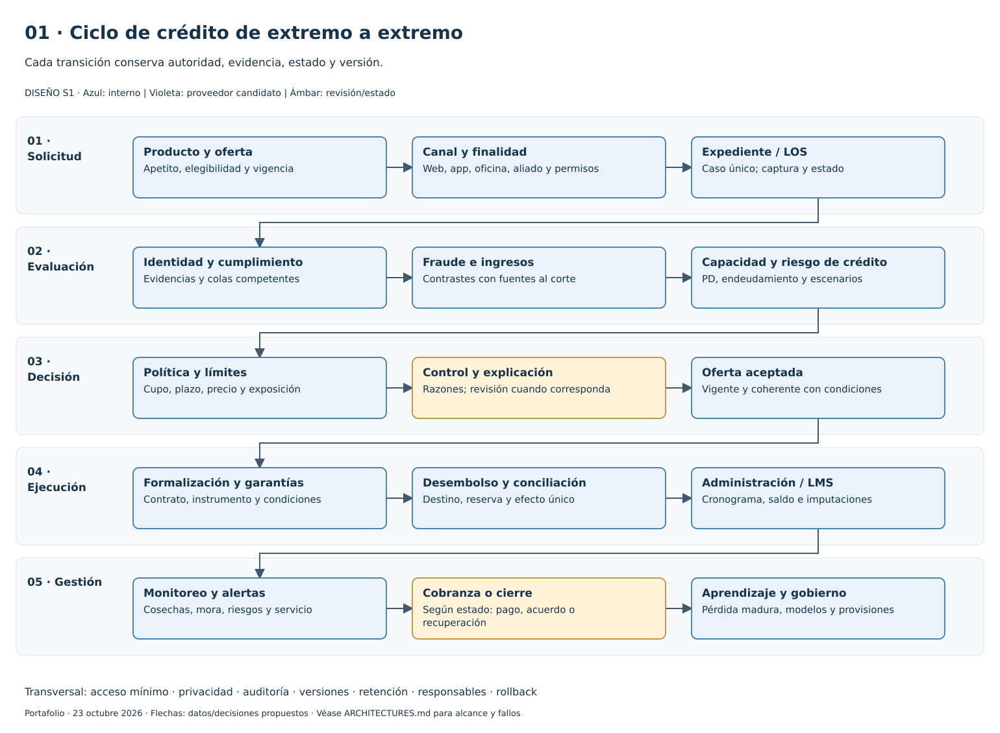
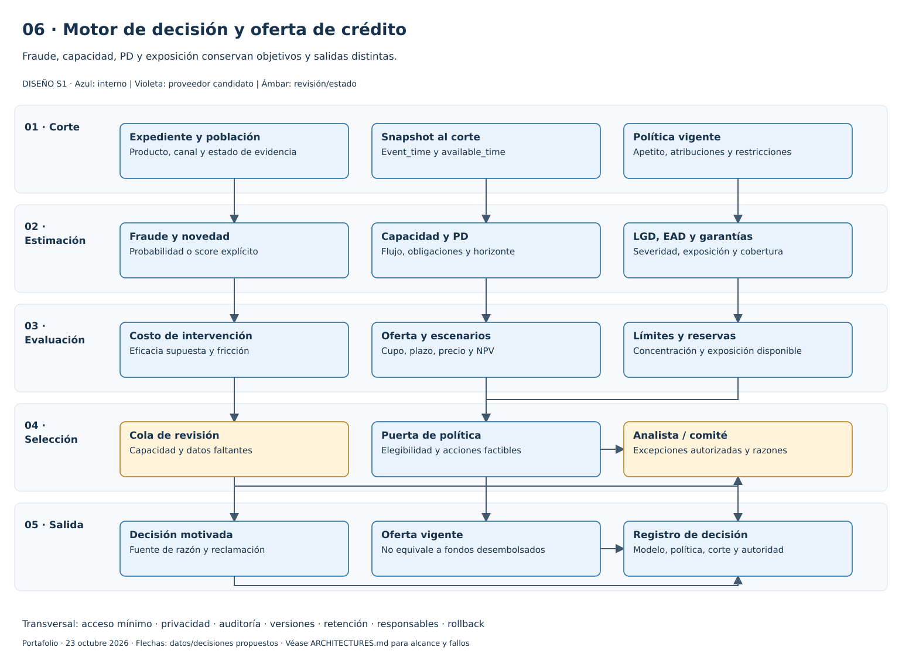
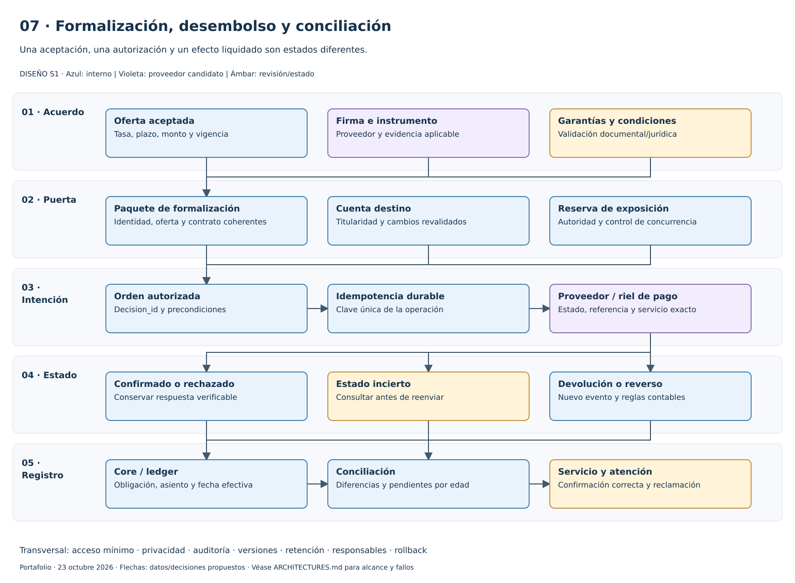
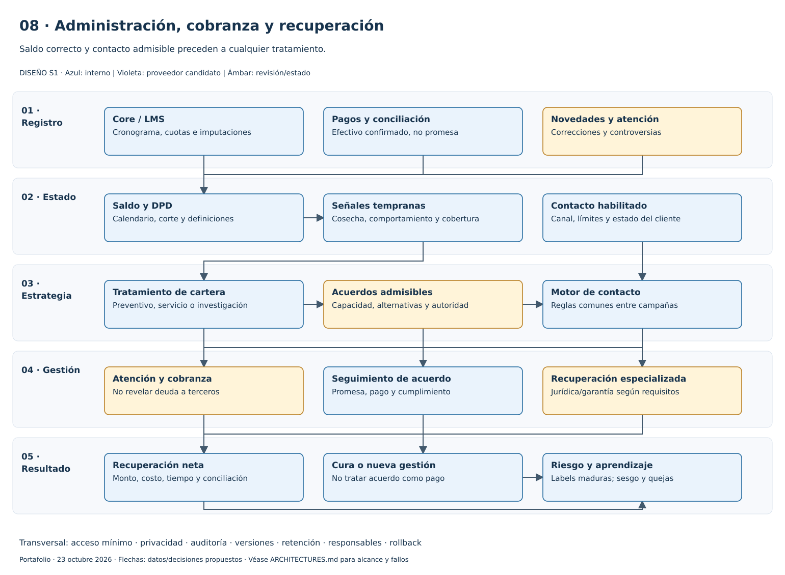
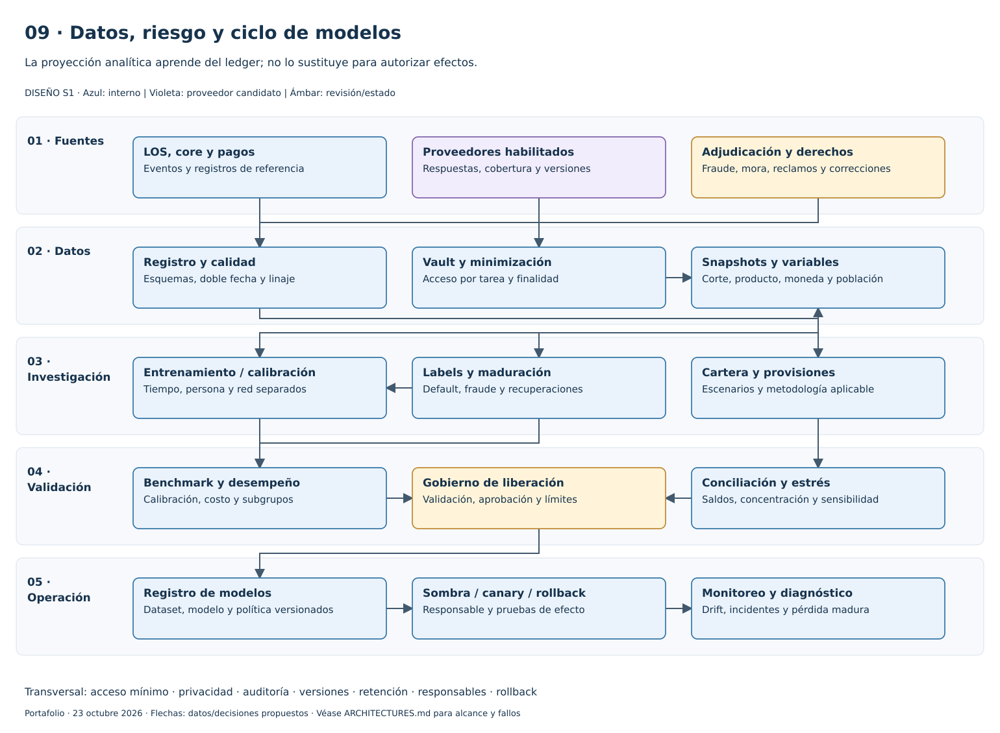

# Nueve diagramas del ciclo de crédito

Descargar [credit-lifecycle.drawio](credit-lifecycle.drawio) y abrir en diagrams.net/draw.io mediante **Archivo → Abrir desde → Dispositivo**. Incluye nueve páginas con 135 cajas de componentes y 142 conectores nativos; textos, cajas, contenedores y geometrías son editables. No son imágenes pegadas. Los contenedores representan capas lógicas; no se configuraron capas de visibilidad independientes.

| Página / SVG | Tipo | Pregunta que responde |
|---|---|---|
| [01-credit-cycle.svg](01-credit-cycle.svg) | Flujo integral | ¿Qué ocurre desde oferta/captación hasta recuperación y aprendizaje? |
| [02-modular.svg](02-modular.svg) | Alternativa de plataforma | ¿Cómo empezar con módulos claros sin separar todo en microservicios? |
| [03-event-workflow.svg](03-event-workflow.svg) | Alternativa de plataforma | ¿Cómo manejar esperas, callbacks, eventos duplicados y replay? |
| [04-existing-core.svg](04-existing-core.svg) | Alternativa de plataforma | ¿Cómo modernizar decisión/datos conservando un core existente? |
| [05-signal-capture.svg](05-signal-capture.svg) | Captación de señales | ¿Cómo entran IP, ubicación, dispositivo y datos externos con controles? |
| [06-credit-decision.svg](06-credit-decision.svg) | Evaluación y decisión | ¿Dónde se separan fraude, capacidad, PD y límites? |
| [07-disbursement.svg](07-disbursement.svg) | Formalización y efectos | ¿Cómo se pasa de aceptación a pago conciliado sin doble ejecución? |
| [08-servicing-collections.svg](08-servicing-collections.svg) | Servicio y cobranza | ¿Cómo se conectan saldo, contacto permitido, acuerdos y recuperación? |
| [09-risk-data-models.svg](09-risk-data-models.svg) | Datos y gobierno | ¿Cómo se producen variables, etiquetas, modelos y monitoreo? |

Las [cuatro vistas previas de defensa de fraude](../../../fraud-and-anomaly-research/ai-enabled-fraud-defense/diagrams/README.md) conservan detalle de KYC, documentos, sesión y red. Son trece vistas complementarias entre ambos archivos draw.io; no se duplica la fuente ni se fusionan responsabilidades del motor de fraude con el core.

## Captación y uso de señales

## Alternativas de plataforma

## Vistas de proceso

Reproducir desde cualquier directorio: `python <ruta-a-credit-lifecycle>/build_diagrams.py`. El script lee diagram_specs.json y reutiliza el renderer de las vistas de fraude; no modifica las cuatro páginas previas. Python estándar es suficiente.

XML mxGraph sin compresión y SVG comparten contenido, conectores y geometrías. El SVG es un render propio, no una exportación certificada desde draw.io. Las vistas fueron renderizadas con Inkscape para inspección visual; no se realizó un round-trip en la interfaz de draw.io. [Manifiesto](manifest.json), [QA](../evidence/qa.json).

Todas las páginas son S1: diseño. Las flechas muestran rutas principales; los flujos detallan bifurcaciones y excepciones. Representan intercambios propuestos, no conexiones desplegadas o proveedores contratados. Véanse las [capas](../ARCHITECTURES.md), [flujos y excepciones](../PROCESS_FLOWS.md) y [fuentes](../sources.json).
