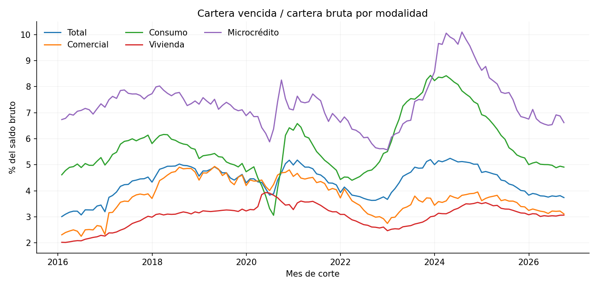
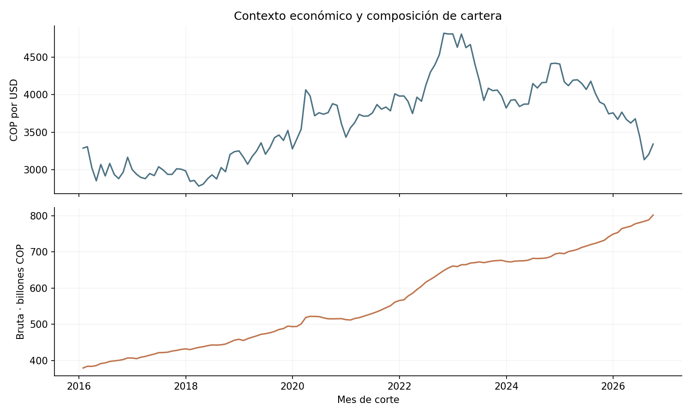
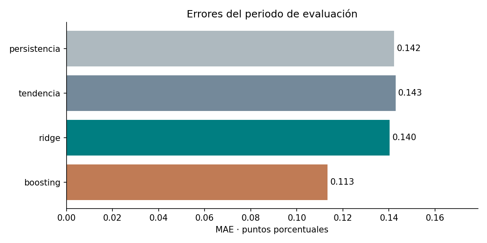
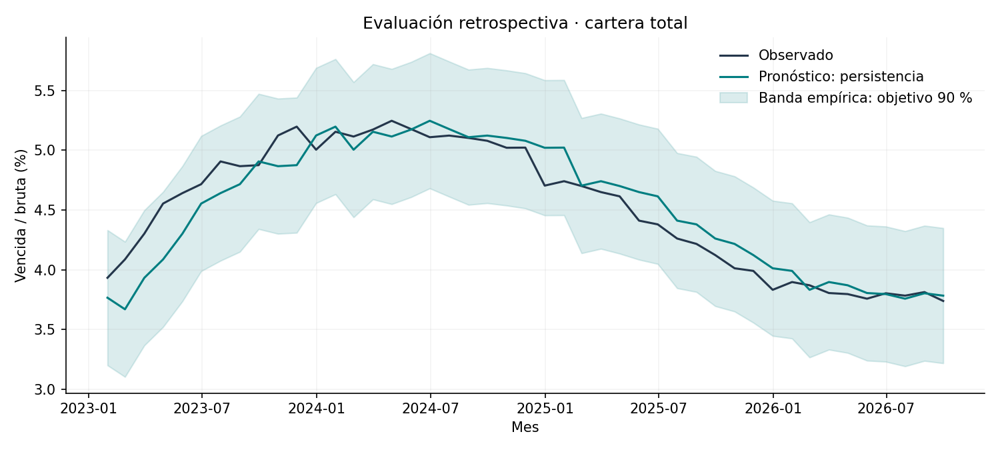

# Calidad de cartera: análisis y modelos exploratorios

**Resultado principal.** La regla seleccionada usando 2020–2022 fue mantener el último dato hipotéticamente disponible, de dos meses antes. En la evaluación retrospectiva de enero de 2023 a septiembre de 2026 obtuvo un MAE de **0,142 puntos porcentuales**. El modelo de gradient boosting obtuvo **0,113 puntos**, pero fue evaluado después de la selección y el resultado ya se ha observado: requiere una nueva prueba independiente antes de elegirlo.

## Datos y alcance

La serie contiene **129 meses**, desde enero de 2016 hasta septiembre de 2026, para establecimientos de crédito sin instituciones oficiales especiales. La información procede de las [series NIIF de la SFC](https://www.superfinanciera.gov.co/publicaciones/10086287/), procesadas por la entidad el 27 de octubre de 2026. El indicador es el saldo vencido dividido por el saldo bruto, en porcentaje; las definiciones de vencimiento dependen de la modalidad. Los saldos son corrientes y no son directamente comparables con valores reales sin ajustar por inflación. El dato nacional no equivale a PD individual ni mide la totalidad del sistema financiero.

Se incluye la [TRM oficial de Datos Abiertos](https://www.datos.gov.co/Econom-a-y-Finanzas/Tasa-de-Cambio-Representativa-del-Mercado-TRM/32sa-8pi3), vigente al cierre mensual, como proxy financiero; no es actividad económica. A septiembre de 2026, la cartera vencida representaba **3,739 %** del saldo bruto. Por modalidad: comercial **3,112 %**, consumo **4,909 %**, vivienda **3,066 %** y microcrédito **6,616 %**. Son cocientes separados con denominadores distintos y no deben sumarse ni interpretarse como comparaciones ajustadas por riesgo.

## Calidad y reconciliación

La transformación exige meses continuos, fechas únicas, valores finitos, saldos no negativos y denominadores positivos. En esta instantánea, la diferencia máxima entre el indicador publicado y el calculado desde los saldos es **0,000000497** en proporción; la suma de vigente y vencida concilia con la cartera bruta dentro de la tolerancia técnica. Las modalidades también suman al total dentro de precisión numérica en esta instantánea. La TRM se une mediante intervalos de vigencia comprobados y hashes de las descargas. No se ha verificado el archivo histórico que estaba disponible en cada mes, por lo que las revisiones de la fuente pueden afectar la evaluación.

## Comparación de modelos

| Modelo | Desarrollo 2020–2022: MAE | Evaluación 2023–septiembre 2026: MAE | Evaluación: RMSE | Sesgo evaluación |
|---|---:|---:|---:|---:|
| Persistencia | **0,208** | 0,142 | 0,185 | −0,003 |
| Tendencia | 0,219 | 0,143 | 0,182 | −0,001 |
| Ridge | 0,240 | 0,140 | 0,194 | −0,042 |
| Gradient boosting | 0,238 | **0,113** | 0,165 | −0,033 |

Valores en puntos porcentuales. Sesgo es predicción menos observación. La selección se hizo por MAE en el periodo de desarrollo, donde ganó persistencia; no se debe escoger boosting a posteriori basándose en el periodo de evaluación ya examinado. El desempeño favorable de boosting es una hipótesis para probar en datos nuevos, no garantía de mejora. Cada estimación utiliza una ventana expansiva y asume disponible la información hasta t−2.

## Incertidumbre y límites

La banda ilustrativa alrededor de la persistencia utiliza errores absolutos de desarrollo y tiene un radio de **0,565 puntos porcentuales**. Cubrió **45 de 45 meses** evaluados; esto describe únicamente esa muestra. La selección y calibración comparten datos, las observaciones temporales no son independientes y existen posibles revisiones. No hay garantía de que mantenga una cobertura del 90 % ni de que sea adecuada para decisiones.

Los errores absolutos más altos de persistencia ocurrieron durante la subida de la cartera vencida en abril, febrero y marzo de 2023, con 0,467, 0,417 y 0,369 puntos, respectivamente. Es una descripción de los errores, no una explicación causal.

La muestra es pequeña para un problema financiero con cambios de régimen; se requieren datos puntuales de publicación y versiones originales, una prueba temporal nueva y comparación con pronósticos oficiales. Las cifras agregadas no autorizan evaluación de personas, concesión de crédito, alertas regulatorias ni cálculo de ECL. Los detalles, variables y controles están en la [especificación](../docs/modelo-y-gobierno.md), y las [métricas](../results/metricas.csv) y [predicciones](../results/predicciones.csv) permiten revisar cada cálculo.
