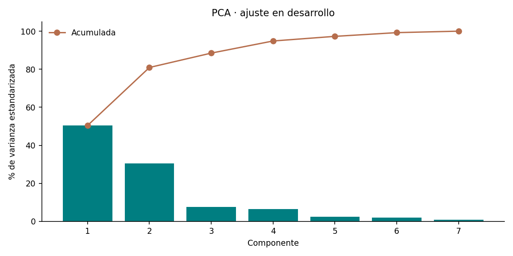
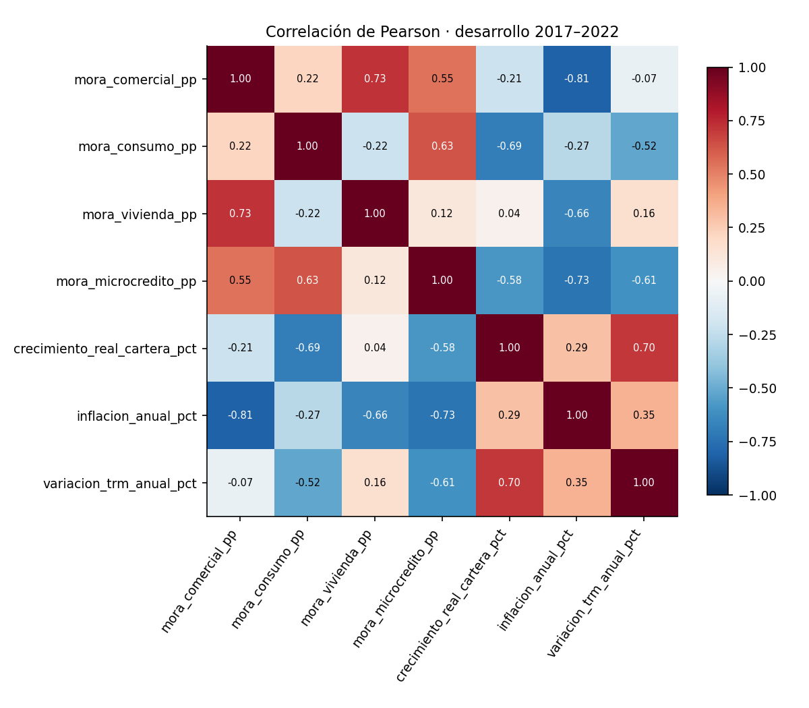
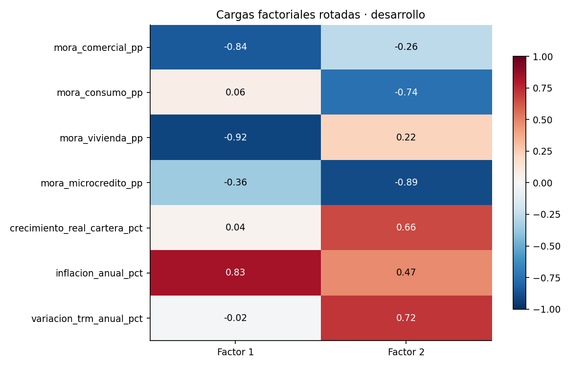
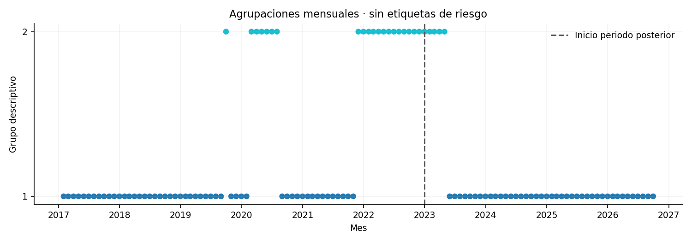
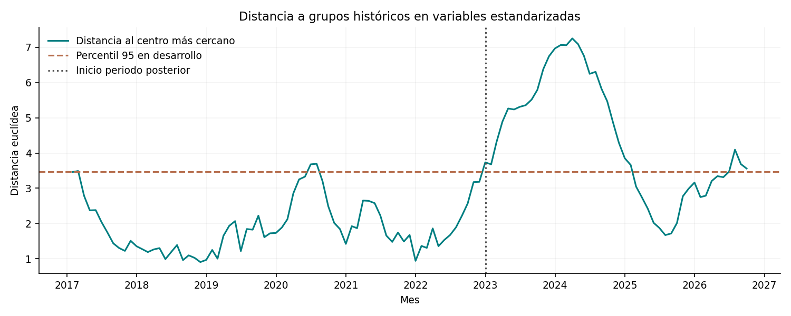

# Patrones financieros y económicos: PCA, factores y agrupaciones

**Resultado principal.** Dos componentes principales resumen el **80,90 %** de la variación estandarizada de las siete variables en 2017–2022. Sin embargo, la estructura cambia en los datos posteriores: **28 de 45 meses** de 2023–septiembre de 2026 quedan más lejos de los centros de los grupos históricos que el percentil 95 de sus distancias de desarrollo. Las agrupaciones son descriptivas; no clasifican personas ni estiman probabilidades de incumplimiento.

## Datos y diseño

Se utilizan 117 observaciones mensuales de enero de 2017 a septiembre de 2026. Las variables son los indicadores de cartera vencida sobre bruta de comercial, consumo, vivienda y microcrédito; crecimiento interanual de cartera bruta ajustado por el IPC nacional; inflación a doce meses y variación interanual de la TRM. El crecimiento real es una aproximación por precios al consumidor, no un deflactor específico de cartera. Las modalidades comparten condiciones del sistema, y algunas relaciones pueden ser mecánicas.

Las fuentes son las [series NIIF de la SFC](https://www.superfinanciera.gov.co/publicaciones/10086287/) para establecimientos de crédito sin IOE, el [IPC empalmado del DANE](https://www.dane.gov.co/files/operaciones/IPC/oct2026/anex-IPC-Indices-oct2026.xlsx) y la [TRM pública](https://www.datos.gov.co/Econom-a-y-Finanzas/Tasa-de-Cambio-Representativa-del-Mercado-TRM/32sa-8pi3). Datos y hashes están en el proyecto. Son versiones históricas descargadas en 2026; no reconstruyen la información disponible en cada fecha.

Se reservan 72 meses de 2017–2022 para ajustar medias, escalas, PCA, factores y agrupaciones; los 45 meses posteriores se transforman con esos parámetros. Se trata de una partición temporal descriptiva ya examinada, no de una prueba independiente nueva. No se imputan faltantes. Las observaciones mensuales y variaciones interanuales solapadas son dependientes: no deben tratarse como 117 experimentos independientes.

## Componentes principales

| Componente | Varianza en desarrollo | Acumulada |
|---|---:|---:|
| PC1 | 50,41 % | 50,41 % |
| PC2 | 30,49 % | 80,90 % |
| PC3 | 7,57 % | 88,47 % |

Las [cargas](../../results/multivariado/pca_cargas.csv) muestran que, en desarrollo y con la orientación calculada, PC1 se relaciona positivamente con mora de microcrédito (0,91), comercial (0,70) y consumo (0,68), y negativamente con inflación (−0,83) y crecimiento real de cartera (−0,73). PC2 tiene una carga alta en mora de vivienda (0,87). El signo de cada componente puede invertirse sin cambiar el resultado; estos valores describen asociaciones en la muestra, no efectos causales ni una escala universal de riesgo.

Las correlaciones no son estables en el tiempo. Por ejemplo, la correlación contemporánea entre inflación y mora de consumo pasa de **−0,27** en desarrollo a **0,43** en el periodo posterior. La comparación es descriptiva y susceptible a tendencias, rezagos, autocorrelación y cambios de composición; no identifica una inversión causal ni estima significancia estadística.

## Análisis factorial

Se ajustaron **dos factores comunes** con rotación varimax en el periodo de desarrollo. La elección de dos facilita la lectura y no prueba que existan exactamente dos causas latentes; el algoritmo convergió en 28 iteraciones. En la orientación obtenida, el primer factor tiene cargas de −0,92 en vivienda, −0,84 en comercial y 0,83 en inflación. El segundo tiene carga de −0,89 en microcrédito y 0,72 en variación de TRM. La rotación y los signos son convenciones; no se identifican shocks económicos causales.

Las varianzas específicas y las siete cargas de cada factor están en la [tabla factorial](../../results/multivariado/factor_cargas.csv). Este ajuste de muestra pequeña, con series serialmente dependientes y posibles cambios estructurales, requiere sensibilidad a número de factores y revisión fuera de muestra antes de interpretaciones fuertes.

## Agrupaciones de periodos

K-means se ajustó con las variables estandarizadas de desarrollo; se compararon k=2 a 5 y se escogió **k=2** por la mayor silueta de desarrollo, **0,388**. El grupo 1 contiene 51 meses de desarrollo y 41 posteriores; el grupo 2, 21 y 4 respectivamente. Los números son etiquetas arbitrarias, no niveles de riesgo ni tipos de cliente. Las [medias por grupo y periodo](../../results/multivariado/perfiles_grupo.csv) permiten explorar sus perfiles sin suponer que los grupos son homogéneos.

Como contraste se ajustó una mezcla gaussiana con dos componentes y covarianza diagonal. El acuerdo ajustado por azar entre las particiones fue **0,887 en desarrollo** y **0,310 en el periodo posterior**. La caída muestra sensibilidad a la forma del modelo, no valida una clasificación verdadera; los cuatro meses posteriores del segundo grupo K-means hacen especialmente frágil la comparación. La pertenencia probabilística de la mezcla depende de sus supuestos y no es probabilidad de crisis o mora. Un valor alto tampoco corrige observaciones fuera de la distribución histórica.

## Estabilidad y uso

El **62,22 %** de los meses posteriores supera el percentil 95 de distancia al centro más cercano calculado en desarrollo. Es un umbral descriptivo interno, no una prueba formal ni una tasa de anomalías validada. El error medio de reconstrucción de las siete variables con dos componentes, usando la escala histórica, fue **0,191** en desarrollo y **1,240** después. La comparación incluye ajuste dentro de muestra frente a datos posteriores; no atribuye una causa al cambio, pero muestra que extrapolar el resumen histórico merece cautela.

Antes de usar estos resultados para decisiones se requieren versiones históricas disponibles en cada fecha, datos adicionales por entidad y territorio comparables, sensibilidad a ventanas y transformaciones, tratamiento explícito de tendencias y dependencia, y evaluación independiente. La serie nacional no permite asignar calificaciones individuales, predecir quiebras ni atribuir un cambio económico a una sola variable. Los [resultados completos](../../results/multivariado/) incluyen observaciones, coordenadas, distancias, cargas y correlaciones.
