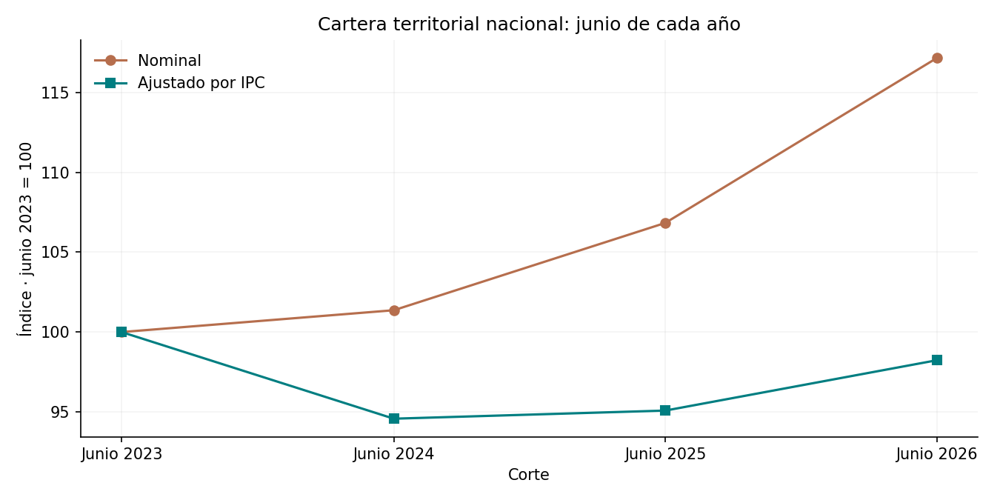
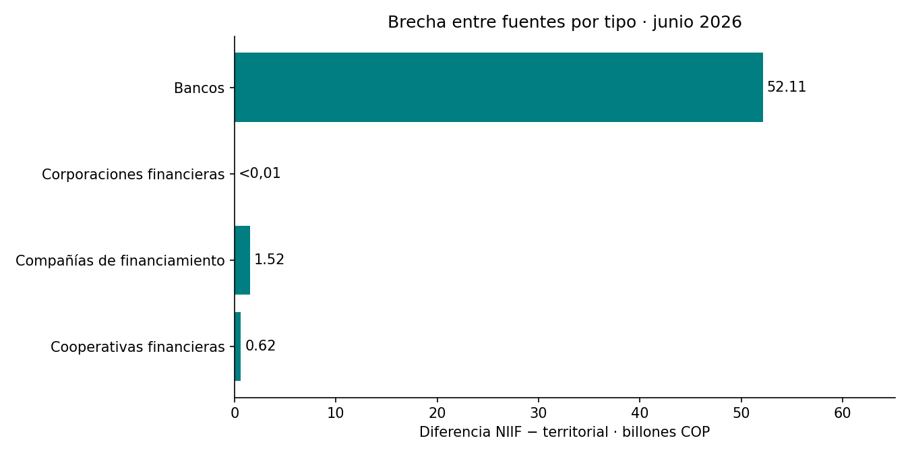
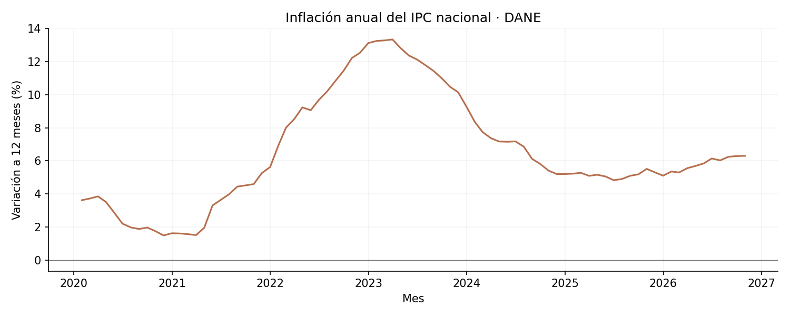
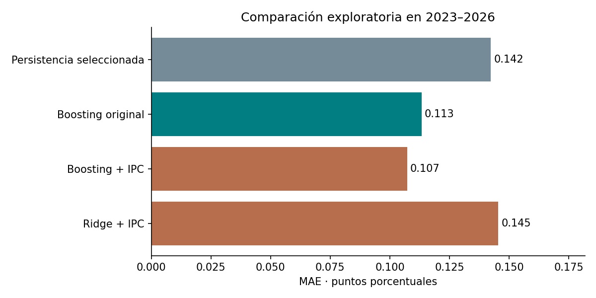
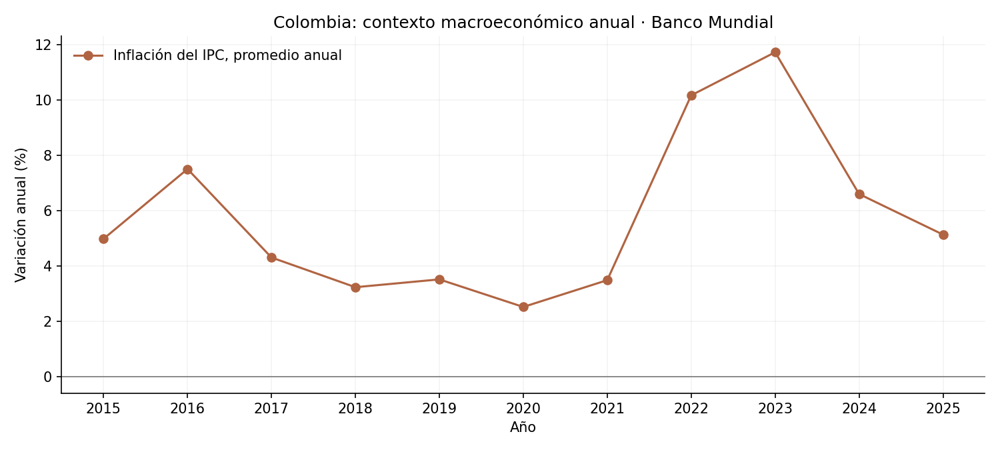

# Cartera, territorio y contexto económico

La cartera informada en el total nacional de la base territorial de la SFC —sin instituciones oficiales especiales— pasó de **662,88 billones de pesos en junio de 2025 a 726,89 billones en junio de 2026**, un aumento nominal de **9,66 %**. Ajustado por el IPC nacional del DANE entre ambos meses, el aumento es aproximadamente **3,31 %**. Esta es una comparación a precios de consumo, no un deflactor específico de crédito, y no demuestra una mejora del acceso o del bienestar.

La serie comprende cuatro cortes de junio (2023–2026). Con junio de 2023 como base 100, el saldo nominal llega a **117,15** en 2026 y el saldo ajustado por IPC a **98,24**; no se observan los trimestres intermedios en esta comparación. El cálculo utiliza los índices DANE publicados con dos decimales, no una serie de precios de activos o servicios financieros.

## Distribución territorial

Para junio de 2026 se homologaron **1.073 municipios** con la DIVIPOLA del DANE. Sus saldos representan **99,37 %** del total nacional publicado en esa base. Bogotá concentra **37,88 %**, Antioquia **23,46 %**, Valle del Cauca **8,54 %** y Atlántico **5,45 %**. Las cifras departamentales son sumas de municipios homologados, no necesariamente totales departamentales completos; excluyen los registros en cuarentena.

Cada punto utiliza la coordenada del municipio publicada en DIVIPOLA. El color muestra el logaritmo del saldo en millones de pesos: una diferencia de una unidad en la escala equivale a diez veces el saldo. El gráfico no representa límites municipales ni la localización precisa de sucursales o deudores.

La [tabla municipal](../../data/territorial/processed/municipios.csv) también divide cada saldo entre la proyección anual de población del DANE para el mismo año. Es una razón descriptiva en pesos por habitante, no el crédito de cada residente ni una medida de acceso: el lugar de registro de una operación puede diferir de la residencia o actividad económica del deudor. La población es una proyección, no un conteo observado en junio. No se hacen afirmaciones de causalidad o de riesgo de una persona a partir del territorio.

## Calidad del cruce

La fuente SFC contiene registros municipales y subtotales de departamento y nación. Se excluyeron los subtotales antes de sumar municipios, y se excluyó el tipo de entidad 22 (IOE), como en la serie nacional del modelo. El código departamental de esa fuente no coincide con DIVIPOLA: se homologó mediante los nombres de sus subtotales, y se combinaron códigos municipales con la DIVIPOLA. Cuatro alias de ciudades principales se aceptaron explícitamente tras comprobar nombre y código; otras discrepancias permanecen en [cuarentena](../../data/territorial/processed/cuarentena_homologacion.csv).

En junio de 2026 la cuarentena agrupa **39 códigos municipales** y **0,628 %** de la cartera nacional reportada; no se asignaron por similitud. Los [candidatos con código coincidente](../../data/territorial/processed/candidatos_sensibilidad.csv) permiten revisar diferencias de nombres, pero no se añaden automáticamente a los resultados ni se consideran homologados. La suma de municipios antes de esa cuarentena queda **0,00265 % por debajo** del total nacional de la misma fuente. Se conserva la diferencia: no se conoce su causa. Las pruebas de fuente no encontraron claves repetidas por fecha, tipo de entidad, entidad y municipio para los cuatro cortes, y se verificaron faltantes y totales. Ver [calidad por fecha](../../data/territorial/processed/calidad.csv).

**Las dos fuentes nacionales no concilian entre sí:** en junio de 2026, el archivo NIIF del modelo reporta **781,14 billones** de cartera bruta, frente a **726,89 billones** en el total de la base municipal sin IOE: una diferencia de **54,25 billones**. Los archivos pueden tener diferencias de cobertura, definición o fecha de procesamiento, pero aquí no se ha identificado la causa. No se mezclan ambos saldos ni se usa la distribución municipal para descomponer el indicador nacional de mora.

La comparación exploratoria por tipo de entidad atribuye **52,11 billones** de esa diferencia a los agregados de bancos, aproximadamente **96,05 %** de la suma de diferencias por tipo. Las series NIIF de bancos y cooperativas consultadas fueron procesadas el 25 de septiembre de 2026; las de corporaciones, compañías y el agregado NIIF, el 27 de octubre. Esta descomposición orienta una investigación, pero las fechas de procesamiento distintas y posibles diferencias de definición impiden inferir la causa. Se conservan las [cifras por tipo y sus fechas](../../data/territorial/processed/brecha_por_tipo.csv).

## Contexto macroeconómico

El DANE publica un IPC empalmado de **150,30** para junio de 2025 y **159,53** para junio de 2026, equivalentes a una variación de **6,14 %** usando los índices redondeados publicados. La variación real aproximada se calcula como `(1 + variación nominal) / (IPC final / IPC inicial) − 1`. No se ha estimado un vínculo causal con la mora.

El Banco Mundial informa una inflación media anual del IPC para Colombia de **11,74 % en 2023**, **6,61 % en 2024** y **5,14 % en 2025**. Esa serie anual es contexto y tiene una definición de periodo distinta al cambio junio a junio.

## Experimento predictivo con inflación

Se incorporó la inflación del IPC a doce meses, rezagada dos meses, como variable adicional de Ridge y gradient boosting, usando las mismas fechas y la ventana expansiva del modelo inicial. En los 45 meses ya observados de 2023–septiembre de 2026, el MAE de boosting fue **0,107 puntos porcentuales con IPC** frente a **0,113 sin IPC**; Ridge pasó de **0,140 a 0,145**. En desarrollo 2020–2022, el boosting con IPC tuvo un MAE de 0,224, frente a 0,208 de persistencia, que sigue siendo la regla seleccionada.

Estos resultados son exploratorios: el periodo posterior se examinó antes de añadir el IPC, y la serie es una descarga revisada, no una reconstrucción de los datos disponibles en cada fecha. No prueban que la inflación cause cambios en la mora ni justifican cambiar el modelo seleccionado. Se requiere una prueba posterior independiente y verificar la disponibilidad de las versiones. Los [pronósticos](../../results/predicciones_ipc.csv) y [métricas](../../results/metricas_ipc.csv) permiten comprobar la comparación.

## Fuentes y límites

- [SFC: captaciones y colocaciones por municipios](https://www.datos.gov.co/Econom-a-y-Finanzas/Saldo-de-las-captaciones-y-colocaciones-por-munici/u2wk-tfe3), cortes de junio de 2023 a 2026; agregación por entidad y municipio reproducida en la consulta guardada.
- [DANE: DIVIPOLA municipal](https://www.datos.gov.co/Mapas-Nacionales/DIVIPOLA-C-digos-municipios/gdxc-w37w), referencia con coordenadas; su cobertura y nombres pueden cambiar en el tiempo.
- [DANE: proyecciones de población](https://www.dane.gov.co/index.php/estadisticas-por-tema/demografia-y-poblacion/proyecciones-de-poblacion), serie municipal 2018–2042, total anual por municipio.
- [Banco Mundial: inflación media anual del IPC](https://data.worldbank.org/indicator/FP.CPI.TOTL.ZG?locations=CO), serie anual de Colombia. Es una descarga revisable.
- [DANE: IPC mensual, serie empalmada](https://www.dane.gov.co/files/operaciones/IPC/oct2026/anex-IPC-Indices-oct2026.xlsx), descargada con corte publicado a octubre de 2026.
- [SFC: series NIIF por tipo de entidad](https://www.superfinanciera.gov.co/publicaciones/10086287/); archivos y fechas de procesamiento conservados en el manifiesto.

Los cuatro cortes territoriales disponibles en este ejercicio no validan un modelo geoespacial. El IPC se usa en un experimento predictivo separado y no modifica el modelo seleccionado. Los datos agregados no sirven para decisiones individuales de crédito.
