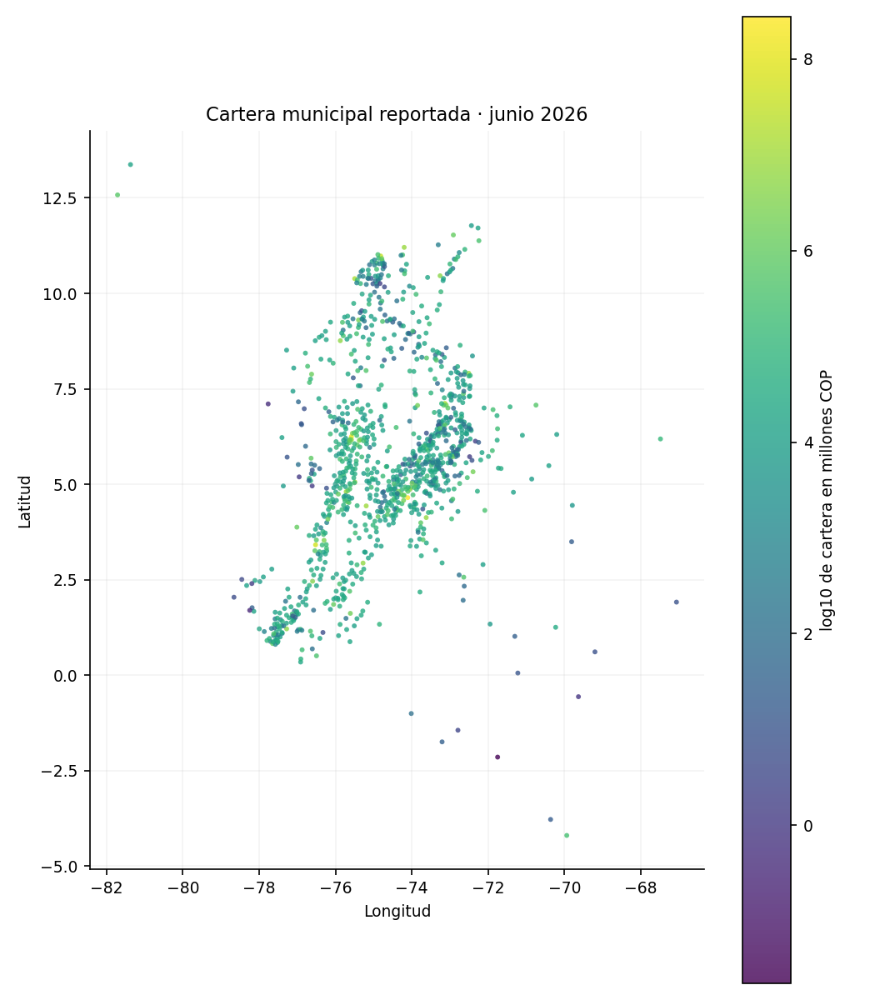
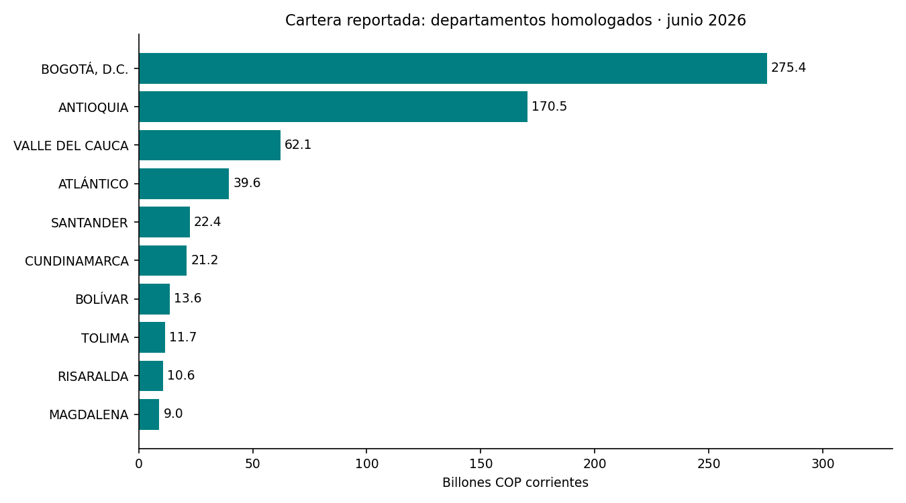

# Cartera, territorio y contexto económico

La cartera informada en el total nacional de la base territorial de la SFC —sin instituciones oficiales especiales— pasó de **662,88 billones de pesos en junio de 2025 a 726,89 billones en junio de 2026**, un aumento nominal de **9,66 %**. Son saldos corrientes; el cambio no está ajustado por inflación ni muestra por sí mismo si aumentó el crédito real, el acceso o el bienestar.

## Distribución territorial

Para junio de 2026 se homologaron **1.073 municipios** con la DIVIPOLA del DANE. Sus saldos representan **99,37 %** del total nacional publicado en esa base. Bogotá concentra **37,88 %**, Antioquia **23,46 %**, Valle del Cauca **8,54 %** y Atlántico **5,45 %**. Las cifras departamentales son sumas de municipios homologados, no necesariamente totales departamentales completos; excluyen los registros en cuarentena.

Cada punto utiliza la coordenada del municipio publicada en DIVIPOLA. El color muestra el logaritmo del saldo en millones de pesos: una diferencia de una unidad en la escala equivale a diez veces el saldo. El gráfico no representa límites municipales ni la localización precisa de sucursales o deudores.

La [tabla municipal](../../data/territorial/processed/municipios.csv) también divide cada saldo entre la proyección anual de población del DANE para el mismo año. Es una razón descriptiva en pesos por habitante, no el crédito de cada residente ni una medida de acceso: el lugar de registro de una operación puede diferir de la residencia o actividad económica del deudor. La población es una proyección, no un conteo observado en junio. No se hacen afirmaciones de causalidad o de riesgo de una persona a partir del territorio.

## Calidad del cruce

La fuente SFC contiene registros municipales y subtotales de departamento y nación. Se excluyeron los subtotales antes de sumar municipios, y se excluyó el tipo de entidad 22 (IOE), como en la serie nacional del modelo. El código departamental de esa fuente no coincide con DIVIPOLA: se homologó mediante los nombres de sus subtotales, y se combinaron códigos municipales con la DIVIPOLA. Cuatro alias de ciudades principales se aceptaron explícitamente tras comprobar nombre y código; otras discrepancias permanecen en [cuarentena](../../data/territorial/processed/cuarentena_homologacion.csv).

En junio de 2026 la cuarentena agrupa **39 códigos municipales** y **0,628 %** de la cartera nacional reportada; no se asignaron por similitud. La suma de municipios antes de esa cuarentena queda **0,00265 % por debajo** del total nacional de la misma fuente. Se conserva la diferencia: no se conoce su causa. Las pruebas de fuente no encontraron claves repetidas por fecha, tipo de entidad, entidad y municipio para los dos cortes, y se verificaron faltantes y totales. Ver [calidad por fecha](../../data/territorial/processed/calidad.csv).

**Las dos fuentes nacionales no concilian entre sí:** en junio de 2026, el archivo NIIF del modelo reporta **781,14 billones** de cartera bruta, frente a **726,89 billones** en el total de la base municipal sin IOE: una diferencia de **54,25 billones**. Los archivos pueden tener diferencias de cobertura, definición o fecha de procesamiento, pero aquí no se ha identificado la causa. No se mezclan ambos saldos ni se usa la distribución municipal para descomponer el indicador nacional de mora.

## Contexto macroeconómico

El Banco Mundial informa una inflación media anual del IPC para Colombia de **11,74 % en 2023**, **6,61 % en 2024** y **5,14 % en 2025**. Esta serie anual se presenta como contexto: no es la inflación acumulada entre junio de 2025 y junio de 2026 y no se utiliza para deflactar ese cambio de cartera. No se ha estimado un vínculo causal con la mora.

## Fuentes y límites

- [SFC: captaciones y colocaciones por municipios](https://www.datos.gov.co/Econom-a-y-Finanzas/Saldo-de-las-captaciones-y-colocaciones-por-munici/u2wk-tfe3), cortes 30 de junio de 2025 y 2026; agregación por entidad y municipio reproducida en la consulta guardada.
- [DANE: DIVIPOLA municipal](https://www.datos.gov.co/Mapas-Nacionales/DIVIPOLA-C-digos-municipios/gdxc-w37w), referencia con coordenadas; su cobertura y nombres pueden cambiar en el tiempo.
- [DANE: proyecciones de población](https://www.dane.gov.co/index.php/estadisticas-por-tema/demografia-y-poblacion/proyecciones-de-poblacion), serie municipal 2018–2042, total anual por municipio.
- [Banco Mundial: inflación media anual del IPC](https://data.worldbank.org/indicator/FP.CPI.TOTL.ZG?locations=CO), serie anual de Colombia. Es una descarga revisable.

Las fuentes territoriales y macroeconómicas se incorporan como análisis descriptivo. Las dos observaciones territoriales disponibles en este ejercicio no validan un modelo geoespacial y la inflación anual no entra al modelo predictivo, porque todavía no se reconstruyen sus fechas históricas de divulgación y revisiones. Los datos agregados no sirven para decisiones individuales de crédito.
