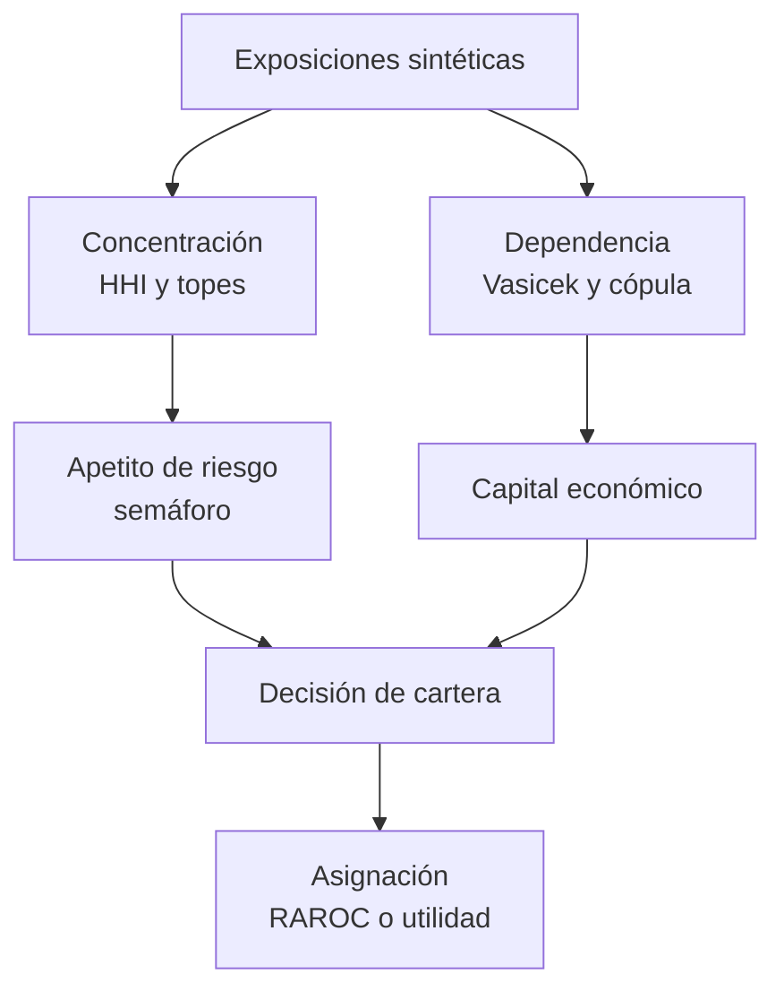

# Riesgo de crédito: estrategia y portafolio

Laboratorio reproducible para decisiones de concentración, capital, dependencia y apetito de riesgo. Cada proyecto es autocontenido, usa datos sintéticos con semilla fija y separa claramente el cálculo ilustrativo de una decisión de crédito productiva.

## Proyectos

| Proyecto | Pregunta de decisión | Técnica principal |
|---|---|---|
| [Concentración de cartera con HHI](concentracion-hhi-cartera) | ¿La cartera depende de pocos deudores o sectores? | HHI, número efectivo, top-N y límites |
| [Capital de Vasicek frente a Monte Carlo](vasicek-perdida-no-esperada) | ¿Cuál es la pérdida no esperada a 99,9 %? | ASRF de un factor y simulación finita |
| [Distribución de pérdidas con cópula gaussiana](copula-gaussiana-perdidas) | ¿Cómo cambia la cola al introducir dependencia? | Factor común, VaR y ES |
| [Monitor de límites de apetito](monitor-de-limites-de-apetito) | ¿Qué límites requieren escalamiento? | Utilización y semáforo auditable |
| [Asignación de cartera por RAROC](asignacion-de-capital-raroc) | ¿Qué mezcla maximiza eficiencia de capital? | Programación lineal fraccional; comparación contra utilidad |

## Contrato de datos y reproducibilidad

La especificación de una base de datos relacional y vistas de control está en [sql/credit_portfolio_schema.sql](sql/credit_portfolio_schema.sql). Es un esquema de referencia PostgreSQL: separa contraparte, exposición, métricas y límites, y evita usar valores agregados como evidencia de cliente.

| Artefacto | Propósito |
|---|---|
| `main.py` | Ejemplo mínimo ejecutable por proyecto |
| `notebook.ipynb` | Investigación, diagnóstico y aserciones reproducibles |
| `README.md` | Supuestos, uso y límites por método |
| `sql/` | Contrato de almacenamiento y consultas de control |

Los ejemplos no incluyen datos reales ni pretenden calibrar un modelo. Antes de uso operativo se requerirían linaje, validación independiente, estimación PD/LGD/EAD, pruebas de estrés, aprobación de modelo y gobierno de cambios.
