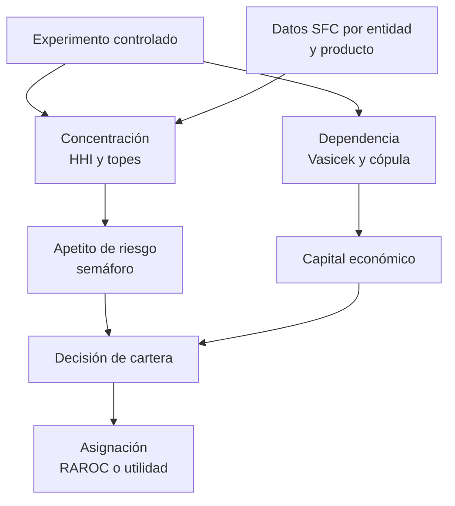

# Riesgo de crédito: estrategia y portafolio

Laboratorios controlados para estudiar concentración, capital, dependencia y apetito de riesgo, complementados donde es posible con aplicaciones de datos observados. El proyecto HHI incorpora saldos públicos de la SFC por entidad acreedora y producto; esos agregados no sustituyen exposiciones por deudor para decisiones internas.

## Proyectos

| Proyecto | Pregunta de decisión | Técnica principal |
|---|---|---|
| [Concentración de cartera con HHI](concentracion-hhi-cartera) | ¿Cómo se concentra el saldo entre deudores/sectores en el laboratorio y entre acreedores por producto en datos oficiales? | HHI, número efectivo, top-N y comparación temporal |
| [Capital de Vasicek frente a Monte Carlo](vasicek-perdida-no-esperada) | ¿Cuál es la pérdida no esperada a 99,9 %? | ASRF de un factor y simulación finita |
| [Distribución de pérdidas con cópula gaussiana](copula-gaussiana-perdidas) | ¿Cómo cambia la cola al introducir dependencia? | Factor común, VaR y ES |
| [Monitor de límites de apetito](monitor-de-limites-de-apetito) | ¿Qué límites requieren escalamiento? | Utilización y semáforo auditable |
| [Asignación de cartera por RAROC](asignacion-de-capital-raroc) | ¿Qué mezcla maximiza eficiencia de capital? | Programación lineal fraccional; comparación contra utilidad |
| [Tarifación paramétrica climática](climate-parametric-pricing) | ¿Cómo tarifar índices climáticos con cambio de distribución y riesgo de base? | Burn analysis, tendencia condicional, TVaR, basis risk y asequibilidad |

## Contrato de datos y reproducibilidad

La especificación de una base de datos relacional y vistas de control está en [sql/credit_portfolio_schema.sql](sql/credit_portfolio_schema.sql). Es un esquema de referencia PostgreSQL: separa contraparte, exposición, métricas y límites, y evita usar valores agregados como evidencia de cliente.

| Artefacto | Propósito |
|---|---|
| `main.py` | Ejemplo mínimo ejecutable por proyecto |
| `notebook.ipynb` | Investigación, diagnóstico y aserciones reproducibles |
| `README.md` | Supuestos, uso y límites por método |
| `sql/` | Contrato de almacenamiento y consultas de control |

Las aplicaciones agregadas observadas informan sobre concentración del sistema; no calibran exposición por cliente, riesgo de default ni límites internos de una entidad. Los proyectos que aún no cuentan con evidencia observada mantienen su alcance explícito. Antes de uso operativo se requieren linaje, validación independiente, límites institucionales, pruebas de estrés, aprobación y gobierno de cambios.
