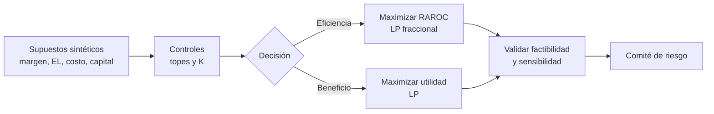

# Asignación de cartera por RAROC

Ejemplo reproducible de asignación de exposición entre segmentos de crédito. Distingue explícitamente dos decisiones que suelen confundirse:

| Decisión | Objetivo | Uso adecuado |
|---|---|---|
| Máximo RAROC | `utilidad / capital` | Eficiencia ajustada por capital |
| Máxima utilidad | `utilidad` | Crecimiento/beneficio sujeto a presupuesto de capital |

El script resuelve el primer objetivo exactamente con la transformación lineal-fraccional de Charnes--Cooper; el segundo se conserva como comparación. Por tanto, no afirma que una optimización de utilidad esté maximizando RAROC.

## Formulación

Para pesos de exposición `x`, utilidad neta unitaria `π`, cargo de capital `k`, topes `u` y presupuesto `K`:

\[
\max_x \frac{\pi^\top x}{k^\top x}\quad
\text{s.a.}\quad \mathbf{1}^\top x=1,\; k^\top x\leq K,\;0\leq x_i\leq u_i.
\]

Con `y=x/(k'x)` y `t=1/(k'x)`, se resuelve un LP global: maximizar `π'y`, con `1'y=t`, `k'y=1`, `Kt≥1` y `yᵢ≤uᵢt`. El modelo asume cargos de capital lineales; para dependencia, diversificación y error de estimación consulte el [notebook](notebook.ipynb).



## Datos y límites

Los seis segmentos y todos sus parámetros son **sintéticos y deterministas**, declarados en `segmentos_sinteticos()`. No hay clientes, operaciones, precios ni desempeño real. `pérdida_esperada` es un insumo resumido; no sustituye PD, LGD, EAD, correlación, impuestos, liquidez o costos de fondeo. Un RAROC alto tampoco autoriza originación: los topes deben provenir del apetito de riesgo aprobado.

## Ejecución y pruebas

```bash
pip install numpy pandas scipy
python3 main.py
python3 -m unittest test_model.py
```

`test_model.py` comprueba presupuesto, inversión total, topes y que cada objetivo domina a la otra solución en su propia métrica.
