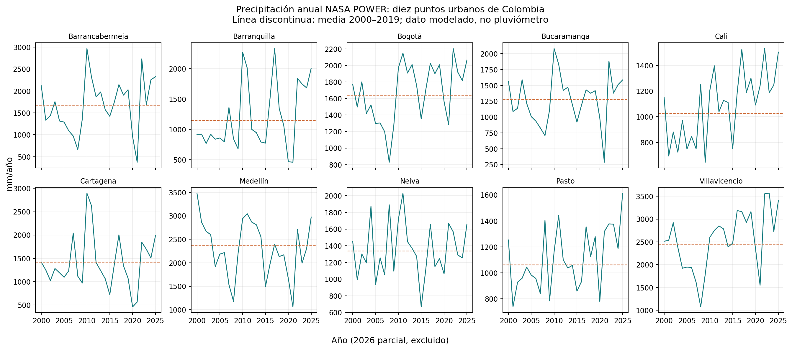
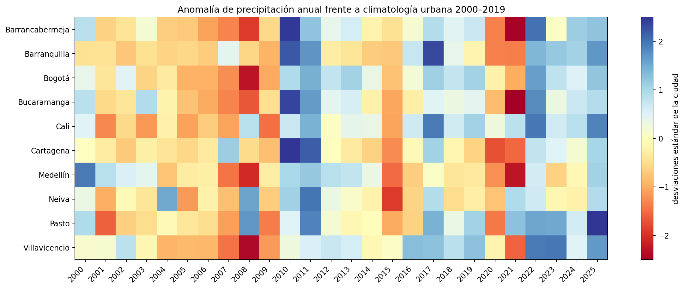
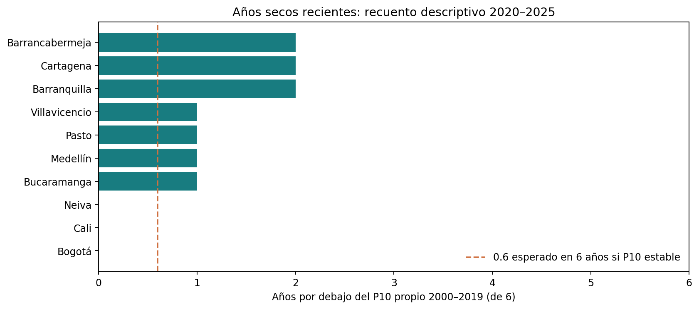

# NASA POWER: señal descriptiva de precipitación en diez ciudades

## Trailer ejecutivo

Una cobertura paramétrica de sequía requiere saber si un índice climático puede describirse de forma estable y auditable antes de discutir contratos, primas o impacto sobre crédito. Este companion añade una referencia climatológica reproducible a la investigación de tarifación: procesa precipitación diaria NASA POWER para diez coordenadas urbanas colombianas, compara totales anuales completos de 2020–2025 con una climatología propia por ciudad para 2000–2019 y registra las comprobaciones de calidad y hashes de los archivos fuente.

En esta ventana, tres de las diez ciudades tuvieron dos años con precipitación anual por debajo de su percentil 10 de referencia; las otras ciudades tuvieron entre cero y un año. Es una señal descriptiva del producto meteorológico cuadriculado, no una frecuencia de siniestros, prueba de cambio climático ni validación de un gatillo. La unidad espacial son puntos urbanos, no predios, estaciones ni zonas agrícolas. No hay datos enlazados de exposición, pérdidas ni pagos; por eso no se estima riesgo de base, prima, asequibilidad o efecto crediticio.

El resultado habilita una siguiente decisión acotada: seleccionar regiones y una variable de contrato que luego se contrastarán con observaciones IDEAM y pérdidas/exposición autorizadas. Hasta entonces, esta serie sirve para revisar el flujo de datos, describir variación y diseñar pruebas fuera de muestra; el modelo sintético existente continúa siendo el entorno para experimentar con pagos.

## Arquitectura

```text
NASA POWER Daily Point API
  (MERRA-2: PRECTOTCORR, mm/día)
        ↓ archivos CSV con cabecera nativa y coordenadas
Parser YEAR + DOY → fechas calendario
        ↓
Perfil: fechas, duplicados, faltantes, rangos, hashes
        ↓
Suma anual por ciudad → referencia 2000–2019 → comparación 2020–2025
        ↓
CSV auditables + tres figuras descriptivas
        ↓
Decisión habilitada: priorizar datos/zonas para evaluación posterior
```

## Decisiones de diseño

| Decisión | Trade-off | Motivo |
|---|---|---|
| Usar PRECTOTCORR en mm/día | Reanálisis cuadriculado versus series puntuales de pluviómetro | La descarga disponible tiene continuidad diaria, coordenada y fuente/versionado recuperables; no equivale a observación local. |
| Agregar por año calendario y comparar años completos | Pierde detalle de temporada frente a un contrato agrícola | Reduce comparaciones parciales y evita presentar 2026 (solo hasta 19 de julio) como un año terminado. |
| Fijar percentil por ciudad en 2000–2019 | Umbral histórico simple frente a selección óptima por pérdidas | Evita optimizar el contrato con resultados de la ventana reciente cuando no hay pérdidas disponibles. |
| No interpolar los faltantes | Menos cobertura frente a imputación | Evita crear lluvia observada por una regla no calibrada; cualquier año con días inválidos se excluye. |
| Conservar fuente cruda fuera del repositorio | Reproducción local requiere ruta al staging | Evita duplicar archivos y registrar datos personales; el companion fija consulta, parámetros y SHA-256 por ciudad. |

## Calidad y resultados

- Diez archivos, de 2000-01-01 a 2026-07-19; 9.697 fechas calendario únicas por ciudad, cero duplicados y cero fechas de calendario ausentes. El archivo contiene 9.697 filas de datos más la fila de nombres de columnas y 15 líneas de metadatos.
- Dos fechas sin precipitación en cada ciudad. Los totales anuales solo se incluyen si todos los días calendario tienen valor; 2026 es parcial y queda fuera de la comparación.
- No se encontraron precipitaciones negativas. Otras variables presentan algunos faltantes adicionales y no participan en este indicador.
- Tres ciudades registran 2 años de 6 por debajo de su P10 base; cuatro registran 1 y tres registran 0. La comparación no trata años como independientes ni convierte el valor esperado de 0,6 bajo una distribución estacionaria en prueba estadística.
- NASA describe la meteorología de POWER como datos de MERRA-2 y GEOS-IT; no deben llamarse mediciones de estación. El [FAQ de datos](https://power.larc.nasa.gov/docs/faqs/data/), la [metodología meteorológica](https://power.larc.nasa.gov/docs/methodology/data/sources_meteorology/) y la [API diaria](https://power.larc.nasa.gov/docs/services/api/temporal/daily/) describen fuente y servicio.

### Figuras







## Limitaciones, regulación y gobierno

Este resultado **no es una tarifa**, no valida un producto de seguros y no demuestra que un seguro reduzca mora. La precipitación cuadriculada puede divergir de la lluvia en el predio. No incorpora cultivos, ciclo productivo, exposición, pérdidas, pagos, cambios instrumentales ni incertidumbre de fuente. Diez puntos urbanos no son una muestra representativa de Colombia.

Como disciplina de riesgo y control, el diseño registra fuente, versión, transformación y hashes (trazabilidad y linaje); conserva la referencia temporal fuera de la ventana reciente (control de información); y separa señal climática de pérdida y decisión crediticia (claridad de propósito y modelo). Esto es una alineación de diseño con principios de ISO 31000 y COSO ERM, no certificación ni conclusión de cumplimiento. No se afirma cumplimiento de Basilea o IFRS 9: faltan outcomes de crédito/seguro y la finalidad del análisis no es medir ECL.

Antes de uso actuarial/institucional se requiere: contraste con estaciones IDEAM y validación de calidad; georreferencia y exposición asegurada; datos de daños y liquidaciones para medir basis risk; selección de índice/gatillo en entrenamiento con evaluación temporal y geográfica separada; pruebas de sensibilidad a fuente y periodo; tolerancias y criterios de aceptación definidos ex ante; y validación independiente actuarial y de modelo. No se proponen criterios numéricos sin propietario del producto y datos de siniestros.

## Reproducibilidad

Desde la raíz del repositorio, con `pandas` y `matplotlib` instalados:

```bash
python3 03-financial-risk/01-credit-risk/credit-portfolio-strategy/climate-parametric-pricing/observed-nasa-power-climate-index/analyze_nasa_power.py \
  --data-dir "/ruta/al/staging/nasa_power"
```

La ruta debe contener los diez CSV nativos citados en `results/source_quality_manifest.json`. El script regenera tablas, figuras y perfil JSON. No descarga datos ni altera la fuente. El manifiesto registra los SHA-256 esperados del snapshot analizado.

## Artefactos

- `analyze_nasa_power.py`: carga, perfil de calidad, agregación y figuras.
- `results/source_quality_manifest.json`: vintage, parámetros, calidad y hashes.
- `results/annual_precipitation.csv`: totales y cobertura de cada año.
- `results/annual_baseline_comparison.csv`: anomalías estandarizadas respecto a referencia 2000–2019.
- `results/recent_descriptive_signal.csv`: resumen 2020–2025 por ciudad.
