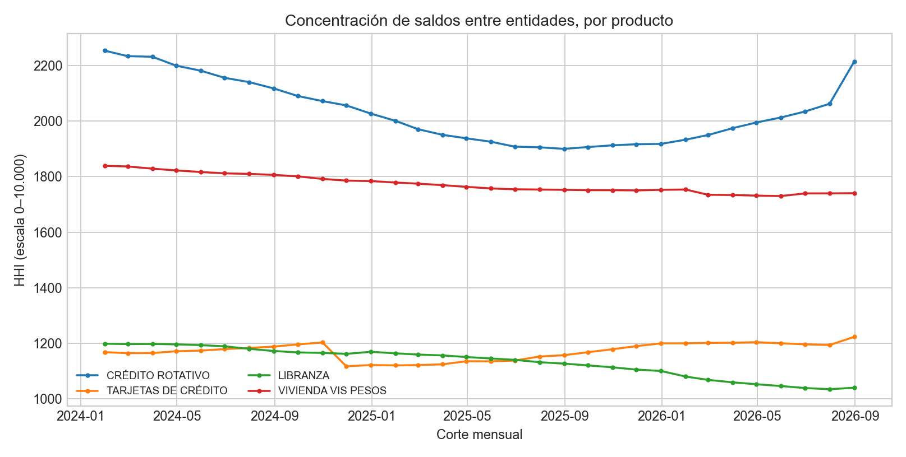
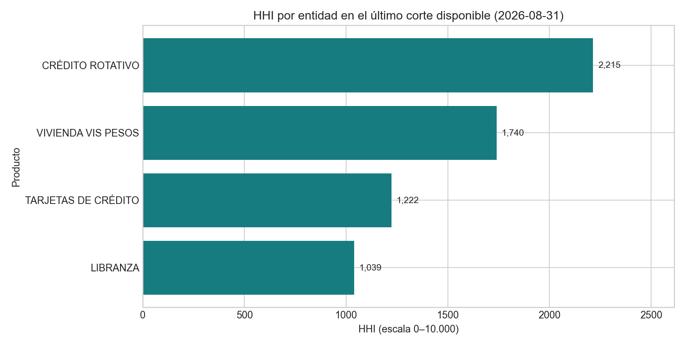

# HHI con saldos oficiales por entidad y producto

## Pregunta ejecutiva

¿Cómo se distribuyen los saldos de cartera de los establecimientos reportantes entre entidades acreedoras, por producto, y cómo cambia esa concentración en el tiempo?

## Fuente y transformación

La [SFC publica la distribución mensual de cartera por entidad, modalidad, producto, mora y calificación](https://www.datos.gov.co/Hacienda-y-Cr-dito-P-blico/Distribuci-n-de-cartera-por-producto/rvii-eis8). El snapshot extraído el 2026-11-10 incluye 9.288 filas `TOTAL`, 32 cortes entre 2024-01-31 y 2026-08-31. La llave compuesta `(fecha, tipo de entidad, código entidad, código producto)` no presenta duplicados; los controles de fechas, saldos y selección de renglón no detectaron excepciones.

Se calcula HHI sobre participaciones de **saldo bruto por entidad acreedora dentro de producto y fecha**. El código de producto `UNICAP` evita fragmentar categorías por inconsistencias de acentos en nombres publicados. Se conservan por separado cada fecha y producto; no se suman productos con potenciales relaciones de composición.

## Resultados

| Producto SFC | HHI ene-2024 | HHI ago-2026 | Entidades ago-2026 | Top 1 ago-2026 | Top 5 ago-2026 |
|---|---:|---:|---:|---:|---:|
| Crédito rotativo | 2.254 | 2.215 | 18 | 32,68% | 90,11% |
| Tarjetas de crédito | 1.167 | 1.222 | 29 | 21,72% | 70,48% |
| Libranza | 1.198 | 1.039 | 31 | 18,13% | 60,66% |
| Vivienda VIS pesos | 1.839 | 1.740 | 23 | 28,28% | 85,27% |

El número efectivo de entidades del último corte es 4,51 para crédito rotativo, 8,18 para tarjetas, 9,62 para libranza y 5,75 para vivienda VIS pesos. El número efectivo es `1 / sum(share²)`, no una cuenta de entidades de igual tamaño ni una medida de solvencia.

En tarjetas se observa una caída puntual del HHI entre octubre y noviembre de 2024 (1.202 a 1.117), coincidente con la incorporación de Nu O Nu Financiera al producto en el corte. El cambio de cobertura basta para mover el índice; la serie no permite atribuirlo a una transformación competitiva del resto de entidades.

## Decisiones de diseño

| Decisión | Alternativa | Motivo |
|---|---|---|
| Retener solamente filas de renglón `TOTAL` | Sumar renglones de saldo vigente y moroso | Evita sumar componentes que ya están contenidos en el saldo bruto. |
| Usar código de entidad compuesto por tipo y código | Agrupar solo por código visible de la entidad | Previene colisiones si una numeración se reutiliza entre tipos. |
| Agrupar por código de producto | Agrupar por texto del producto | El catálogo presenta variantes de escritura que podrían dividir el mismo código. |
| Calcular HHI separadamente por producto y corte | Agregar todas las modalidades en un único índice | Mantiene comparable la población y evita dobles conteos de productos. |

La página de la SFC advierte que sus cifras históricas corresponden a lo disponible en cada fecha y no incorporan cambios originados en retransmisiones. La entrada de una entidad y los cambios de publicación deben reconciliarse antes de atribuir variaciones económicas al HHI.

## Decisión que habilita y límites

La aplicación permite seguir dónde el saldo público del sistema está más concentrado entre acreedores y revisar movimientos por producto. No adopta umbrales regulatorios ni límites internos: su idoneidad depende de la pregunta y perímetro de concentración definidos por cada entidad.

La fuente no contiene identidad ni saldo por deudor. Por eso, **no valida** el HHI por cliente o sector del laboratorio original, ni sustenta concentración de contraparte dentro de una cartera específica, riesgo de default, EL, límites de apetito o contagio. Para esa aplicación se necesitan exposiciones anonimizadas por deudor, sector, grupo económico y fecha de corte, autorizadas por una entidad; concentración bancaria pública es un complemento de sistema, no un reemplazo de esa evidencia.

Reproducción, atribución y hashes: [tarjeta de datos](../data/README.md), [manifiesto](../data/official/manifest.json) y [runner](../official_application.py).
