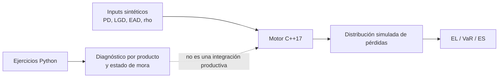

# Credit Risk Engine — complemento C++17

El motor C++17 vive de forma compartida en [`04-quant-strategy-and-products/risk-engines`](../../../04-quant-strategy-and-products/risk-engines). Esta sección documenta cómo se relaciona con los ejercicios Python de crédito; no duplica código ni presenta el motor como infraestructura productiva.

## Qué aporta

El [header `risk.hpp`](../../../04-quant-strategy-and-products/risk-engines/include/quant/risk.hpp), su [CLI de crédito](../../../04-quant-strategy-and-products/risk-engines/apps/credit.cpp) y las [pruebas](../../../04-quant-strategy-and-products/risk-engines/tests/tests.cpp) implementan un prototipo de pérdidas de un factor:

\[
Z_i=\sqrt{\rho}\,Y+\sqrt{1-\rho}\,\epsilon_i, \qquad
D_i=\mathbf{1}\{Z_i<\Phi^{-1}(PD_i)\},
\]

\[
L=\sum_i D_i\,LGD_i\,EAD_i, \qquad
EL=\mathbb{E}[L], \quad VaR_\alpha=q_\alpha(L), \quad ES_\alpha=\mathbb{E}[L\mid L\ge VaR_\alpha].
\]

Python cubre interpretación por producto, score, cohortes y transición; C++ cubre simulación agregada cuando importa ejecutar múltiples escenarios con bajo overhead. Ambos usan datos sintéticos y son demostrativos.

## Ejecución y límites

Siga los comandos de compilación y prueba en el [README del motor](../../../04-quant-strategy-and-products/risk-engines/README.md). Antes de extenderlo, valide dominios: \(0\le PD,LGD\le1\), \(EAD\ge0\), \(0\le\rho<1\), semilla reproducible y tamaño de simulación suficiente para el cuantil objetivo.

El factor único no sustituye dependencia sectorial/geográfica, correlaciones dinámicas, migración de rating, prepagos, recuperaciones temporales, escenarios macroeconómicos ni un cálculo IFRS 9. No hay APIs, persistencia, autenticación ni contrato de servicio; por diseño, es código de portafolio técnico.
