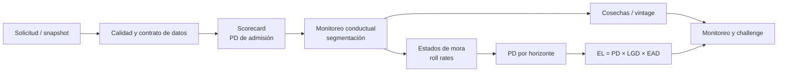

# Riesgo de crédito — productos y ciclo de vida

Este espacio combina laboratorios controlados para scorecards, medición, transiciones y cohortes con companions agregadas de datos oficiales de la SFC. Las companions observan el stock vencido por modalidad/entidad y la mezcla de saldos A–E por producto; no identifican outcomes de crédito individuales. Ninguna edición es un sistema de decisión ni una metodología aprobada.

> **Uso responsable.** Los proxies SFC miden cartera vencida agregada y mezcla agregada de saldos clasificados D/E. No son PD, default por operación ni roll-rates, y no validan scorecards, matrices de transición o pérdida esperada. No habilitan originación, provisiones, precios, límites, decisiones adversas o cumplimiento normativo.



## Mapa de proyectos

| Etapa | Proyecto | Pregunta técnica | Artefacto principal |
|---|---|---|---|
| Admisión | [Scorecard logístico con WoE e IV](scorecard-logistico-woe) | ¿Qué variables separan buenos y malos fuera de entrenamiento? | WoE, IV, AUC, Gini y KS |
| Medición | [Pérdida esperada: PD, LGD, EAD](perdida-esperada-pd-lgd-ead) | ¿Cómo se agrega la pérdida esperada por producto? | EL por cuenta y simulación de defaults |
| Seguimiento | [Matrices de transición y roll rates](matrices-de-transicion-roll-rates) | ¿Cómo evoluciona el estado de mora por mes? | Matriz de Markov y PD acumulada |
| Monitoreo | [Análisis de cosechas](analisis-de-cosechas-vintage) | ¿Qué cohortes se deterioran frente al promedio? | Curvas acumuladas por vintage |
| Exploración | [Segmentación con k-means](segmentacion-clientes-kmeans) | ¿Qué perfiles conductuales se observan? | Perfiles y silueta; no una regla de decisión |
| Investigación | [IFRS 9 — investigación cuantitativa](ifrs9-investigacion-cuantitativa) | ¿Qué supuestos y pruebas exige una arquitectura ECL? | Seis monografías técnicas |
| Referencia observada | [Proxy SFC de calidad de cartera](observed-sfc-quality-proxy) | ¿Cómo cambió el stock vencido por modalidad y entidad reportante? | ICV agregado por vencimiento; no PD ni transición |
| Referencia observada | [Mezcla de calificación SFC por producto](perdida-esperada-pd-lgd-ead/observed-sfc-product-risk-mix) | ¿Qué proporción del saldo calificado A–E está en D/E y qué cobertura tiene frente al saldo bruto? | D+E / A–E por producto-mes; no PD, default individual ni transición |

Los laboratorios controlados siguen usando datos sintéticos; las companions agregadas SFC mantienen separados sus snapshots, hashes, transformaciones, visualizaciones e informes. Los notebooks son material de aprendizaje, no pipelines de producción. Las categorías y modalidades no son directamente comparables; los resultados no sustituyen validación con datos institucionales a nivel de crédito.

La búsqueda de datos individuales colombianos está registrada en [DATA_GAP_PUBLIC_COLOMBIA.md](DATA_GAP_PUBLIC_COLOMBIA.md): FINAGRO publica originaciones/saldos por operación, pero la documentación no da un outcome explícito de default y requiere aclarar tratamiento/licencia antes de procesar datos a nivel de persona. SFC e ICETEX son agregados; MURIC es una fuente supervisora no pública. Por ahora, ningún snapshot de estas fuentes valida PD, LGD o scorecard colombiano.

## Fundamentos cuantitativos

Para una exposición \(i\), el cálculo estático ilustrativo es:

\[
\operatorname{EL}_i = \operatorname{PD}_i \times \operatorname{LGD}_i \times \operatorname{EAD}_i,
\qquad \operatorname{EL}_{portafolio}=\sum_i \operatorname{EL}_i.
\]

La matriz mensual \(P\) se estima por conteos \(N_{ij}\):

\[
\widehat P_{ij}=\frac{N_{ij}}{\sum_j N_{ij}}, \qquad
\operatorname{PD}_{0\rightarrow D}(h)=(\widehat P^h)_{0D}.
\]

Estas identidades requieren decisiones que el código deliberadamente no automatiza: definición de default, horizonte, curas, prepagos, descuentos, segmentación y observaciones censuradas.

## Contratos, reproducibilidad y controles

- [Contrato de datos y diccionario](docs/DATA_CONTRACTS.md): grano, llaves, tipos, controles y linaje de datasets sintéticos.
- [Esquema SQL de referencia](docs/credit_risk_schema.sql): DDL PostgreSQL para una capa analítica, no una base operacional.
- [Guía de calidad y gobierno](docs/QUALITY_AND_GOVERNANCE.md): controles mínimos, partición temporal y límites de uso.
- [Motor C++17 complementario](CPP_PRODUCT.md): simulación agregada de pérdidas correlacionadas, separada de los ejemplos Python.

Los scripts fijan semillas y no escriben archivos. Desde esta carpeta:

```bash
for file in */main.py; do python3 "$file"; done
```

## Límites de alcance

No hay calibración con cartera observada, validación independiente, monitoreo en producción, MRM formal, control de sesgo/fair lending, seguridad operacional ni aprobación contable. Para uso real se requiere dueño del modelo, datos con base legal, definición aprobada de default, validación independiente, gestión de cambios, auditoría y revisión jurídica/regulatoria aplicable.
