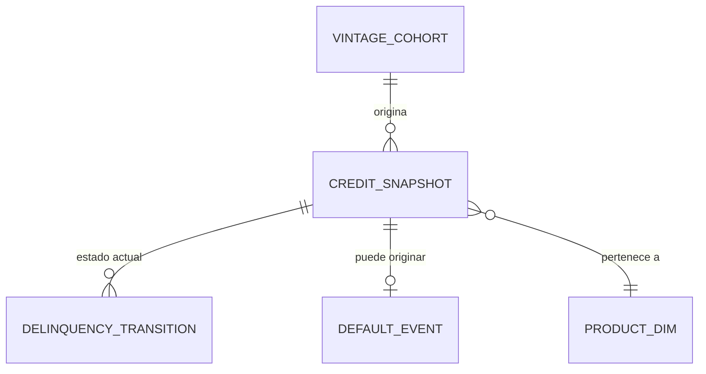

# Contratos de datos — laboratorio de productos de crédito

Este documento define una interfaz analítica mínima para reproducir los ejemplos con datos sintéticos. No describe una extracción de producción ni autoriza reutilizar atributos sensibles. Los montos están en unidades monetarias ilustrativas y no en una moneda reportable.

## Principios

1. **Grano explícito.** `credit_snapshot` es una fila por `account_id` y `as_of_date`; `delinquency_transition` es una transición cuenta-mes; `default_event` contiene como máximo un default por cuenta.
2. **Tiempo sin filtración.** Features y EAD deben existir al `as_of_date`; el `default_flag` pertenece al horizonte posterior. En uso real, entrenamiento, validación y prueba se separan por fecha.
3. **Seudonimización.** `account_id` es un identificador técnico sintético. No se incluyen nombres, documentos, direcciones, teléfonos ni atributos protegidos.
4. **Versionamiento.** Toda corrida debe conservar `snapshot_id`, `data_version`, `model_version`, semilla y fecha de corte.

## Entidades y grano

| Entidad | Llave | Grano | Campos esenciales |
|---|---|---|---|
| `product_dim` | `product_code` | producto | `product_name`, `active_flag` |
| `vintage_cohort` | `vintage_id` | cohorte de originación | `origination_month` |
| `credit_snapshot` | `(account_id, as_of_date)` | cuenta-observación | producto, cohorte, ingreso, utilización, mora, PD, LGD, EAD |
| `delinquency_transition` | `(account_id, observation_month)` | transición mensual | `state_from`, `state_to` |
| `default_event` | `account_id` | primer evento de default | `default_date`, `loss_amount` |

## Reglas de dominio y calidad

| Campo | Regla | Control mínimo |
|---|---|---|
| `pd_12m`, `lgd` | \([0,1]\) | rechazar nulos y fuera de rango |
| `ead` | \(\ge0\) | reconciliar total con snapshot fuente |
| `utilization` | \([0,1.2]\) en este ejercicio | investigar p99 y negativos |
| `days_past_due` | entero \(\ge0\) | mapear de forma determinista a estado |
| `state_from`, `state_to` | catálogo cerrado | default absorbente en este ejemplo |
| `as_of_date` | fecha de corte | no usar variables posteriores al corte |
| `default_flag` | 0/1 | una primera fecha de default por cuenta |

Una tasa de nulidad, duplicados de llave, volumen, distribución de score, PSI y tasa de default por segmento deben compararse contra un baseline aprobado antes de cualquier uso operativo.

## Mapeo a los ejercicios

| Ejercicio | Entradas mínimas | Salidas reproducibles |
|---|---|---|
| Scorecard | snapshot + `default_flag` al horizonte | bins, WoE, IV, PD predicha, AUC/KS |
| EL | `pd_12m`, `lgd`, `ead`, producto | EL por cuenta y producto |
| Roll rates | panel de estados consecutivos | conteos, matriz \(P\), \(P^h\) |
| Vintage | fecha de originación y primer default | curva acumulada por cohorte |
| Segmentación | ingreso, utilización, mora | etiqueta exploratoria y perfil |

El DDL ejecutable está en [`credit_risk_schema.sql`](credit_risk_schema.sql). Es un esquema de referencia para PostgreSQL y no contiene datos ni roles de acceso.
