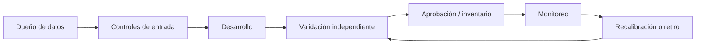

# Calidad, validación y gobierno

Los scripts son reproducibles, pero reproducibilidad no equivale a validez de modelo. Esta lista separa lo que el laboratorio demuestra de lo que un despliegue responsable tendría que controlar.

## Controles mínimos por capa

| Capa | Ejemplos de control | Evidencia esperada |
|---|---|---|
| Datos | unicidad, completitud, dominios, reconciliación, snapshot as-of | reporte de calidad y versión de fuente |
| Desarrollo | semilla, partición temporal, sin leakage, outliers | código revisado y experimento reproducible |
| Desempeño | AUC/KS, calibración, Brier, estabilidad, backtest de transiciones | evaluación OOT con intervalos |
| Uso | propósito aprobado, override, explicabilidad y sesgo | política, owner y registro de decisiones |
| Operación | drift, tasa de default, cobertura, latencia, incidentes | tablero y umbrales con acciones |

## Criterios específicos

- **Scorecard:** fijar `bad`, ventana de desempeño y tratamiento de rechazados antes de calcular WoE. El binning por cuantiles del ejemplo no reemplaza monotonicidad, estabilidad temporal ni revisión de sesgo.
- **EL:** alinear PD, LGD y EAD al mismo horizonte y fecha de corte. La identidad `PD × LGD × EAD` no es lifetime ni por sí sola IFRS 9.
- **Roll rates:** documentar cures, write-offs, prepagos y cuentas cerradas; validar que `default` sea absorbente solo si así lo exige la definición elegida.
- **Vintage:** comparar cohortes con igual madurez y exposición; no interpretar diferencias como causalidad sin controlar mix, política y macroeconomía.
- **Segmentación:** usarla como exploración. Un clúster no es una clase de riesgo ni una regla de elegibilidad sin validación adicional.

## Gate de cambio sugerido

Un cambio de datos, features, segmentos, horizonte, código o parámetros debe producir: identificador de cambio, impacto esperado, reproducción de baseline, validación independiente, aprobación del dueño y plan de reversión. Ningún output de este repositorio constituye ese gate.
