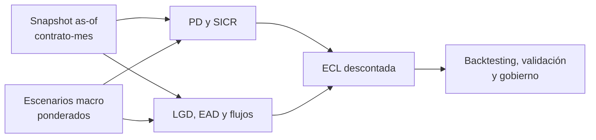

# IFRS 9 — Laboratorio de investigación matemática y cuantitativa

Colección de monografías técnicas sobre deterioro crediticio bajo IFRS 9. Objetivo: distinguir el requerimiento contable de su implementación estadística, hacer explícitos los supuestos, derivar estimadores, diseñar validaciones y conectar resultados con gestión de portafolios.

**Alcance:** documentos de investigación; no constituyen una política contable aprobada, opinión de auditoría ni interpretación vinculante. Revisar el texto vigente de IFRS 9, IFRS 7, políticas de la entidad y guías supervisoras aplicables antes de adoptar una metodología. En Colombia, no confundir exigencias contables internacionales con provisiones prudenciales de la SFC.

## Estudios

1. [01 — Arquitectura ECL y fundamentos matemáticos](01_FUNDAMENTOS_ECL.md)
2. [02 — PD temporal, supervivencia, SICR y staging](02_PD_SICR_STAGING.md)
3. [03 — LGD, EAD, recuperaciones y flujo descontado](03_LGD_EAD_FLUJOS.md)
4. [04 — Escenarios macroeconómicos y dependencia](04_MACRO_ESCENARIOS.md)
5. [05 — Validación, backtesting y gobierno](05_VALIDACION_GOBIERNO.md)
6. [06 — Caso integrado y plan de experimentación](06_CASO_INTEGRADO.md)

## Estándar de evidencia

Cada estudio distingue: **norma / principio contable**, **decisión de modelación**, **identidad matemática**, **estimación estadística**, **prueba empírica** y **limitación**. Los ejemplos son ilustrativos y no calibraciones sobre cartera real. No se reportan métricas empíricas que no hayan sido ejecutadas.

## Secuencia reproducible propuesta

Congelar snapshot as-of, construir panel contrato-mes sin filtración futura, generar cohortes de desarrollo y validación temporal, estimar PD condicionales y sus incertidumbres, estimar recuperaciones y EAD, reconciliar cash shortfalls, producir ECL por escenario, someter a pruebas independientes y documentar aprobaciones. La unidad mínima de trazabilidad es (contrato, fecha de observación, horizonte, escenario, versión de modelo, versión de datos).

El [contrato de datos del laboratorio](../docs/DATA_CONTRACTS.md) y su [DDL de referencia](../docs/credit_risk_schema.sql) especifican una base mínima para experimentos sintéticos. No codifican IFRS 9, políticas contables ni un cálculo ECL productivo.

## Bibliografía primaria para cotejo

- IFRS Foundation, **IFRS 9 Financial Instruments**, especialmente requerimientos de impairment y medición de expected credit losses.
- IFRS Foundation, **IFRS 7 Financial Instruments: Disclosures**, revelaciones de riesgo crediticio.
- Basel Committee on Banking Supervision, *Guidance on credit risk and accounting for expected credit losses* (2015), orientación prudencial, no sustituto de IFRS 9.
- Documentación regulatoria y política contable aplicable a cada entidad y jurisdicción.
