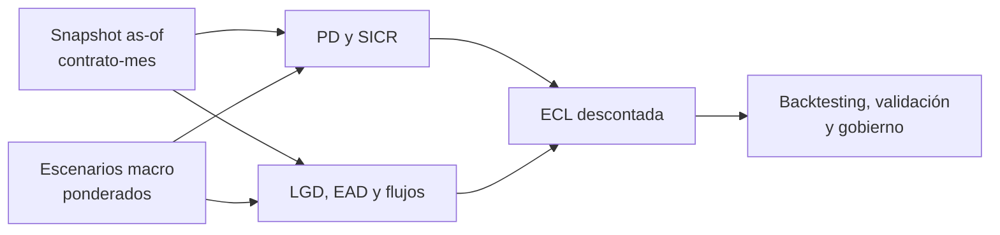

# IFRS 9 — Laboratorio de investigación matemática y cuantitativa

## Auditoría Stage3 — 2026-10-18

[MVP ejecutado de cash shortfalls y recuperación descontada](stage3-cash-shortfall-audit/)
con baseline histórico, 432 casos, oráculo Decimal, tests y notebook. La ruta
actual ya distingue Stage3 por recuperaciones descontadas. La actualización del
19-oct fija el baseline por commit y SHA256, reconcilia 300 contratos entre
versiones y conserva pérdidas de demora pequeñas con expm1. Ver
[informe de migración](stage3-cash-shortfall-audit/informe-migracion.md).
Las equivalencias Stage1/2 sólo se afirman en el dominio común de inputs;
no es un cálculo de provisiones aprobado ni una revisión normativa completa.

> **Laboratorio ejecutable:** abre [`notebooks/ifrs9_laboratory.ipynb`](notebooks/ifrs9_laboratory.ipynb) en GitHub para ver ecuaciones renderizadas, tablas de staging, ECL por escenario y gráficos de calibración. Los datos son sintéticos; no es un cálculo contable ni una política productiva.

## Implementación reproducible

- [`src/ifrs9_engine.py`](src/ifrs9_engine.py): PD a 12 meses y de vida, staging por SICR/DPD, LGD/EAD, ECL descontada y ponderación de escenarios.
- [`run_lab.py`](run_lab.py): corrida determinista con resumen de exposición, ECL y stages.
- [`tests/test_ifrs9_engine.py`](tests/test_ifrs9_engine.py): invariantes de Stage 3, sensibilidad adversa y ECL válida.
- [`sql/ifrs9_laboratory_schema.sql`](sql/ifrs9_laboratory_schema.sql): snapshots de exposición, pesos de escenarios y auditoría de staging.

El cálculo ilustrativo usa:

$$\operatorname{ECL}=\sum_{t=1}^{T} PD_t^{marginal}\times LGD_t\times EAD_t\times DF_t$$

Stage 1 usa la aproximación anual de defaults a 12 meses y Stage 2 la de defaults lifetime. Stage 3 usa saldo bruto financiado y recuperaciones netas esperadas explícitas; no una PD futura multiplicando una exposición ya deteriorada. La ponderación macroeconómica es $ECL^w=\sum_s w_s ECL_s$, con $\sum_s w_s=1$.

```bash
python3 run_lab.py
python3 -m unittest discover -s tests -v
python3 -m jupyter nbconvert --execute --to notebook --inplace notebooks/ifrs9_laboratory.ipynb
```

Colección de monografías técnicas sobre deterioro crediticio bajo IFRS 9. Objetivo: distinguir el requerimiento contable de su implementación estadística, hacer explícitos los supuestos, derivar estimadores, diseñar validaciones y conectar resultados con gestión de portafolios.

**Alcance:** documentos de investigación; no constituyen una política contable aprobada, opinión de auditoría ni interpretación vinculante. Revisar el texto vigente de IFRS 9, IFRS 7, políticas de la entidad y guías supervisoras aplicables antes de adoptar una metodología. En Colombia, no confundir exigencias contables internacionales con provisiones prudenciales de la SFC.

## Estudios

1. [01 — Arquitectura ECL y fundamentos matemáticos](01_FUNDAMENTOS_ECL.md)
2. [02 — PD temporal, supervivencia, SICR y staging](02_PD_SICR_STAGING.md)
3. [03 — LGD, EAD, recuperaciones y flujo descontado](03_LGD_EAD_FLUJOS.md)
4. [04 — Escenarios macroeconómicos y dependencia](04_MACRO_ESCENARIOS.md)
5. [05 — Validación, backtesting y gobierno](05_VALIDACION_GOBIERNO.md)
6. [06 — Caso integrado y plan de experimentación](06_CASO_INTEGRADO.md)

## Estándar de evidencia

Cada estudio distingue: **norma / principio contable**, **decisión de modelación**, **identidad matemática**, **estimación estadística**, **prueba empírica** y **limitación**. Los ejemplos son ilustrativos y no calibraciones sobre cartera real. No se reportan métricas empíricas que no hayan sido ejecutadas.

## Secuencia reproducible propuesta

Congelar snapshot as-of, construir panel contrato-mes sin filtración futura, generar cohortes de desarrollo y validación temporal, estimar PD condicionales y sus incertidumbres, estimar recuperaciones y EAD, reconciliar cash shortfalls, producir ECL por escenario, someter a pruebas independientes y documentar aprobaciones. La unidad mínima de trazabilidad es (contrato, fecha de observación, horizonte, escenario, versión de modelo, versión de datos).



El [contrato de datos del laboratorio](../docs/DATA_CONTRACTS.md) y su [DDL de referencia](../docs/credit_risk_schema.sql) especifican una base mínima para experimentos sintéticos. No codifican IFRS 9, políticas contables ni un cálculo ECL productivo.

## Bibliografía primaria para cotejo

- IFRS Foundation, **IFRS 9 Financial Instruments**, especialmente requerimientos de impairment y medición de expected credit losses.
- IFRS Foundation, **IFRS 7 Financial Instruments: Disclosures**, revelaciones de riesgo crediticio.
- Basel Committee on Banking Supervision, *Guidance on credit risk and accounting for expected credit losses* (2015), orientación prudencial, no sustituto de IFRS 9.
- Documentación regulatoria y política contable aplicable a cada entidad y jurisdicción.


## Contrato revisado del motor

- IDs e índices únicos; PD y LGD en rangos; CCF en [0,1]; EAD y no utilizado no negativos; DPD entero no negativo; alineación explícita entre Series.
- Pesos de escenario finitos, no negativos y suma uno con tolerancia absoluta 1e−12. Se rechaza el caso antes aceptado `{base: 2, severo: -1}`.
- `pd_lifetime` devuelve probabilidades condicionales y masas marginales distintas. Su suma marginal reconcilia con supervivencia; no se suman probabilidades condicionales como PD lifetime.
- Stage 3 requiere `gross_carrying_amount`, `recovery_cashflows` y `recovery_times` (años desde el corte). El parámetro `tasa_descuento` es la EIR anual efectiva suministrada para el experimento. No se deriva de una tasa de mercado observada.
- `ecl_basis` identifica el método. Para Stage 3, `ecl_12m` y `ecl_lifetime` se dejan NaN porque los diagnósticos de default futuro no aplican; `ecl` contiene la pérdida de recuperaciones. Puede recibirse PD=1 sólo si la regla ilustrativa clasifica Stage 3.
- Se expone `pv_expected_recoveries` y cualquier `recovery_surplus`; el prototipo aplica un piso cero a la cifra de allowance. Ese piso y el multiplicador de escenario sobre recuperaciones son decisiones de modelación visibles.

La [nota pública de IFRS Foundation](https://www.ifrs.org/projects/completed-projects/2019/curing-of-a-credit-impaired-financial-asset-ifrs-9/tad-presentation-of-unrecognised-interest-following-the-curing-of-a-credit-impaired-financial-asset/) reproduce definiciones de pérdidas y descuento; es una decisión tentativa histórica sobre curas, no una certificación de este motor ni una revisión del texto consolidado vigente. El acceso al texto completo consultado requiere suscripción. No se afirma haber auditado cumplimiento contable.

**Límites persistentes:** staging por DPD/ratio es ilustrativo; Stage 1/2 usan EAD y LGD constantes y buckets anuales. No se implementan POCI, modificación, curas, interés neto, asientos, aplicación local SFC ni estimación histórica de recuperaciones. El generador fabrica recuperaciones para investigación; datos externos Stage 3 sin esos inputs se rechazan.
