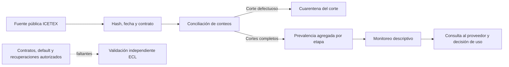
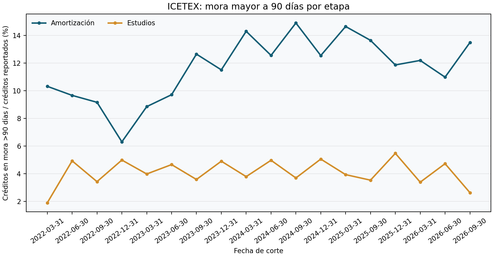
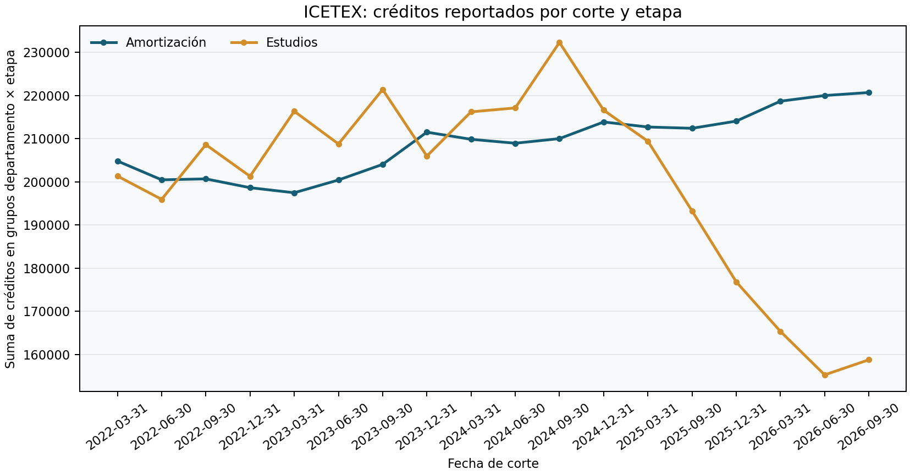
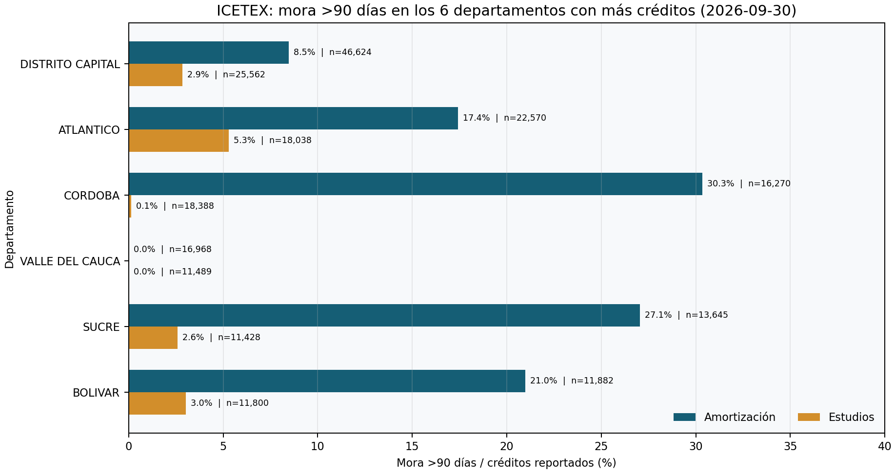
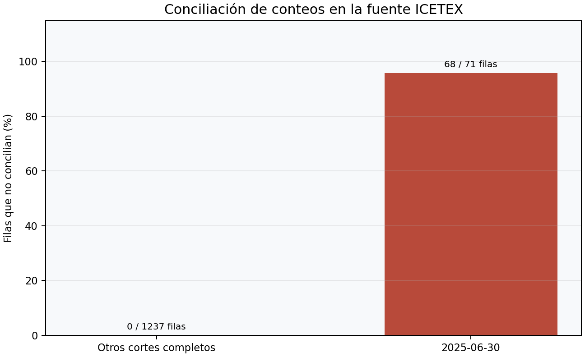
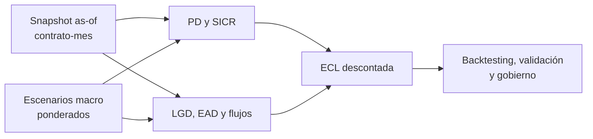

# IFRS 9 — Evidencia pública, gobierno y medición ECL

## Caso ejecutivo: de la mora observada al límite de evidencia

Una entidad que evalúa pérdidas crediticias necesita unir los estados de pago de cada exposición con la fecha de conocimiento, los flujos de recuperación y escenarios futuros. La información pública disponible puede describir tendencias de cartera, pero no sustituye esos insumos contractuales. Este caso conecta el análisis a una fuente oficial colombiana para mostrar qué se observa, qué decisión de monitoreo habilita y dónde se detiene la inferencia antes de llamar al resultado una ECL.

La edición utiliza el conjunto del [ICETEX sobre comportamiento de cartera](../../observed-data-proxies/data/README.md), publicado en Datos Abiertos. La extracción del 10-nov-2026 contiene 1.308 grupos por corte, departamento y fase. Sesenta y ocho filas del 30-jun-2025 no concilian sus conteos; se excluyó el corte completo, incluidas tres filas que sí conciliaban. La serie analítica conserva 1.237 filas en 18 cortes completos y documenta fuente, hash, fecha de actualización, cuarentena y transformaciones.

Con estos datos se calculan conteos y prevalencias de mora >90 días ponderadas por créditos. Entre el primer y el último corte completo, la prevalencia observada pasó de 10,32% a 13,48% en Amortización y de 1,90% a 2,63% en Estudios. Son cambios descriptivos de stocks: no estiman PD futura, migraciones a default, LGD, recuperaciones ni ECL. Una caída marcada en el conteo de créditos en Estudios después de 2025 requiere confirmación metodológica del proveedor antes de una interpretación de negocio.

La decisión que habilita esta versión es mantener un periodo con datos inconsistentes fuera del monitoreo comparable y pedir aclaración al responsable de la fuente. Una estimación real de ECL necesita cartera de contratos autorizada, identificadores seudonimizados, saldos y calendarios, default y curas observadas, recuperaciones fechadas, EIR y vintages macroeconómicos disponibles a cada corte. Esos datos no están en este conjunto público. Por ello el caso es una edición empírica y oficial de monitoreo agregado, mientras que la medición ECL permanece como un componente matemático separado que requiere datos institucionales antes de backtesting o aprobación independiente.

**Estado de esta edición:** datos públicos observados; sin medición ECL ni calibración de cartera. [One-pager ejecutivo (PDF)](../../../../output/pdf/ifrs9-ecl-executive-brief.pdf).

### Flujo de evidencia y decisión



### Registro de decisiones

| Decisión | Alternativa | Motivo y coste |
|---|---|---|
| Excluir toda la fecha 2025-06-30 al encontrar fallas de conciliación | Retener solo las tres filas que conciliaban | Evita comparar un periodo geográfico parcial; sacrifica tres filas y deja visible el defecto del proveedor. |
| Ponderar mora >90 días por conteos y denominadores | Promediar porcentajes departamentales | Conserva la escala del grupo; no transforma el stock en riesgo de default futuro. |
| Mantener separado el indicador publicado y el ratio derivado | Sustituir uno por otro | Permite revisar diferencias de definición, escala y denominador. |
| Tratar fase y fecha como grano de observación | Colapsar regiones y fechas al cargar | Conserva el lineage y habilita revisiones de cobertura y exclusión. |
| No usar el agregado para estimar PD, LGD o ECL | Inferir etiquetas individuales del stock | La inferencia no es identificable con esta fuente; se requiere evidencia contractual autorizada. |

### MRM, validación independiente y aceptación de ECL

La validación independiente del **motor ECL no se ha ejecutado**. Las reglas propuestas son:

- **Datos y supuestos:** definición institucional de default/cura, población, granularidad contrato-mes, corte y availability timestamp; censura; EIR; garantías y recuperaciones; escenarios y pesos; SICR. Trazar todas las exclusiones y reconciliar saldos con fuentes autorizadas.
- **Robustez:** sensibilidad de PD, LGD, EAD, descuento, pesos y trayectorias macro; estrés adverso y reverso; estabilidad por vintage y segmento; ablations; escenarios de drift; invariantes y límites del cálculo.
- **Backtesting:** reconstrucción point-in-time por cohortes maduras; calibración y error separado para PD, LGD, EAD y ECL; intervalos que respeten dependencia por deudor/cohorte; transiciones SICR, defaults sin alerta y conciliación contable. La mora agregada de esta fuente no sustituye estos objetivos.
- **Gate de aceptación:** cero fallos en controles críticos y leakage; tolerancias aprobadas antes de evaluar, basadas en materialidad y riesgo; resultados reproducibles; hallazgos críticos cerrados; aprobación escrita de validación independiente, finanzas/contabilidad, riesgo y gobierno de datos. No se adoptan umbrales universales.

### Trazabilidad normativa

| Referencia | Decisión que informa | Evidencia pendiente |
|---|---|---|
| [IFRS 9](https://www.ifrs.org/issued-standards/list-of-standards/ifrs-9-financial-instruments/) | La ECL debe reflejar resultados ponderados, valor del dinero y evidencia histórica, actual y prospectiva razonable; el dato agregado actual solo informa contexto. | Datos contractuales, escenarios soportados, política contable, SICR, flujos descontados y conciliación. |
| [Guía BCBS de ECL](https://www.bis.org/publications/201512-guidelines-guidance-credit-risk-and-accounting-expected-credit-losses) | Gobierno de riesgo, validación y control complementan el estándar contable; no prescriben una única fórmula de ECL. | Política institucional, control interno, validación y criterios de supervisión aplicables. |
| [BCBS 239](https://www.bis.org/publ/bcbs239.pdf) | Identidad de corte, grano y trazabilidad son condiciones para agregar y reportar riesgo. | Linaje institucional, completitud, oportunidad y agregación de todas las fuentes materiales. |
| [ISO 31000:2018](https://www.iso.org/standard/31000) y [COSO ERM](https://www.coso.org/enterprise-risk-management) | Llevar una excepción de datos hasta una acción, dueño y escalamiento. | Apetito, responsables y controles de la entidad; esta referencia no implica certificación. |

### Evidencia visual calculada desde datos observados

Las cuatro figuras se derivan del snapshot del ICETEX y del método documentado en el [informe de evidencia](../../observed-data-proxies/reports/2026-11-10-official-observed-evidence.md).

| Mora >90 días por etapa | Conteos reportados por etapa |
|---|---|
|  |  |

| Comparación departamental del último corte | Integridad de fuente |
|---|---|
|  |  |

### Reproducibilidad de la edición observada

Desde la raíz del repositorio, con Python 3.13:

```bash
python3 03-financial-risk/01-credit-risk/credit-risk-products/ifrs9-investigacion-cuantitativa/run_lab.py
MPLCONFIGDIR=/tmp/mplconfig MPLBACKEND=Agg python3 \
  03-financial-risk/01-credit-risk/observed-data-proxies/src/build_observed_figures.py
```

El runner reproduce el resumen desde el snapshot congelado. La edición cruda, curada, manifest y exclusiones están en [`observed-data-proxies/data`](../../observed-data-proxies/data/README.md). Las figuras publicadas se regeneran desde el CSV curado versionado.

## Componente matemático de ECL

El [motor ECL](src/ifrs9_engine.py), la auditoría numérica Stage 3 y sus contratos/tests cubren reglas, hazards, descuento y shortfalls bajo casos controlados. El notebook [`ifrs9_laboratory.ipynb`](notebooks/ifrs9_laboratory.ipynb) sigue siendo un experimento de método con escenarios generados; sus resultados no se mezclan con las figuras ni las métricas observadas del ICETEX. La cartera pública agregada no se introduce al motor porque no contiene flujos por contrato, default observado ni recuperaciones.

## Auditoría Stage 3 — 2026-10-18

[MVP ejecutado de cash shortfalls y recuperación descontada](stage3-cash-shortfall-audit/)
con baseline histórico, 432 casos, oráculo Decimal, tests y notebook. La ruta
actual ya distingue Stage3 por recuperaciones descontadas. La actualización del
19-oct fija el baseline por commit y SHA256, reconcilia 300 contratos entre
versiones y conserva pérdidas de demora pequeñas con expm1. Ver
[informe de migración](stage3-cash-shortfall-audit/informe-migracion.md).
Las equivalencias Stage1/2 sólo se afirman en el dominio común de inputs;
no es un cálculo de provisiones aprobado ni una revisión normativa completa.

> **Experimento de método:** el notebook [`ifrs9_laboratory.ipynb`](notebooks/ifrs9_laboratory.ipynb) muestra ecuaciones, tablas de staging, ECL por escenarios y gráficos de calibración. Sus entradas se generan para probar el comportamiento computacional; no son una medición del portafolio ICETEX.

## Implementación reproducible

- [`src/ifrs9_engine.py`](src/ifrs9_engine.py): PD a 12 meses y de vida, staging por SICR/DPD, LGD/EAD, ECL descontada y ponderación de escenarios.
- [`run_lab.py`](run_lab.py): reproduce el resumen observado de ICETEX y la cuarentena del corte 2025-06-30.
- [`tests/test_ifrs9_engine.py`](tests/test_ifrs9_engine.py): invariantes de Stage 3, sensibilidad adversa y ECL válida.
- [`sql/ifrs9_laboratory_schema.sql`](sql/ifrs9_laboratory_schema.sql): snapshots de exposición, pesos de escenarios y auditoría de staging.

El prototipo matemático, separado de la ruta de datos observados, expresa:

$$\operatorname{ECL}=\sum_{t=1}^{T} PD_t^{marginal}\times LGD_t\times EAD_t\times DF_t$$

Stage 1 usa la aproximación anual de defaults a 12 meses y Stage 2 la de defaults lifetime. Stage 3 usa saldo bruto financiado y recuperaciones netas esperadas explícitas; no una PD futura multiplicando una exposición ya deteriorada. La ponderación macroeconómica es $ECL^w=\sum_s w_s ECL_s$, con $\sum_s w_s=1$.

Colección de monografías técnicas sobre deterioro crediticio bajo IFRS 9. Objetivo: distinguir el requerimiento contable de su implementación estadística, hacer explícitos los supuestos, derivar estimadores, diseñar validaciones y conectar resultados con gestión de portafolios.

**Alcance:** documentos de investigación; no constituyen una política contable aprobada, opinión de auditoría ni interpretación vinculante. Revisar el texto vigente de IFRS 9, IFRS 7, políticas de la entidad y guías supervisoras aplicables antes de adoptar una metodología. En Colombia, no confundir exigencias contables internacionales con provisiones prudenciales de la SFC.

## Estudios

1. [01 — Arquitectura ECL y fundamentos matemáticos](01_FUNDAMENTOS_ECL.md)
2. [02 — PD temporal, supervivencia, SICR y staging](02_PD_SICR_STAGING.md)
3. [03 — LGD, EAD, recuperaciones y flujo descontado](03_LGD_EAD_FLUJOS.md)
4. [04 — Escenarios macroeconómicos y dependencia](04_MACRO_ESCENARIOS.md)
5. [05 — Validación, backtesting y gobierno](05_VALIDACION_GOBIERNO.md)
6. [06 — Caso integrado y plan de experimentación](06_CASO_INTEGRADO.md)

## Estándar de evidencia

Cada estudio distingue: **norma / principio contable**, **decisión de modelación**, **identidad matemática**, **estimación estadística**, **prueba empírica** y **limitación**. Los ejemplos son ilustrativos y no calibraciones sobre cartera real. No se reportan métricas empíricas que no hayan sido ejecutadas.

## Secuencia reproducible propuesta

Congelar snapshot as-of, construir panel contrato-mes sin filtración futura, generar cohortes de desarrollo y validación temporal, estimar PD condicionales y sus incertidumbres, estimar recuperaciones y EAD, reconciliar cash shortfalls, producir ECL por escenario, someter a pruebas independientes y documentar aprobaciones. La unidad mínima de trazabilidad es (contrato, fecha de observación, horizonte, escenario, versión de modelo, versión de datos).



El [contrato de datos del laboratorio](../docs/DATA_CONTRACTS.md) y su [DDL de referencia](../docs/credit_risk_schema.sql) especifican una base mínima para experimentos controlados. No codifican políticas contables ni un cálculo ECL productivo.

## Bibliografía primaria para cotejo

- IFRS Foundation, **IFRS 9 Financial Instruments**, especialmente requerimientos de impairment y medición de expected credit losses.
- IFRS Foundation, **IFRS 7 Financial Instruments: Disclosures**, revelaciones de riesgo crediticio.
- Basel Committee on Banking Supervision, *Guidance on credit risk and accounting for expected credit losses* (2015), orientación prudencial, no sustituto de IFRS 9.
- Documentación regulatoria y política contable aplicable a cada entidad y jurisdicción.


## Contrato revisado del motor

- IDs e índices únicos; PD y LGD en rangos; CCF en [0,1]; EAD y no utilizado no negativos; DPD entero no negativo; alineación explícita entre Series.
- Pesos de escenario finitos, no negativos y suma uno con tolerancia absoluta 1e−12. Se rechaza el caso antes aceptado `{base: 2, severo: -1}`.
- `pd_lifetime` devuelve probabilidades condicionales y masas marginales distintas. Su suma marginal reconcilia con supervivencia; no se suman probabilidades condicionales como PD lifetime.
- Stage 3 requiere `gross_carrying_amount`, `recovery_cashflows` y `recovery_times` (años desde el corte). El parámetro `tasa_descuento` es la EIR anual efectiva suministrada para el experimento. No se deriva de una tasa de mercado observada.
- `ecl_basis` identifica el método. Para Stage 3, `ecl_12m` y `ecl_lifetime` se dejan NaN porque los diagnósticos de default futuro no aplican; `ecl` contiene la pérdida de recuperaciones. Puede recibirse PD=1 sólo si la regla ilustrativa clasifica Stage 3.
- Se expone `pv_expected_recoveries` y cualquier `recovery_surplus`; el prototipo aplica un piso cero a la cifra de allowance. Ese piso y el multiplicador de escenario sobre recuperaciones son decisiones de modelación visibles.

La [nota pública de IFRS Foundation](https://www.ifrs.org/projects/completed-projects/2019/curing-of-a-credit-impaired-financial-asset-ifrs-9/tad-presentation-of-unrecognised-interest-following-the-curing-of-a-credit-impaired-financial-asset/) reproduce definiciones de pérdidas y descuento; es una decisión tentativa histórica sobre curas, no una certificación de este motor ni una revisión del texto consolidado vigente. El acceso al texto completo consultado requiere suscripción. No se afirma haber auditado cumplimiento contable.

**Límites persistentes:** staging por DPD/ratio es ilustrativo; Stage 1/2 usan EAD y LGD constantes y buckets anuales. No se implementan POCI, modificación, curas, interés neto, asientos, aplicación local SFC ni estimación histórica de recuperaciones. El generador fabrica recuperaciones para investigación; datos externos Stage 3 sin esos inputs se rechazan.
